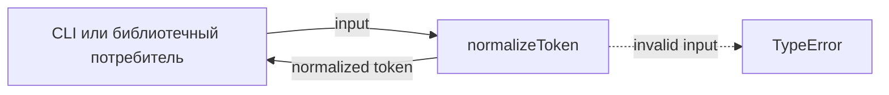
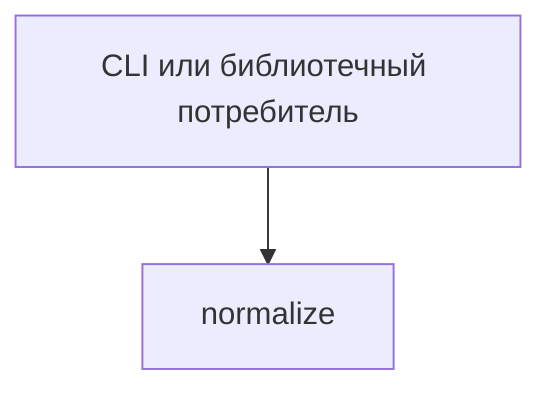

# Module: normalize

<!--SECTION:SPEC_ID-->
TOKEN-NORMALIZE
<!--/SECTION:SPEC_ID-->

<!--SECTION:MODULE_VISION-->
## Module Vision

Модуль `normalize` владеет единственной ответственностью скоупа [`token`](../token.spec.md): детерминированной нормализацией ASCII-токена без сети, состояния и ввода-вывода. Он публикует функцию `normalizeToken(input: string): string` и отклоняет недопустимый вход через `TypeError`.

Соседних модулей, родительских модулей и дочерних модулей нет: скоуп `token` декомпозирован в один плоский модуль `normalize`.
<!--/SECTION:MODULE_VISION-->

<!--SECTION:OVERVIEW-->
## Overview



_Путь нормализации токена и отклонения недопустимого входа — NOR-REQ-1, NOR-REQ-2._
<!--/SECTION:OVERVIEW-->

<!--SECTION:MODULE_USAGE_EXAMPLE-->
## Module Usage Example

```ts
import { normalizeToken } from "./normalize.ts";

const token = normalizeToken("  Foo__BAR  ");
console.log(token);

try {
  normalizeToken("");
} catch (error) {
  if (error instanceof TypeError) {
    console.error(error.message);
  }
}
```

Корректный вход даёт `"foo-bar"`, пустая строка даёт `TypeError`; сеть, файлы и конфигурация не нужны.
<!--/SECTION:MODULE_USAGE_EXAMPLE-->

<!--SECTION:MODULE_REQUIREMENTS-->
## Requirements

### NOR-REQ-1 [должен]
**Когда** на вход передана ASCII-строка, содержащая хотя бы один символ вне множества ASCII-пробела, underscore и hyphen, **нормализатор должен** обрезать крайние ASCII-пробелы, привести ASCII-буквы к нижнему регистру и свернуть каждую серию ASCII-пробелов, underscore и hyphen в один hyphen.

> Уточняет `TOK-REQ-1`: модуль фиксирует точную форму токена, которую получают CLI и библиотечные потребители.

### NOR-REQ-2 [должен · нештатная]
**Если** строка пустая, состоит только из ASCII-пробелов, underscore и hyphen или содержит не-ASCII символ, **то нормализатор должен** выбросить `TypeError` без ввода-вывода.

> Уточняет `TOK-REQ-2`: ошибку входа нельзя маскировать пустым корректным токеном.

| Input | Outcome |
|---|---|
| `"  Foo__BAR  "` | `"foo-bar"` |
| `""` | `TypeError` |
<!--/SECTION:MODULE_REQUIREMENTS-->

<!--SECTION:INTER_MODULE_DEPENDENCIES-->
## Inter-Module Dependencies

- **Depends on:** нет sibling-модулей внутри скоупа `token`.
- **Scope Reference (cross-scope):** нет.
- **Provides to:** CLI и библиотечные потребители через родительский скоуп [`token`](../token.spec.md).



_Модуль вызывается напрямую потребителями; sibling-зависимостей нет._
<!--/SECTION:INTER_MODULE_DEPENDENCIES-->

<!--SECTION:ENTITY_INVENTORY-->
## Entity Inventory

_Это полный список сущностей модуля. Любое введение сущности execution-агентом помимо этого списка считается drift'ом и требует обновления spec._

| Name | Type | Purpose |
|------|------|---------|
| `normalizeToken` | Function | Чистая нормализация ASCII-токена и отклонение недопустимого входа |

Ошибки: throw (`TypeError`) → `normalizeToken`

ER-скетч не рисуется: в инвентаре одна сущность, связывать нечего.
<!--/SECTION:ENTITY_INVENTORY-->

<!--SECTION:ENTITY_SURFACES-->
## Entity Surfaces

`normalizeToken` — единственная публичная сущность модуля; ниже её полная поверхность и владение ошибкой.

<details>
<summary>Полные поверхности сущностей</summary>

### `normalizeToken`

- **Type:** Function
- **Purpose:** Возвращает канонический токен из корректной ASCII-строки.
- **Public Properties:** N/A
- **Public Operations:** `normalizeToken(input: string): string` — нормализует корректный вход; для недопустимого входа выбрасывает `TypeError`.
- **Lifecycle:** Чистая функция без состояния; создаётся при загрузке модуля, завершается вместе с вызовом.
- **Events Emitted:** N/A
- **Errors & Degradation:** `TypeError` выбрасывается синхронно для пустой строки, строки только из разделителей и не-ASCII входа; ошибку обрабатывает вызывающий потребитель.
- **Consumers:**
  - Internal: `N/A — других сущностей в модуле нет`
  - External: CLI и библиотечные потребители скоупа `token`
- **Usage Waiver (external: CLI и библиотечные потребители):** Единственная публичная функция модуля; требуется `TOK-REQ-1` и `TOK-REQ-2`.

</details>
<!--/SECTION:ENTITY_SURFACES-->

<!--SECTION:MODULE_CONTRACTS-->
## Module Contracts

Модуль определяет одну чистую функцию `normalizeToken`; Port и Adapter не вводятся.

Граф не рисуется: в модуле нет Port/Adapter, только Service `normalizeToken` (чистая функция).

Call Chain не рисуется: в модуле одна абстракция — `normalizeToken`.

<details>
<summary>Контракты DbC</summary>

### Services

#### Service: `normalizeToken`

- **Purpose:** Детерминированно нормализовать корректный ASCII-токен и отклонить недопустимый вход.
- **Consumers:** CLI и библиотечные потребители скоупа `token`.
- **Runtime Backing:** `not-implemented`
- **Verification Levels:** `contract`, `unit`
- **Deferred Runtime Scope:** Вся заявленная нормализация не имеет реализации в этой authoring-задаче.

**Contract (DbC)**

- `normalizeToken`:
  - Pre: `input` — ASCII-строка, содержащая хотя бы один символ вне множества ASCII-пробела, underscore и hyphen.
  - Post: возвращает строку с обрезанными крайними ASCII-пробелами, ASCII-буквами в нижнем регистре и каждой серией ASCII-пробелов, underscore и hyphen, свёрнутой в один hyphen.
  - On pre-violation: недопустимый вход (пустая строка, строка только из разделителей, не-ASCII символ или не-строка) приводит к синхронному `TypeError`; ввод-вывод не выполняется.

**Invariants:** Функция детерминирована, не хранит состояние и не выполняет ввод-вывод; один и тот же корректный вход всегда даёт один и тот же токен.

</details>
<!--/SECTION:MODULE_CONTRACTS-->

<!--SECTION:PUBLIC_OPTIONS-->
## Public Options & Policies

Публичных опций, флагов и политик нет.

<details>
<summary>Опции и политики</summary>

Нормализация фиксирована `NOR-REQ-1` и `NOR-REQ-2`; настраиваемых параметров и отложенных опций нет.

</details>
<!--/SECTION:PUBLIC_OPTIONS-->

<!--SECTION:FILE_STRUCTURE-->
## File Structure

```
normalize/
├── normalize.ts
└── normalize.test.ts
```

**File Mapping:**
- `normalize/normalize.ts`: чистая реализация `normalizeToken` и отклонение недопустимого входа через `TypeError`.
- `normalize/normalize.test.ts`: контрактные и unit-тесты для `NOR-REQ-1` и `NOR-REQ-2`.
<!--/SECTION:FILE_STRUCTURE-->

<!--SECTION:RESEARCH-->
## Research

No research documents for this bounded deterministic draft.
<!--/SECTION:RESEARCH-->

<!--SECTION:MODULE_DECISION_LOG-->
## Module Decision Log

Зафиксировано одно решение — об отсутствии Port/Adapter; полная запись ниже.

<details>
<summary>Полные записи Decision Log</summary>

NOR-DL-1 2026-10-24 — нормализация реализуется одной чистой функцией `normalizeToken` без Port/Adapter (почему: одна реализация и нет подтверждённой вариативности или тестового шва; отвергнуто: Port/Adapter ради одной операции — лишняя абстракция; риск: будущая вариативность потребует отдельного решения) [verdict: pending-operator]

</details>
<!--/SECTION:MODULE_DECISION_LOG-->

<!--SECTION:HANDOFF-->
## Handoff to Tasks

- **Implementation files to be created:** `normalize/normalize.ts`
- **Test files to be created:** `normalize/normalize.test.ts`
- **Stack dependencies:**
  - Language: `typescript` (resolves to `ai/directives/coding/typescript-rules.xml`)
  - Test framework: `node-test` (resolves to `ai/directives/testing/node-test.xml`)
- **Module Rules Additions:** None
- **Open risks & validation needs:** Реализация не запрошена, поэтому поведение подтверждено только authoring-проверкой; владелец ошибки — `normalizeToken`, внешняя обработка `TypeError` остаётся за потребителем.
- **Owner handoff:** pending-operator — операторское одобрение, тикеты и исполнение не созданы и не заявлены.
<!--/SECTION:HANDOFF-->

<!--SECTION:IMPLEMENTATION_INSIGHTS-->
## Implementation Insights

Не применимо: реализации ещё нет, поэтому пост-имплементационных наблюдений нет.

<details>
<summary>Заметки по реализации</summary>

Нет наблюдений: раздел станет содержательным только после реализации и audit-цикла.

</details>
<!--/SECTION:IMPLEMENTATION_INSIGHTS-->
