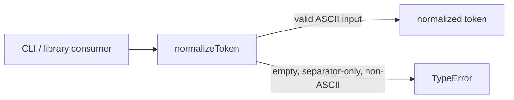
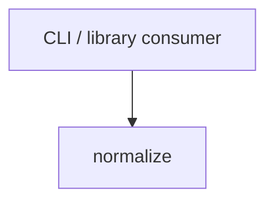

# Module: normalize

<!--SECTION:SPEC_ID-->
TOKEN-NORMALIZE
<!--/SECTION:SPEC_ID-->

<!--SECTION:MODULE_VISION-->
## Module Vision
`normalize` владеет единственной операцией нормализации ASCII-токена для скоупа [`token`](../token.spec.md). Модуль не владеет CLI-разбором, конфигурацией или вводом-выводом; соседних модулей в скоупе нет.
<!--/SECTION:MODULE_VISION-->

<!--SECTION:OVERVIEW-->
## Overview


_Путь нормализации токена и отклонение недопустимого ввода._
<!--/SECTION:OVERVIEW-->

<!--SECTION:MODULE_USAGE_EXAMPLE-->
## Module Usage Example
Модуль экспортирует одну чистую функцию; инициализация и конфигурация не требуются.

```ts
import { normalizeToken } from "./normalize";

const token = normalizeToken("  Foo__BAR  ");
// token === "foo-bar"

try {
  normalizeToken("");
} catch (error) {
  // error instanceof TypeError
}
```
<!--/SECTION:MODULE_USAGE_EXAMPLE-->

<!--SECTION:MODULE_REQUIREMENTS-->
## Requirements
### NOR-REQ-1 [должен]
**Когда** передана непустая ASCII-строка, содержащая хотя бы один символ кроме ASCII-пробела, underscore и hyphen, **нормализатор должен** обрезать ведущие и замыкающие ASCII-пробелы, привести ASCII-буквы к нижнему регистру и свернуть каждую серию ASCII-пробелов, underscore и hyphen в один hyphen.

> Уточняет TOK-REQ-1: модуль фиксирует единый детерминированный формат токена для CLI и библиотечных потребителей.

### NOR-REQ-2 [должен · нештатная]
**Если** ввод пустой, состоит только из ASCII-пробелов, underscore и hyphen или содержит не-ASCII символ, **то нормализатор должен** выбросить TypeError без ввода-вывода.

> Уточняет TOK-REQ-2: ошибочный вход нельзя маскировать пустым или частично нормализованным токеном.

| Input | Outcome |
|---|---|
| `"  Foo__BAR  "` | `"foo-bar"` |
| `""` | `TypeError` |
| `"---___   "` | `TypeError` |
| `"café"` | `TypeError` |
<!--/SECTION:MODULE_REQUIREMENTS-->

<!--SECTION:INTER_MODULE_DEPENDENCIES-->
## Inter-Module Dependencies
- **Depends on:** нет модулей внутри скоупа `token`.
- **Scope Reference (cross-scope):** нет; модуль не пересекает границу скоупа.
- **Provides to:** CLI и библиотечные потребители скоупа `token`.


_Зависимости модуля: внешний потребитель вызывает normalize; рёбер к соседним модулям нет._
<!--/SECTION:INTER_MODULE_DEPENDENCIES-->

<!--SECTION:ENTITY_INVENTORY-->
## Entity Inventory
_Это полный список сущностей модуля. Любое введение сущности execution-агентом помимо этого списка считается drift'ом и требует обновления spec._

| Name | Type | Purpose |
|------|------|---------|
| `normalizeToken` | Function | Нормализует ASCII-токен в один hyphen и отклоняет недопустимый ввод |

Ошибки: throw → `normalizeToken`

ER-эскиз не рисуется: в инвентаре одна сущность, связывать нечего.
<!--/SECTION:ENTITY_INVENTORY-->

<!--SECTION:ENTITY_SURFACES-->
## Entity Surfaces
Одна функция `normalizeToken`: чистая нормализация и выброс `TypeError` на недопустимом вводе.

<details>
<summary>Полные поверхности сущностей</summary>

### `normalizeToken`
- **Type:** Function
- **Purpose:** Детерминированно приводит допустимый ASCII-токен к нижнему регистру через один hyphen.
- **Public Properties:** N/A
- **Public Operations:** normalizeToken(input) — нормализовать допустимый токен; недопустимый ввод отклоняется.
- **Lifecycle:** Не имеет состояния: вызывается по требованию, время жизни совпадает с модулем.
- **Events Emitted:** N/A
- **Errors & Degradation:** `TypeError` через throw на пустом, separator-only или не-ASCII вводе; владелец — `normalizeToken`; ввод-вывод отсутствует.
- **Consumers:**
  - Internal: `normalize/normalize.ts` (экспорт функции для CLI)
  - External: CLI и библиотечные потребители

</details>
<!--/SECTION:ENTITY_SURFACES-->

<!--SECTION:MODULE_CONTRACTS-->
## Module Contracts
Модуль определяет одну чистую функцию `normalizeToken`; Port и Adapter не вводятся — вариативности и тестового шва нет.

Граф не рисуется: в модуле нет Port/Adapter, только Service `normalizeToken`.

Цепочка вызовов не рисуется: в модуле одна абстракция — `normalizeToken`.

<details>
<summary>Контракты DbC</summary>

### Services

#### Service: `normalizeToken`
- **Purpose:** Детерминированно нормализовать допустимый ASCII-токен и явно отклонить недопустимый ввод.
- **Consumers:** internal: CLI entry point · external: библиотечные потребители
- **Runtime Backing:** `not-implemented`
- **Verification Levels:** `contract`, `unit`
- **Deferred Runtime Scope:** Вся реализация отложена; код не создаётся в этой authoring-задаче.

**Contract (DbC)**
- `normalizeToken`:
  - Pre: Вход — строка, каждый символ которой ASCII, и в ней есть хотя бы один символ кроме ASCII-пробела, underscore и hyphen.
  - Post: Краевые ASCII-пробелы удалены, ASCII-буквы приведены к нижнему регистру, каждая серия ASCII-пробелов, underscore и hyphen заменена одним hyphen; результат детерминирован.
  - On pre-violation: Выбрасывается `TypeError` без ввода-вывода.

**Invariants:** Функция не читает и не изменяет внешнее состояние, не выполняет ввод-вывод и возвращает один и тот же результат для одного и того же входа.

</details>
<!--/SECTION:MODULE_CONTRACTS-->

<!--SECTION:PUBLIC_OPTIONS-->
## Public Options & Policies
Публичных флагов, опций и политик нет: поведение полностью задано контрактом `normalizeToken`.

<details>
<summary>Опции и политики</summary>

Опции не предусмотрены и не отложены.

</details>
<!--/SECTION:PUBLIC_OPTIONS-->

<!--SECTION:FILE_STRUCTURE-->
## File Structure
```
normalize/
├── normalize.ts
└── normalize.test.ts
```

**File Mapping:**
- `normalize/normalize.ts`: чистая функция `normalizeToken` и проверка допустимости входа
- `normalize/normalize.test.ts`: unit-тесты нормализации и отклонения недопустимого ввода
<!--/SECTION:FILE_STRUCTURE-->

<!--SECTION:RESEARCH-->
## Research
Ресёрч-документов нет: поведение задано контрактом `docs/token-contract.md` и родительскими требованиями TOK-REQ-1, TOK-REQ-2.
<!--/SECTION:RESEARCH-->

<!--SECTION:MODULE_DECISION_LOG-->
## Module Decision Log
Записано одно решение: чистая функция без Port и Adapter.

<details>
<summary>Полные записи Decision Log</summary>

NOR-DL-1 2026-10-24 — Port и Adapter не вводятся; где: specs/token/normalize/normalize.spec.md#module-contracts (почему: одна детерминированная трансформация без вариативности и тестового шва; отвергнуто: Port/Adapter — лишний слой без второй реализации; риск: нет) [verdict: pending-operator]

</details>
<!--/SECTION:MODULE_DECISION_LOG-->

<!--SECTION:HANDOFF-->
## Handoff to Tasks
- **Implementation files to be created:** `normalize/normalize.ts`
- **Test files to be created:** `normalize/normalize.test.ts`
- **Stack dependencies:**
  - Language: `typescript` (resolves to `ai/directives/coding/typescript-rules.xml`)
  - Test framework: `node-test` (resolves to `ai/directives/testing/node-test.xml`)
- **Module Rules Additions:** None
- **Open risks & validation needs:** Операторское одобрение не получено: handoff остаётся `pending-operator`. Реализация и runtime-проверка отложены; authoring не подтверждает выполнение.
<!--/SECTION:HANDOFF-->

<!--SECTION:IMPLEMENTATION_INSIGHTS-->
## Implementation Insights
Не применимо: реализация не создавалась, post-implementation наблюдений нет.

<details>
<summary>Заметки по реализации</summary>

Не применимо: артефакт создан до реализации.

</details>
<!--/SECTION:IMPLEMENTATION_INSIGHTS-->
