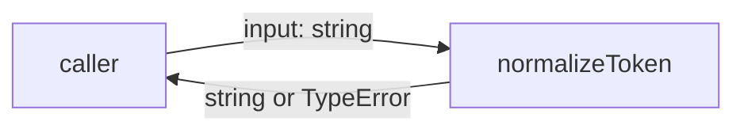
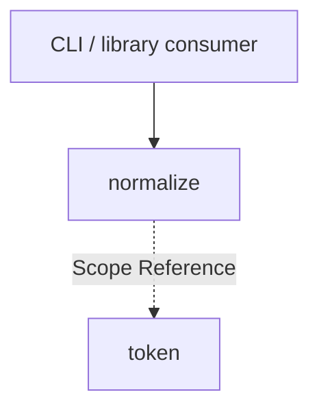

# Module: normalize

<!--SECTION:SPEC_ID-->
TOKEN-NORMALIZE
<!--/SECTION:SPEC_ID-->

<!--SECTION:MODULE_VISION-->
## Module Vision
Модуль `normalize` владеет единственной обязанностью: детерминированно нормализовать одну ASCII-строку в токен и отклонять недопустимый вход. Он реализует поведение скоупа [token](../token.spec.md) и не владеет CLI, хранением или сетью. Соседних, родительских и дочерних модулей у него нет.
<!--/SECTION:MODULE_VISION-->

<!--SECTION:OVERVIEW-->
## Overview


_Один вызов превращает допустимую строку в токен, а недопустимую — в TypeError._
<!--/SECTION:OVERVIEW-->

<!--SECTION:MODULE_USAGE_EXAMPLE-->
## Module Usage Example
```typescript
import { normalizeToken } from "./normalize.js";

const token = normalizeToken("  Foo__BAR  ");
console.log(token); // "foo-bar"

try {
  normalizeToken("");
} catch (error) {
  console.error(error instanceof TypeError); // true
}
```
<!--/SECTION:MODULE_USAGE_EXAMPLE-->

<!--SECTION:MODULE_REQUIREMENTS-->
## Requirements
### NOR-REQ-1 [должен]
**Когда** передана ASCII-строка, содержащая хотя бы один символ, отличный от пробела, underscore и hyphen, **нормализатор должен** обрезать крайние ASCII-пробелы, привести ASCII-буквы к нижнему регистру и свернуть каждую последовательность пробелов, underscore и hyphen в один hyphen.

> Уточняет TOK-REQ-1: модуль фиксирует точную форму одного токена, чтобы CLI и библиотечные потребители получали одинаковый результат.

### NOR-REQ-2 [должен · нештатная]
**Если** строка пустая, состоит только из ASCII-пробелов, underscore и hyphen или содержит хотя бы один не-ASCII символ, **то нормализатор должен** выбросить TypeError без ввода-вывода.

> Уточняет TOK-REQ-2: недопустимый вход нельзя маскировать пустым или частично нормализованным токеном.

| Input | Outcome |
|---|---|
| `"  Foo__BAR  "` | `"foo-bar"` |
| `""` | `TypeError` |
<!--/SECTION:MODULE_REQUIREMENTS-->

<!--SECTION:INTER_MODULE_DEPENDENCIES-->
## Inter-Module Dependencies
- **Depends on:** None.
- **Scope Reference (cross-scope):** [token](../token.spec.md).
- **Provides to:** None; sibling modules are not decomposed yet.


_Модуль стоит отдельно от соседей и уточняет контракт скоупа token._
<!--/SECTION:INTER_MODULE_DEPENDENCIES-->

<!--SECTION:ENTITY_INVENTORY-->
## Entity Inventory
_Это полный список сущностей модуля. Любое введение сущности execution-агентом помимо этого списка считается drift'ом и требует обновления spec._

| Name | Type | Purpose |
|------|------|---------|
| `normalizeToken` | Function | Чистая нормализация одной ASCII-строки в токен |

Ошибки: throw → `normalizeToken`

ER-эскиз не рисуется: в инвентаре одна сущность, связывать нечего.
<!--/SECTION:ENTITY_INVENTORY-->

<!--SECTION:ENTITY_SURFACES-->
## Entity Surfaces
Поверхность одна: публичная функция `normalizeToken` принимает строку и возвращает строку либо выбрасывает TypeError.

<details>
<summary>Полные поверхности сущностей</summary>

### `normalizeToken`
- **Type:** Function
- **Purpose:** Детерминированно превращает допустимую ASCII-строку в нормализованный токен.
- **Public Properties:** N/A.
- **Public Operations:** Нормализовать одну ASCII-строку; при недопустимом входе выбросить TypeError.
- **Lifecycle:** Создаётся при импорте модуля; состояние отсутствует; завершение не применимо.
- **Events Emitted:** N/A.
- **Errors & Degradation:** `TypeError` через throw; владелец — `normalizeToken`; вызывающая сторона обрабатывает или пробрасывает ошибку.
- **Consumers:**
  - Internal: N/A — единственная сущность модуля.
  - External: local CLI and library consumers.
- **Usage Waiver (external: local CLI and library consumers):** Публичная функция — единственная точка входа модуля.

</details>
<!--/SECTION:ENTITY_SURFACES-->

<!--SECTION:MODULE_CONTRACTS-->
## Module Contracts
Модуль определяет один Service `normalizeToken`; Port и Adapter отсутствуют.

Граф не рисуется: в модуле нет Port/Adapter, только Service `normalizeToken`.
Call Chain не рисуется: абстракция одна, цепочки вызовов между сущностями модуля нет.

<details>
<summary>Контракты DbC</summary>

### Services

#### Service: `normalizeToken`
- **Purpose:** Детерминированно нормализовать одну ASCII-строку в токен.
- **Consumers:** local CLI and library consumers.
- **Runtime Backing:** `not-implemented`
- **Verification Levels:** `contract`, `unit`
- **Deferred Runtime Scope:** Вся заявленная логика нормализации — без реального runtime до реализации.

**Contract (DbC)** — one block per operation:
- `normalizeToken`:
  - Pre: вход имеет тип `string`.
  - Post: для ASCII-строки, содержащей хотя бы один символ, отличный от ASCII-пробела, underscore и hyphen, возвращается строка без крайних ASCII-пробелов, с ASCII-буквами в нижнем регистре и с каждой последовательностью ASCII-пробелов, underscore и hyphen, заменённой одним hyphen.
  - On pre-violation: если строка пустая, состоит только из ASCII-пробелов, underscore и hyphen или содержит не-ASCII символ, выбрасывается TypeError без ввода-вывода.

**Invariants:** Функция не выполняет ввода-вывода, не хранит состояние между вызовами и не возвращает ничего, кроме строки или TypeError.

</details>
<!--/SECTION:MODULE_CONTRACTS-->

<!--SECTION:PUBLIC_OPTIONS-->
## Public Options & Policies
Публичных опций и политик нет: поведение фиксировано контрактом `normalizeToken`.

<details>
<summary>Опции и политики</summary>

None. Флаги, режимы и конфигурация не предусмотрены.
</details>
<!--/SECTION:PUBLIC_OPTIONS-->

<!--SECTION:FILE_STRUCTURE-->
## File Structure
```
normalize/
├── normalize.ts
└── normalize.test.ts
```

**File Mapping:**
- `normalize/normalize.ts`: реализация `normalizeToken`.
- `normalize/normalize.test.ts`: unit-тесты нормализации и отклонения входа.
<!--/SECTION:FILE_STRUCTURE-->

<!--SECTION:RESEARCH-->
## Research
Не применимо: ресёрч-документов для этого ограниченного детерминированного модуля нет.
<!--/SECTION:RESEARCH-->

<!--SECTION:MODULE_DECISION_LOG-->
## Module Decision Log
Записано одно решение: нормализация реализуется чистой функцией без Port/Adapter.

<details>
<summary>Полные записи Decision Log</summary>

NOR-DL-1 2026-10-24 — реализовать нормализацию одной чистой функцией `normalizeToken` без Port/Adapter (почему: одна реализация и нет подтверждённой вариативности; отвергнуто: Port ради подмены — лишний слой для чистой функции; риск: расширение вариативности потребует нового решения).

</details>
<!--/SECTION:MODULE_DECISION_LOG-->

<!--SECTION:HANDOFF-->
## Handoff to Tasks
- **Implementation files to be created:** `normalize/normalize.ts`
- **Test files to be created:** `normalize/normalize.test.ts`
- **Stack dependencies:**
  - Language: `TypeScript` (resolves to `ai/directives/coding/typescript-rules.xml`)
  - Test framework: `node-test` (resolves to `ai/directives/testing/node-test.xml`)
- **Module Rules Additions:** None.
- **Open risks & validation needs:** Операторское одобрение не получено; реализация не запрошена; проверка не-ASCII требует явной проверки кодовых точек, а не только типа `string`.
- **Handoff status:** pending-operator; операторское решение не записано.
<!--/SECTION:HANDOFF-->

<!--SECTION:IMPLEMENTATION_INSIGHTS-->
## Implementation Insights
Не применимо: реализации ещё нет, post-implementation insights отсутствуют.

<details>
<summary>Заметки по реализации</summary>

Нет заметок: раздел заполняется только после реализации и аудита.
</details>
<!--/SECTION:IMPLEMENTATION_INSIGHTS-->
