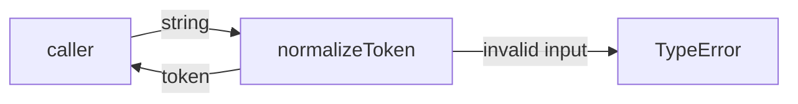
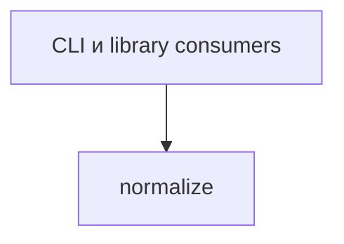

# Module: normalize

<!--SECTION:SPEC_ID-->
TOKEN-NORMALIZE
<!--/SECTION:SPEC_ID-->

<!--SECTION:MODULE_VISION-->
## Module Vision
Модуль владеет чистой функцией `normalizeToken`, которая приводит входную строку к каноническому токену. Parent scope: [token](../token.spec.md). Siblings, parent и child modules отсутствуют: `normalize` — единственный плоский модуль этого скоупа.
<!--/SECTION:MODULE_VISION-->

<!--SECTION:OVERVIEW-->
## Overview


_Вход превращается в канонический токен, недопустимый вход даёт TypeError — NOR-REQ-1, NOR-REQ-2._
<!--/SECTION:OVERVIEW-->

<!--SECTION:MODULE_USAGE_EXAMPLE-->
## Module Usage Example

```ts
import { normalizeToken } from "./normalize.js";

const token = normalizeToken("  Foo__BAR  ");
console.log(token);

try {
  normalizeToken("");
} catch (error) {
  if (!(error instanceof TypeError)) throw error;
  console.error(error.message);
}
```
<!--/SECTION:MODULE_USAGE_EXAMPLE-->

<!--SECTION:MODULE_REQUIREMENTS-->
## Requirements

### NOR-REQ-1 [должен]
**Когда** `normalizeToken` получает ASCII-строку, содержащую хотя бы один символ, отличный от пробела, underscore и hyphen, **функция должна** обрезать крайние ASCII-пробелы, привести ASCII-буквы к lower-case и свернуть серии пробелов, underscore и hyphen в один hyphen.

> Уточняет [TOK-REQ-1](../token.spec.md): модуль задаёт единственный детерминированный формат токена для CLI и библиотечных потребителей.

### NOR-REQ-2 [должен · нештатная]
**Если** строка пустая, состоит только из разделителей или содержит не-ASCII символы, **то функция должна** выбросить TypeError без ввода-вывода.

> Уточняет [TOK-REQ-2](../token.spec.md): ошибочный вход нельзя маскировать пустым корректным токеном.

| Input | Outcome |
|---|---|
| `"  Foo__BAR  "` | `"foo-bar"` |
| `""` | `TypeError` |
<!--/SECTION:MODULE_REQUIREMENTS-->

<!--SECTION:INTER_MODULE_DEPENDENCIES-->
## Inter-Module Dependencies
- **Depends on:** нет модулей внутри скоупа.
- **Scope Reference (cross-scope):** нет; модуль не использует cross-scope interfaces.
- **Provides to:** нет модулей внутри скоупа.


_Внешние потребители вызывают normalize; зависимостей внутри скоупа нет._
<!--/SECTION:INTER_MODULE_DEPENDENCIES-->

<!--SECTION:ENTITY_INVENTORY-->
## Entity Inventory

_Это полный список сущностей модуля. Любое введение сущности execution-агентом помимо этого списка считается drift'ом и требует обновления spec._

| Name | Type | Purpose |
|------|------|---------|
| `normalizeToken` | Function | Приводит входную строку к каноническому токену или выбрасывает TypeError |

Ошибки: throw → `normalizeToken`

ER-скетч не рисуется: инвентарь содержит одну сущность, связывать нечего.
<!--/SECTION:ENTITY_INVENTORY-->

<!--SECTION:ENTITY_SURFACES-->
## Entity Surfaces

Одна публичная функция; полная поверхность ниже.

<details>
<summary>Полные поверхности сущностей</summary>

### `normalizeToken`
- **Type:** Function
- **Purpose:** Приводит ASCII-строку к каноническому токену.
- **Public Properties:** N/A
- **Public Operations:** нормализовать входную строку; отклонить недопустимый вход.
- **Lifecycle:** Stateless: создаётся при импорте модуля, не владеет состоянием, завершается после возврата или throw.
- **Events Emitted:** N/A
- **Errors & Degradation:** TypeError через throw; владелец — `normalizeToken`, без I/O fallback.
- **Consumers:**
  - Internal: нет
  - External: CLI и library consumers
- **Usage Waiver (external: CLI и library consumers):** единственная публичная функция модуля, экспортируется как весь его surface.

</details>
<!--/SECTION:ENTITY_SURFACES-->

<!--SECTION:MODULE_CONTRACTS-->
## Module Contracts

Модуль определяет один Service `normalizeToken`; Ports и Adapters отсутствуют.

Граф не рисуется: в модуле нет Port/Adapter, только Service `normalizeToken`.

Call Chain не рисуется: в модуле одна абстракция — Service `normalizeToken`.

<details>
<summary>Контракты DbC</summary>

### Services

#### Service: `normalizeToken`
- **Purpose:** Приводит ASCII-строку к каноническому токену или отклоняет недопустимый вход.
- **Consumers:** CLI и library consumers
- **Runtime Backing:** `not-implemented`
- **Verification Levels:** `contract`, `unit`
- **Deferred Runtime Scope:** Вся заявленная функция не имеет runtime; реализация не запрошена.

**Contract (DbC)**:
- `normalizeToken(input)`:
  - Pre: `input` — ASCII-строка, содержащая хотя бы один символ, отличный от пробела, underscore и hyphen; не-ASCII символы отсутствуют.
  - Post: возвращается строка без крайних ASCII-пробелов, с ASCII-буквами в lower-case и с каждой серией пробелов, underscore и hyphen, заменённой одним hyphen.
  - On pre-violation: выбрасывается TypeError без ввода-вывода.

**Invariants:** функция чистая: не выполняет I/O, не хранит состояние, для одного входа всегда возвращает один и тот же токен или TypeError.

</details>
<!--/SECTION:MODULE_CONTRACTS-->

<!--SECTION:PUBLIC_OPTIONS-->
## Public Options & Policies

Публичных опций и политик нет: функция не имеет конфигурации.

<details>
<summary>Опции и политики</summary>

Нет: `normalizeToken` не принимает флагов, опций или политик; поведение полностью задано контрактом.

</details>
<!--/SECTION:PUBLIC_OPTIONS-->

<!--SECTION:FILE_STRUCTURE-->
## File Structure
```
normalize/
├── normalize.ts
└── normalize.test.ts
```

**File Mapping:**
- `normalize/normalize.ts`: реализация `normalizeToken`
- `normalize/normalize.test.ts`: unit- и contract-тесты `normalizeToken`
<!--/SECTION:FILE_STRUCTURE-->

<!--SECTION:RESEARCH-->
## Research

Исследовательских документов нет: задача ограничена детерминированным поведением из parent scope и контракта token.
<!--/SECTION:RESEARCH-->

<!--SECTION:MODULE_DECISION_LOG-->
## Module Decision Log

Записано одно решение о выборе Service без Port/Adapter.

<details>
<summary>Полные записи Decision Log</summary>

NOR-DL-1 2026-10-24 — Модуль реализует чистую функцию `normalizeToken` напрямую как Service без Port и Adapter (почему: одна детерминированная реализация без подтверждённой вариативности; отвергнуто: Port ради тестового шва — избыточен для чистой функции).

</details>
<!--/SECTION:MODULE_DECISION_LOG-->

<!--SECTION:HANDOFF-->
## Handoff to Tasks
- **Implementation files to be created:** `normalize/normalize.ts`
- **Test files to be created:** `normalize/normalize.test.ts`
- **Stack dependencies:**
  - Language: `typescript` (resolves to `ai/directives/coding/typescript-rules.xml`)
  - Test framework: `node-test` (resolves to `ai/directives/testing/node-test.xml`)
- **Module Rules Additions:** None
- **Open risks & validation needs:** Статус pending-operator: операторского approval нет, реализация и задачи не создавались.
<!--/SECTION:HANDOFF-->

<!--SECTION:IMPLEMENTATION_INSIGHTS-->
## Implementation Insights

Не применимо: реализация не выполнялась, post-implementation learnings отсутствуют.

<details>
<summary>Заметки по реализации</summary>

Нет: секция применима только после реализации и audit-cycle compaction; в этой authoring-задаче кода нет.

</details>
<!--/SECTION:IMPLEMENTATION_INSIGHTS-->
