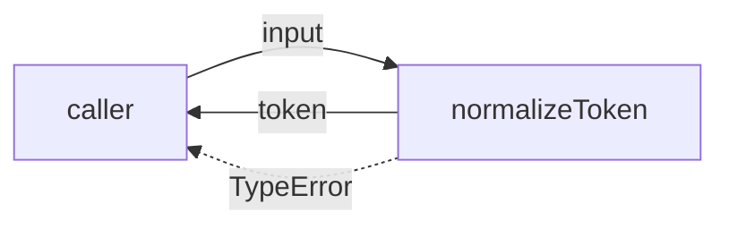
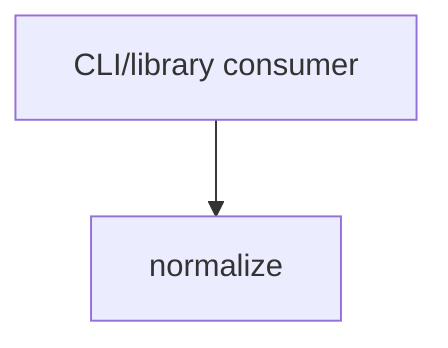

# Module: normalize

<!--SECTION:SPEC_ID-->
TOKEN-NORMALIZE
<!--/SECTION:SPEC_ID-->

<!--SECTION:MODULE_VISION-->
## Module Vision

Модуль `normalize` владеет единственной чистой операцией `normalizeToken`: приведением ASCII-строки к каноническому токену без ввода-вывода и без состояния. Он реализует обязательства родительского скоупа [token](../token.spec.md); sibling-, parent- и child-модулей в этой плоской декомпозиции нет.
<!--/SECTION:MODULE_VISION-->

<!--SECTION:OVERVIEW-->
## Overview


_Главный путь нормализации токена и его единственная ошибка — NOR-REQ-1, NOR-REQ-2._
<!--/SECTION:OVERVIEW-->

<!--SECTION:MODULE_USAGE_EXAMPLE-->
## Module Usage Example

```ts
import { normalizeToken } from "./normalize.js";

const token = normalizeToken("  Foo__BAR  ");
console.log(token);

try {
  normalizeToken("");
} catch (error) {
  if (error instanceof TypeError) {
    console.error("invalid token");
  }
}
```
<!--/SECTION:MODULE_USAGE_EXAMPLE-->

<!--SECTION:MODULE_REQUIREMENTS-->
## Requirements

### NOR-REQ-1 [должен]
**Когда** на вход подана непустая ASCII-строка, содержащая хотя бы один символ, отличный от пробела, underscore и hyphen, **нормализатор должен** обрезать крайние ASCII-пробелы, привести ASCII-буквы к нижнему регистру и свернуть серии пробелов, underscore и hyphen в один hyphen.

> Уточняет TOK-REQ-1: модуль фиксирует точный канонический формат токена для CLI и библиотечных потребителей.

### NOR-REQ-2 [должен · нештатная]
**Если** вход пуст, состоит только из разделителей или содержит не-ASCII символы, **то нормализатор должен** выбросить `TypeError` без ввода-вывода.

> Уточняет TOK-REQ-2: ошибочный вход нельзя маскировать пустым корректным токеном или частичной нормализацией.

| Input | Outcome |
|---|---|
| `"  Foo__BAR  "` | `"foo-bar"` |
| `""` | `TypeError` |
<!--/SECTION:MODULE_REQUIREMENTS-->

<!--SECTION:INTER_MODULE_DEPENDENCIES-->
## Inter-Module Dependencies

- **Depends on:** none; this module has no sibling modules in the flat decomposition.
- **Scope Reference (cross-scope):** none.
- **Provides to:** none within `token`; the public function is consumed by external CLI/library callers.


_Внешний потребитель — единственный вызывающий, межмодульных рёбер нет._
<!--/SECTION:INTER_MODULE_DEPENDENCIES-->

<!--SECTION:ENTITY_INVENTORY-->
## Entity Inventory

_Это полный список сущностей модуля. Любое введение сущности execution-агентом помимо этого списка считается drift'ом и требует обновления spec._

| Name | Type | Purpose |
|------|------|---------|
| `normalizeToken` | Function | Приводит ASCII-строку к каноническому токену |

Ошибки: throw `TypeError` → `normalizeToken`

ER-набросок не применим: инвентарь содержит одну сущность, связей между двумя или более сущностями нет.
<!--/SECTION:ENTITY_INVENTORY-->

<!--SECTION:ENTITY_SURFACES-->
## Entity Surfaces

Одна публичная функция `normalizeToken`; состояние и отдельный жизненный цикл отсутствуют.

<details>
<summary>Полные поверхности сущностей</summary>

### `normalizeToken`
- **Type:** Function
- **Purpose:** Приводит входную ASCII-строку к каноническому токену или отвергает недопустимый вход.
- **Public Properties:** N/A
- **Public Operations:** нормализовать строку в канонический токен.
- **Lifecycle:** Создаётся импортом модуля; состояние не хранит; завершается возвратом значения или исключением `TypeError`.
- **Events Emitted:** N/A
- **Errors & Degradation:** `TypeError` через throw; владелец — `normalizeToken`.
- **Consumers:**
  - Internal: `src/token/normalize/normalize.ts` (future implementation; not created in this authoring task)
  - External: CLI / library consumers
- **Usage Waiver (external: CLI/library consumers):** Единственная публичная операция скоупа, ради которой модуль существует.

</details>
<!--/SECTION:ENTITY_SURFACES-->

<!--SECTION:MODULE_CONTRACTS-->
## Module Contracts

Один чистый сервис `normalizeToken`; Port и Adapter не вводятся, потому что нет подтверждённой вариативности или тестового шва.

Граф не рисуется: в модуле нет Port/Adapter, только Service `normalizeToken`.

Call Chain не строится: в инвентаре одна абстракция (`normalizeToken`), порог ≥2 не достигнут.

<details>
<summary>Контракты DbC</summary>

#### Service: `normalizeToken`
- **Purpose:** Приводит ASCII-строку к каноническому токену или выбрасывает `TypeError` для недопустимого входа.
- **Consumers:** CLI / library consumers
- **Runtime Backing:** `not-implemented`
- **Verification Levels:** `contract`, `unit`
- **Deferred Runtime Scope:** Вся реализация отложена; код в этой задаче не создаётся.

**Contract (DbC)**
- `normalizeToken`:
  - Pre: вход — строка; она непуста, содержит хотя бы один символ, отличный от пробела, underscore и hyphen, и состоит только из ASCII-символов.
  - Post: возвращается строка без крайних ASCII-пробелов, с ASCII-буквами в нижнем регистре и одиночными hyphen вместо серий пробелов, underscore и hyphen.
  - On pre-violation: выбрасывается `TypeError` без ввода-вывода.

**Invariants:** Операция не выполняет ввод-вывод и не сохраняет состояние между вызовами.
</details>
<!--/SECTION:MODULE_CONTRACTS-->

<!--SECTION:PUBLIC_OPTIONS-->
## Public Options & Policies

Публичных опций нет: у `normalizeToken` один обязательный аргумент и фиксированная политика нормализации.

<details>
<summary>Опции и политики</summary>

Публичные флаги, опции и настраиваемые политики отсутствуют; политика нормализации зафиксирована в `NOR-REQ-1` и `NOR-REQ-2`. Deferred: none.
</details>
<!--/SECTION:PUBLIC_OPTIONS-->

<!--SECTION:FILE_STRUCTURE-->
## File Structure

```
src/
└── token/
    └── normalize/
        ├── normalize.ts
        └── normalize.test.ts
```

**File Mapping:**
- `src/token/normalize/normalize.ts`: implementation of `normalizeToken`
- `src/token/normalize/normalize.test.ts`: unit tests for valid and invalid input
<!--/SECTION:FILE_STRUCTURE-->

<!--SECTION:RESEARCH-->
## Research

Not applicable: this bounded deterministic module has no research documents, and the fixture contains no `specs/token/research/` registry.
<!--/SECTION:RESEARCH-->

<!--SECTION:MODULE_DECISION_LOG-->
## Module Decision Log

Одна запись: отказ от Port/Adapter для единственной чистой функции.

<details>
<summary>Полные записи Decision Log</summary>

NOR-DL-1 2026-10-24 — Port/Adapter не вводятся для единственной чистой функции; где: specs/token/normalize/normalize.spec.md#module-contracts (почему: нет подтверждённой вариативности или тестового шва) [verdict: pending-operator]
</details>
<!--/SECTION:MODULE_DECISION_LOG-->

<!--SECTION:HANDOFF-->
## Handoff to Tasks

- **Implementation files to be created:** `src/token/normalize/normalize.ts`
- **Test files to be created:** `src/token/normalize/normalize.test.ts`
- **Stack dependencies:**
  - Language: `typescript` (resolves to `ai/directives/coding/typescript-rules.xml`)
  - Test framework: `node-test` (resolves to `ai/directives/testing/node-test.xml`)
- **Module Rules Additions:** None; no module-specific additions on top of the scope-wide baseline.

  | Rule | Category | Source |
  |------|----------|--------|
- **Open risks & validation needs:** Implementation and tests are not created in this authoring task; operator approval is pending.
<!--/SECTION:HANDOFF-->

<!--SECTION:IMPLEMENTATION_INSIGHTS-->
## Implementation Insights

Not applicable: no implementation exists yet, so there are no post-implementation learnings.

<details>
<summary>Заметки по реализации</summary>

Раздел заполняется только после реализации и аудита; в этой задаче заметок нет.
</details>
<!--/SECTION:IMPLEMENTATION_INSIGHTS-->
