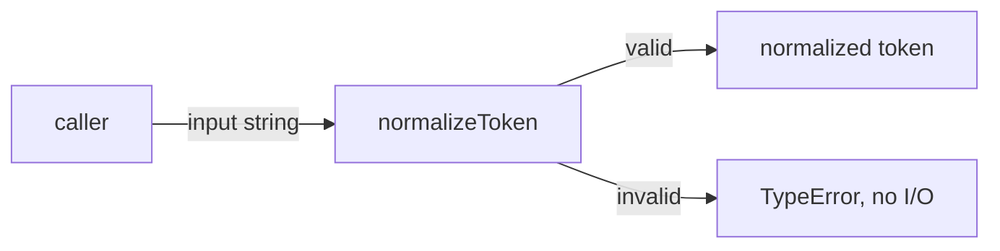
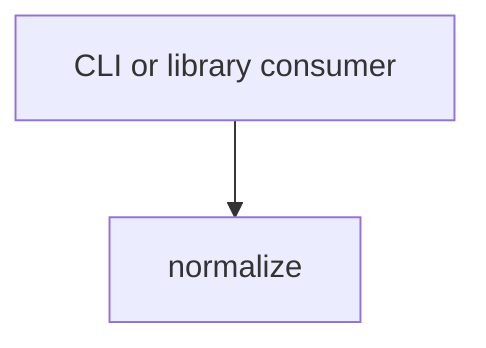

# Module: Normalize

<!--SECTION:SPEC_ID-->
TOKEN-NORMALIZE
<!--/SECTION:SPEC_ID-->

<!--SECTION:MODULE_VISION-->
## Module Vision
Normalize owns the single deterministic token-normalization operation inside the [token scope](../token.spec.md). It has no child modules and no sibling module dependencies; its public surface is the `normalizeToken` function described in the scope [PUBLIC_API_SURFACE](../token.spec.md#PUBLIC_API_SURFACE).

<!--/SECTION:MODULE_VISION-->

<!--SECTION:OVERVIEW-->
## Overview

_Путь нормализации токена и отказ на недопустимом входе — NOR-REQ-1, NOR-REQ-2._

<!--/SECTION:OVERVIEW-->

<!--SECTION:MODULE_USAGE_EXAMPLE-->
## Module Usage Example
```ts
import { normalizeToken } from "./normalize.js";

const token: string = normalizeToken("  Foo__BAR  ");
console.log(token);

try {
  normalizeToken("");
} catch (error) {
  if (error instanceof TypeError) {
    console.error("invalid token");
  }
}
```
The happy path returns `"foo-bar"`; the minimal error path handles the `TypeError` raised for an empty input.

<!--/SECTION:MODULE_USAGE_EXAMPLE-->

<!--SECTION:MODULE_REQUIREMENTS-->
## Requirements
### NOR-REQ-1 [должен]
**Когда** передана строка, содержащая хотя бы один ASCII-символ, не являющийся пробелом, underscore или hyphen, **нормализатор должен** обрезать крайние ASCII-пробелы, привести ASCII-буквы к нижнему регистру и свернуть серии пробелов, underscore и hyphen в один hyphen, сохраняя остальные ASCII-символы без изменений.
> Уточняет родительское требование TOK-REQ-1 для модуля normalize.

### NOR-REQ-2 [должен · нештатная]
**Если** входная строка пустая, состоит только из разделителей или содержит не-ASCII символ, **то нормализатор должен** выбросить `TypeError` без ввода-вывода.
> Уточняет родительское требование TOK-REQ-2 для модуля normalize.

| Input | Outcome |
|---|---|
| `"  Foo__BAR  "` | `"foo-bar"` |
| `""` | `TypeError` |

<!--/SECTION:MODULE_REQUIREMENTS-->

<!--SECTION:INTER_MODULE_DEPENDENCIES-->
## Inter-Module Dependencies
- **Depends on:** None — the module uses no sibling module.
- **Scope Reference (cross-scope):** None — the behavior is local and deterministic.
- **Provides to:** CLI and library consumers of the token scope; no sibling module consumes it.


_Нормализатор предоставляется внешним потребителям без зависимостей от соседних модулей._

<!--/SECTION:INTER_MODULE_DEPENDENCIES-->

<!--SECTION:ENTITY_INVENTORY-->
## Entity Inventory
_Это полный список сущностей модуля. Любое введение сущности execution-агентом помимо этого списка считается drift'ом и требует обновления spec._

| Name | Type | Purpose |
|------|------|---------|
| `normalizeToken` | Function | Детерминированно нормализует один токен и владеет отказом на недопустимом входе |

Ошибки: throw (`TypeError`) → `normalizeToken`

ER-набросок не рисуется: в инвентаре одна сущность, связывать нечего.

<!--/SECTION:ENTITY_INVENTORY-->

<!--SECTION:ENTITY_SURFACES-->
## Entity Surfaces
Поверхность модуля состоит из одной публичной функции с единственной операцией нормализации.

<details>
<summary>Полные поверхности сущностей</summary>

### `normalizeToken`
- **Type:** Function
- **Purpose:** Преобразует допустимый ASCII-токен в единый канонический вид и отвергает недопустимый вход.
- **Public Properties:** N/A
- **Public Operations:** `normalizeToken(input)` — нормализовать один токен.
- **Lifecycle:** Создаётся как чистая функция; вызывающий владеет вызовом, состояние не сохраняется, завершение не требуется.
- **Events Emitted:** N/A
- **Errors & Degradation:** `TypeError` через throw для пустого входа, входа только из разделителей или не-ASCII входа; обрабатывает вызывающий потребитель, ввод-вывод не выполняется.
- **Consumers:**
  - Internal: `src/token/normalize/normalize.ts`
  - External: CLI and library consumers
- **Usage Waiver (external: CLI and library consumers):** Единственная публичная операция составляет всё назначение модуля; иного production-вызывающего пока нет.

</details>

<!--/SECTION:ENTITY_SURFACES-->

<!--SECTION:MODULE_CONTRACTS-->
## Module Contracts
Модуль не определяет Port или Adapter: одна чистая функция `normalizeToken` описана как Service с DbC.

Граф не рисуется: в модуле нет Port/Adapter, только Service `normalizeToken`.

Call Chain не рисуется: в инвентаре одна абстракция — `normalizeToken`.

<details>
<summary>Контракты DbC</summary>

### Services
#### Service: `normalizeToken`
- **Purpose:** Детерминированно нормализовать один ASCII-токен или выбросить `TypeError`.
- **Consumers:** `src/token/normalize/normalize.ts`; CLI and library consumers.
- **Runtime Backing:** `not-implemented`
- **Verification Levels:** `contract`, `unit`
- **Deferred Runtime Scope:** Вся заявленная реализация отложена; код не создан.

**Contract (DbC)** — one block per operation:
- `normalizeToken`:
  - Pre: Вход — строка, содержащая хотя бы один ASCII-символ, не являющийся пробелом, underscore или hyphen, и не содержащая не-ASCII символов.
  - Post: Возвращается строка с обрезанными крайними ASCII-пробелами, ASCII-буквами в нижнем регистре и сериями пробелов, underscore и hyphen, свёрнутыми в один hyphen; прочие ASCII-символы сохранены; ввод-вывод не выполняется.
  - On pre-violation: Выбрасывается `TypeError` без ввода-вывода и без возврата корректирующего токена.

**Invariants:** Операция чистая и детерминированная: один и тот же допустимый вход даёт один и тот же результат, состояние между вызовами не сохраняется.

</details>

<!--/SECTION:MODULE_CONTRACTS-->

<!--SECTION:PUBLIC_OPTIONS-->
## Public Options & Policies
Публичных опций нет; единственная поверхность — сигнатура `normalizeToken(input: string): string`.

<details>
<summary>Опции и политики</summary>

Публично наблюдаемых флагов, опций или политик в v1 нет; режимы нормализации не настраиваются.

</details>

<!--/SECTION:PUBLIC_OPTIONS-->

<!--SECTION:FILE_STRUCTURE-->
## File Structure
```
src/token/normalize/
├── normalize.ts
└── normalize.test.ts
```

**File Mapping:**
- `src/token/normalize/normalize.ts`: реализация `normalizeToken`
- `src/token/normalize/normalize.test.ts`: модульные проверки требований NOR-REQ-1 и NOR-REQ-2

<!--/SECTION:FILE_STRUCTURE-->

<!--SECTION:RESEARCH-->
## Research
Реестр ресёрчей не применим: для этого ограниченного детерминированного черновика исследований нет.

<!--/SECTION:RESEARCH-->

<!--SECTION:MODULE_DECISION_LOG-->
## Module Decision Log
Записано одно решение: чистая функция без Port/Adapter; операторского подтверждения нет.

<details>
<summary>Полные записи Decision Log</summary>

NOR-DL-1 2026-10-24 — нормализация представлена одной чистой функцией `normalizeToken` без Port и Adapter (почему: преобразование детерминировано и не имеет подтверждённой вариативности или test seam; отвергнуто: Port с единственным Adapter; риск: будущая вариативная нормализация потребует изменения контракта) [verdict: pending-operator]

</details>

<!--/SECTION:MODULE_DECISION_LOG-->

<!--SECTION:HANDOFF-->
## Handoff to Tasks
- **Implementation files to be created:** `src/token/normalize/normalize.ts`
- **Test files to be created:** `src/token/normalize/normalize.test.ts`
- **Stack dependencies:**
  - Language: `typescript` (resolves to `ai/directives/coding/typescript-rules.xml`)
  - Test framework: `node-test` (resolves to `ai/directives/testing/node-test.xml`)
- **Module Rules Additions:** None

  | Rule | Category | Source |
  |------|----------|--------|
  | None | N/A | N/A |

- **Open risks & validation needs:** Реализация не создана и не проверена; операторское подтверждение отсутствует; поведение для не-ASCII входа и серий разделителей требует unit-проверок после появления кода.

<!--/SECTION:HANDOFF-->

<!--SECTION:IMPLEMENTATION_INSIGHTS-->
## Implementation Insights
Не применимо: реализации пока нет, поэтому пост-имплементационных наблюдений нет.

<details>
<summary>Заметки по реализации</summary>

Раздел остаётся пустым до появления реализации и последующего audit-cycle compaction.

</details>
<!--/SECTION:IMPLEMENTATION_INSIGHTS-->
