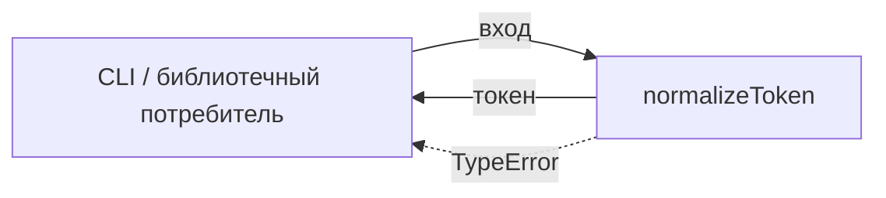
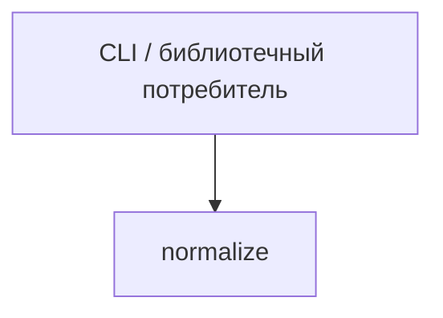

# Module: normalize

<!--SECTION:SPEC_ID-->
TOKEN-NORMALIZE
<!--/SECTION:SPEC_ID-->

<!--SECTION:MODULE_VISION-->
## Module Vision
Модуль `normalize` владеет единственной операцией `normalizeToken` — локальной детерминированной нормализацией ASCII-токена без состояния, ввода-вывода и сетевых зависимостей. Скоуп: [Scope](../token.spec.md). Место в карте: [MODULE_MAP](../token.spec.md#MODULE_MAP). Родительских, дочерних и соседних модулей нет: `normalize` — единственный модуль скоупа `token`.
<!--/SECTION:MODULE_VISION-->

<!--SECTION:OVERVIEW-->
## Overview


_Нормализация допустимого входа и отказ на недопустимом — NOR-REQ-1, NOR-REQ-2._
<!--/SECTION:OVERVIEW-->

<!--SECTION:MODULE_USAGE_EXAMPLE-->
## Module Usage Example

```ts
import { normalizeToken } from "./normalize";

const token = normalizeToken("  Foo__BAR  ");
console.log(token);

try {
  normalizeToken("");
} catch (error) {
  if (error instanceof TypeError) {
    console.error("invalid token input");
  }
}
```
<!--/SECTION:MODULE_USAGE_EXAMPLE-->

<!--SECTION:MODULE_REQUIREMENTS-->
## Requirements
### NOR-REQ-1 [должен]
**Когда** на вход подана непустая ASCII-строка, содержащая хотя бы один символ, отличный от пробела, underscore и hyphen, **нормализатор должен** обрезать крайние ASCII-пробелы, привести ASCII-буквы к нижнему регистру и свернуть каждый ряд пробелов, underscore и hyphen в один hyphen.

> Уточняет TOK-REQ-1: модуль владеет единственной операцией нормализации, поэтому именно здесь зафиксирован наблюдаемый формат токена, общий для CLI и библиотечных потребителей.

### NOR-REQ-2 [должен · нештатная]
**Если** строка пустая, состоит только из разделителей (пробел, underscore, hyphen) или содержит не-ASCII символ, **то нормализатор должен** выбросить TypeError без ввода-вывода.

> Уточняет TOK-REQ-2: недопустимый вход нельзя маскировать пустым корректным токеном, а отсутствие ввода-вывода сохраняет операцию локальной и предсказуемой.

| Input | Outcome |
|---|---|
| `"  Foo__BAR  "` | `"foo-bar"` |
| `""` | `TypeError` |
<!--/SECTION:MODULE_REQUIREMENTS-->

<!--SECTION:INTER_MODULE_DEPENDENCIES-->
## Inter-Module Dependencies
- **Depends on:** None; `normalize` is the only module in scope `token`.
- **Scope Reference (cross-scope):** None.
- **Provides to:** None inside the scope; the public operation is consumed outside the scope by CLI and library callers.


_Внешний потребитель вызывает единственный модуль скоупа._
<!--/SECTION:INTER_MODULE_DEPENDENCIES-->

<!--SECTION:ENTITY_INVENTORY-->
## Entity Inventory
_Это полный список сущностей модуля. Любое введение сущности execution-агентом помимо этого списка считается drift'ом и требует обновления spec._

| Name | Type | Purpose |
|------|------|---------|
| `normalizeToken` | Function | Детерминированно превращает допустимую ASCII-строку в нормализованный токен |

Ошибки: throw → `normalizeToken`

ER-скетч не рисуется: в инвентаре одна сущность, связывать нечего.
<!--/SECTION:ENTITY_INVENTORY-->

<!--SECTION:ENTITY_SURFACES-->
## Entity Surfaces
Одна публичная функция `normalizeToken`; полная поверхность раскрыта ниже.

<details>
<summary>Полные поверхности сущностей</summary>

### `normalizeToken`
- **Type:** Function
- **Purpose:** Возвращает нормализованный токен для допустимого ASCII-входа.
- **Public Properties:** None.
- **Public Operations:** `normalizeToken` — нормализует строку либо выбрасывает TypeError.
- **Lifecycle:** Stateless; доступна после импорта, завершения жизненного цикла нет.
- **Events Emitted:** None.
- **Errors & Degradation:** `TypeError` via throw for empty, separator-only or non-ASCII input; the calling CLI or library consumer owns handling and display.
- **Consumers:**
  - Internal: `normalize/index.ts`
  - External: CLI and library consumers
- **Usage Waiver (external: CLI and library consumers):** Единственная публичная операция модуля; внешнее потребление не входит в счётчик использований репозитория.

</details>
<!--/SECTION:ENTITY_SURFACES-->

<!--SECTION:MODULE_CONTRACTS-->
## Module Contracts
Один Service `normalizeToken` без Port и Adapter; контракт операции раскрыт ниже.

Граф не рисуется: в модуле нет Port/Adapter, только Service `normalizeToken`.
Call Chain не рисуется: в инвентаре одна абстракция, последовательность вызовов отсутствует.

<details>
<summary>Контракты DbC</summary>

### Services

#### Service: `normalizeToken`
- **Purpose:** Детерминированно нормализовать допустимый ASCII-токен.
- **Consumers:** CLI and library consumers via `normalize/index.ts`.
- **Runtime Backing:** `not-implemented`
- **Verification Levels:** `contract`, `unit`
- **Deferred Runtime Scope:** Вся объявленная операция не имеет runtime до реализации.

**Contract (DbC)** — one block per operation:
- `normalizeToken`:
  - Pre: вход — строка JavaScript, непустая, ASCII-only и содержит хотя бы один символ, отличный от пробела, underscore и hyphen.
  - Post: возвращена строка с обрезанными крайними ASCII-пробелами, ASCII-буквами в нижнем регистре и каждым рядом пробелов, underscore и hyphen, свёрнутым в один hyphen; ввод-вывод не выполняется.
  - On pre-violation: для пустой строки, строки только из разделителей или строки с не-ASCII символом выбрасывается `TypeError` до любого ввода-вывода.

**Invariants:** Операция чистая и детерминированная: одинаковый вход даёт одинаковый результат либо одинаковый `TypeError`, побочных эффектов нет.

</details>
<!--/SECTION:MODULE_CONTRACTS-->

<!--SECTION:PUBLIC_OPTIONS-->
## Public Options & Policies
Публичных флагов и политик нет; допустимость входа фиксирована NOR-REQ-1 и NOR-REQ-2.

<details>
<summary>Опции и политики</summary>

No public flags or policies. The ASCII-only input rule with at least one non-separator character is fixed behavior from NOR-REQ-1 and NOR-REQ-2, not a configurable option.

</details>
<!--/SECTION:PUBLIC_OPTIONS-->

<!--SECTION:FILE_STRUCTURE-->
## File Structure
```
normalize/
├── normalize.ts
└── index.ts
```

**File Mapping:**
- `normalize/normalize.ts`: реализация `normalizeToken`.
- `normalize/index.ts`: публичный экспорт `normalizeToken`.
<!--/SECTION:FILE_STRUCTURE-->

<!--SECTION:RESEARCH-->
## Research
Not applicable: this bounded deterministic module has no research documents, and the scope research registry is empty.
<!--/SECTION:RESEARCH-->

<!--SECTION:MODULE_DECISION_LOG-->
## Module Decision Log
Одна запись: `normalizeToken` остаётся чистой функцией без Port и Adapter.

<details>
<summary>Полные записи Decision Log</summary>

NOR-DL-1 2026-10-24 — `normalizeToken` остаётся чистой функцией без Port и Adapter (почему: одна детерминированная операция без внешних зависимостей; отвергнуто: Port и Adapter ради тестового шва — подменять нечего).

</details>
<!--/SECTION:MODULE_DECISION_LOG-->

<!--SECTION:HANDOFF-->
## Handoff to Tasks
- **Implementation files to be created:** `normalize/normalize.ts`, `normalize/index.ts`
- **Test files to be created:** `normalize/normalize.test.ts`
- **Stack dependencies:**
  - Language: `typescript` (resolves to `ai/directives/coding/typescript-rules.xml`)
  - Test framework: `node-test` (resolves to `ai/directives/testing/node-test.xml`)
- **Module Rules Additions:** None.
- **Open risks & validation needs:** Реализация не создана и не проверена; независимый семантический review не проводился. Operator approval #1: pending; tickets not created.
<!--/SECTION:HANDOFF-->

<!--SECTION:IMPLEMENTATION_INSIGHTS-->
## Implementation Insights
Not applicable: implementation has not started, so no post-implementation learnings exist.

<details>
<summary>Заметки по реализации</summary>

None yet; this appendix fills only after implementation and audit-cycle compaction.

</details>
<!--/SECTION:IMPLEMENTATION_INSIGHTS-->
