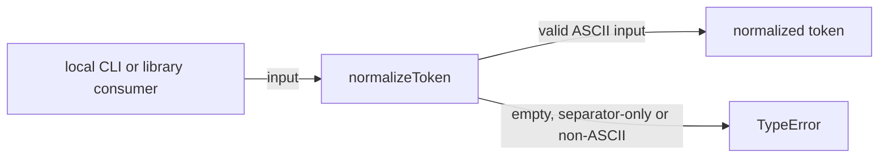
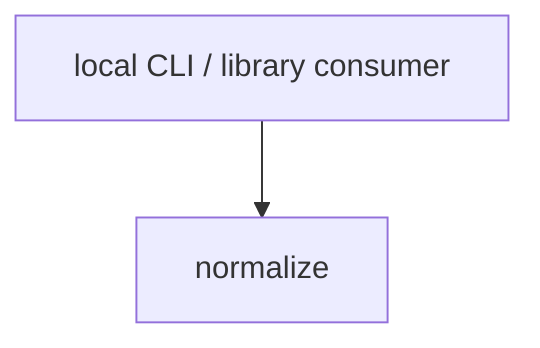

# Module: normalize

<!--SECTION:SPEC_ID-->
TOKEN-NORMALIZE
<!--/SECTION:SPEC_ID-->

<!--SECTION:MODULE_VISION-->
## Module Vision

Модуль `normalize` владеет детерминированной нормализацией ASCII-токена в скоупе [token](../token.spec.md) и реализует [TOK-REQ-1 и TOK-REQ-2](../token.spec.md#REQUIREMENTS_AND_CONSTRAINTS). Это плоский модуль: дочерних модулей нет, а публичная поверхность ограничена [`normalizeToken`](../token.spec.md#PUBLIC_API_SURFACE).
<!--/SECTION:MODULE_VISION-->

<!--SECTION:OVERVIEW-->
## Overview


_Путь от входа к токену или ошибке — NOR-REQ-1, NOR-REQ-2._
<!--/SECTION:OVERVIEW-->

<!--SECTION:MODULE_USAGE_EXAMPLE-->
## Module Usage Example

```ts
import { normalizeToken } from "./normalize.js";

const token = normalizeToken("  Foo__BAR  ");
console.log(token);

try {
  normalizeToken("");
} catch (error) {
  if (!(error instanceof TypeError)) {
    throw error;
  }
  console.error("invalid input");
}
```
<!--/SECTION:MODULE_USAGE_EXAMPLE-->

<!--SECTION:MODULE_REQUIREMENTS-->
## Requirements

### NOR-REQ-1 [должен]
**Когда** на вход передана строка, содержащая хотя бы один ASCII-символ, отличный от пробела (U+0020), underscore (U+005F) и hyphen (U+002D), **нормализатор должен** удалить крайние ASCII-пробелы, привести ASCII-буквы к нижнему регистру и заменить каждую последовательность ASCII-пробелов, underscore и hyphen одним hyphen, сохранив порядок остальных символов.

> Уточняет TOK-REQ-1 на уровне модуля: нормализация должна быть детерминированной и не зависеть от состояния, сети или файлового ввода-вывода.

### NOR-REQ-2 [должен · нештатная]
**Если** входная строка пустая, состоит только из ASCII-пробелов, underscore и hyphen или содержит хотя бы один не-ASCII символ, **то нормализатор должен** выбросить `TypeError` без файлового, сетевого и любого другого ввода-вывода.

> Уточняет TOK-REQ-2 на уровне модуля: пустой или неоднозначный вход нельзя маскировать корректным токеном, а ошибка должна быть явной и синхронной.

| Input | Outcome |
|---|---|
| `"  Foo__BAR  "` | `"foo-bar"` |
| `""` | `TypeError` |
<!--/SECTION:MODULE_REQUIREMENTS-->

<!--SECTION:INTER_MODULE_DEPENDENCIES-->
## Inter-Module Dependencies

- **Depends on:** None — модуль не использует соседние модули.
- **Scope Reference (cross-scope):** None — кросс-скоупных интерфейсов нет.
- **Provides to:** None — публичная функция используется потребителями скоупа напрямую.


_Модуль вызывается локальными потребителями и не зависит от соседних модулей._
<!--/SECTION:INTER_MODULE_DEPENDENCIES-->

<!--SECTION:ENTITY_INVENTORY-->
## Entity Inventory

_Это полный список сущностей модуля. Любое введение сущности execution-агентом помимо этого списка считается drift'ом и требует обновления spec._

| Name | Type | Purpose |
|------|------|---------|
| `normalizeToken` | Function | Детерминированно нормализует ASCII-вход в токен и отвергает недопустимый вход. |

Ошибки: throw `TypeError` → `normalizeToken`

ER-эскиз не требуется: в inventory одна сущность, связывать нечего.
<!--/SECTION:ENTITY_INVENTORY-->

<!--SECTION:ENTITY_SURFACES-->
## Entity Surfaces

Одна публичная сущность — чистая функция `normalizeToken`; ниже её полная поверхность.

<details>
<summary>Полные поверхности сущностей</summary>

### `normalizeToken`
- **Type:** Function
- **Purpose:** Детерминированно нормализует ASCII-вход в токен и отвергает недопустимый вход.
- **Public Properties:** N/A
- **Public Operations:** нормализовать переданную строку в канонический токен.
- **Lifecycle:** Stateless; доступна всё время загрузки модуля, собственного состояния и завершения нет.
- **Events Emitted:** N/A
- **Errors & Degradation:** `TypeError` выбрасывается синхронно при пустом, separator-only или не-ASCII входе; владелец — `normalizeToken`, альтернативной обработки нет.
- **Consumers:**
  - Internal: none — функция является единственной публичной операцией модуля.
  - External: local CLI и библиотечные потребители скоупа `token`.
- **Usage Waiver (external: local CLI and library consumers):** Функция — публичная точка входа модуля с единственной ответственностью; второго внутреннего использования в однофункциональном модуле быть не может.

</details>
<!--/SECTION:ENTITY_SURFACES-->

<!--SECTION:MODULE_CONTRACTS-->
## Module Contracts

Модуль определяет одну чистую функцию `normalizeToken`; Port и Adapter не нужны. Граф зависимостей не рисуется: в модуле нет Port/Adapter, только чистая функция в форме Service. Call Chain не рисуется: в модуле одна абстракция, поэтому цепочка вызовов была бы диаграммой одного участника.

<details>
<summary>Контракты DbC</summary>

### Services

#### Service: `normalizeToken`
- **Purpose:** Детерминированно нормализует ASCII-вход в токен и отвергает недопустимый вход.
- **Consumers:** local CLI и библиотечные потребители скоупа `token`; внутренних потребителей-соседей нет.
- **Runtime Backing:** `not-implemented`
- **Verification Levels:** `contract`, `unit`
- **Deferred Runtime Scope:** None

**Contract (DbC)** — one block per operation:
- `normalizeToken`:
  - Pre: `input` является строкой, каждый символ которой — ASCII (кодовая единица ≤ 0x7F), и содержит хотя бы один символ, отличный от ASCII-пробела (U+0020), underscore (U+005F) и hyphen (U+002D).
  - Post: возвращается строка с удалёнными крайними ASCII-пробелами, ASCII-буквами в нижнем регистре и каждой максимальной последовательностью ASCII-пробелов, underscore и hyphen, заменённой одним hyphen; порядок остальных символов сохранён.
  - On pre-violation: синхронно выбрасывается `TypeError` без ввода-вывода.

**Invariants:** Результат зависит только от входной строки; операция не выполняет ввода-вывода и не изменяет разделяемое состояние.

</details>
<!--/SECTION:MODULE_CONTRACTS-->

<!--SECTION:PUBLIC_OPTIONS-->
## Public Options & Policies

Модуль не предоставляет публичных опций или политик: поведение `normalizeToken` фиксировано.

<details>
<summary>Опции и политики</summary>

Настраиваемых флагов, параметров конфигурации и отложенных опций нет.

</details>
<!--/SECTION:PUBLIC_OPTIONS-->

<!--SECTION:FILE_STRUCTURE-->
## File Structure

```
normalize/
├── normalize.ts
└── normalize.test.ts
```

**File Mapping:**
- `normalize/normalize.ts`: чистая функция `normalizeToken`
- `normalize/normalize.test.ts`: unit-тесты допустимой нормализации и отказов
<!--/SECTION:FILE_STRUCTURE-->

<!--SECTION:RESEARCH-->
## Research

Not applicable: для этого ограниченного детерминированного модуля нет research-документов; поведение задано [спекой скоупа](../token.spec.md) и [контрактом токена](../../../docs/token-contract.md).
<!--/SECTION:RESEARCH-->

<!--SECTION:MODULE_DECISION_LOG-->
## Module Decision Log

Записано одно решение: чистая функция без Port/Adapter.

<details>
<summary>Полные записи Decision Log</summary>

NOR-DL-1 2026-10-24 — нормализация реализуется чистой функцией без Port/Adapter (почему: одна реализация и нет подтверждённой вариативности; отвергнуто: отдельный Port ради тестового шва — избыточен для одной чистой операции; риск: при появлении альтернативных реализаций потребуется рефакторинг).

</details>
<!--/SECTION:MODULE_DECISION_LOG-->

<!--SECTION:HANDOFF-->
## Handoff to Tasks

- **Implementation files to be created:** `normalize/normalize.ts`
- **Test files to be created:** `normalize/normalize.test.ts`
- **Stack dependencies:**
  - Language: `typescript` (resolves to `ai/directives/coding/typescript-rules.xml`)
  - Test framework: `node-test` (resolves to `ai/directives/testing/node-test.xml`)
- **Module Rules Additions:** None — scope-wide baseline applies.
- **Open risks & validation needs:** Operator approval is pending; implementation, tests and execution are not created. `typescript` and `node-test` are proposed defaults because the repository declares no implementation stack; confirm them at scaffold.
- **Approval status:** pending operator approval (Approval #1); this artifact does not claim implementation, execution or acceptance.
<!--/SECTION:HANDOFF-->

<!--SECTION:IMPLEMENTATION_INSIGHTS-->
## Implementation Insights

Not applicable: implementation has not been performed, so there are no post-implementation learnings to record.

<details>
<summary>Заметки по реализации</summary>

No implementation or runtime observation exists yet; this appendix stays intentionally empty until the audit-cycle compaction after implementation.

</details>
<!--/SECTION:IMPLEMENTATION_INSIGHTS-->
