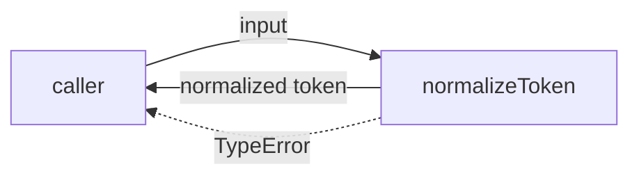
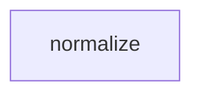

# Module: normalize

<!--SECTION:SPEC_ID-->
TOKEN-NORMALIZE
<!--/SECTION:SPEC_ID-->

<!--SECTION:MODULE_VISION-->
## Module Vision
Модуль `normalize` владеет детерминированной нормализацией одного ASCII-токена в скоупе [token](../token.spec.md): обрезкой крайних ASCII-пробелов, приведением ASCII-букв к нижнему регистру и сворачиванием пробелов, underscore и hyphen в один hyphen. Соседних, родительских и дочерних модулей в скоупе нет; карта модулей — [MODULE_MAP](../token.spec.md#MODULE_MAP).
<!--/SECTION:MODULE_VISION-->

<!--SECTION:OVERVIEW-->
## Overview


_Путь нормализации одного токена — NOR-REQ-1, NOR-REQ-2._
<!--/SECTION:OVERVIEW-->

<!--SECTION:MODULE_USAGE_EXAMPLE-->
## Module Usage Example

```ts
import { normalizeToken } from "./normalize.ts";

const token = normalizeToken("  Foo__BAR  ");
if (token !== "foo-bar") throw new Error("unexpected normalization result");

try {
  normalizeToken("");
} catch (error) {
  if (!(error instanceof TypeError)) throw error;
}
```
<!--/SECTION:MODULE_USAGE_EXAMPLE-->

<!--SECTION:MODULE_REQUIREMENTS-->
## Requirements

### NOR-REQ-1 [должен]
**Когда** передана строка, содержащая хотя бы один ASCII-символ, отличный от пробела, underscore и hyphen, **нормализатор должен** обрезать крайние ASCII-пробелы, привести ASCII-буквы к нижнему регистру и свернуть каждую последовательность ASCII-пробелов, underscore и hyphen в один hyphen.

> Уточняет TOK-REQ-1: фиксирует наблюдаемый формат результата для одного токена, чтобы CLI и библиотечные потребители получали одинаковую форму записи.

### NOR-REQ-2 [должен · нештатная]
**Если** вход пустой, состоит только из ASCII-пробелов, underscore и hyphen или содержит не-ASCII символ, **то нормализатор должен** выбросить `TypeError` без ввода-вывода.

> Уточняет TOK-REQ-2: запрещает маскировать недопустимый вход пустым или частично нормализованным токеном и оставляет ошибку вызывающему коду.

Примеры входа и результата:

| Input | Outcome |
|---|---|
| `"  Foo__BAR  "` | `"foo-bar"` |
| `""` | `TypeError` |
<!--/SECTION:MODULE_REQUIREMENTS-->

<!--SECTION:INTER_MODULE_DEPENDENCIES-->
## Inter-Module Dependencies
- **Depends on:** Нет модулей внутри скоупа `token`.
- **Scope Reference (cross-scope):** Нет; зависимость скоупа от `infra-base` относится к инструментам авторинга, а не к runtime-контракту модуля.
- **Provides to:** Нет модулей внутри скоупа `token`; публичная функция предназначена для local CLI и library consumers.


_Зависимостей между модулями скоупа token нет._
<!--/SECTION:INTER_MODULE_DEPENDENCIES-->

<!--SECTION:ENTITY_INVENTORY-->
## Entity Inventory

_Это полный список сущностей модуля. Любое введение сущности execution-агентом помимо этого списка считается drift'ом и требует обновления spec._

| Name | Type | Purpose |
|------|------|---------|
| `normalizeToken` | Function | Чистая нормализация одного ASCII-токена |

Ошибки: throw `TypeError` → `normalizeToken`.

ER-скетч не рисуется: в инвентаре одна сущность, связывать нечего.
<!--/SECTION:ENTITY_INVENTORY-->

<!--SECTION:ENTITY_SURFACES-->
## Entity Surfaces
Одна публичная функция `normalizeToken`; полная поверхность ниже.

<details>
<summary>Полные поверхности сущностей</summary>

### `normalizeToken`
- **Type:** Function
- **Purpose:** Приводит один допустимый ASCII-токен к единому hyphen-separated виду.
- **Public Properties:** N/A
- **Public Operations:** `normalizeToken(input: string): string` — нормализует вход или выбрасывает `TypeError`.
- **Lifecycle:** Не создаётся и не хранится; вызывается на каждый вход и завершается синхронно.
- **Events Emitted:** N/A
- **Errors & Degradation:** `TypeError` через `throw` при пустом, разделительном или не-ASCII входе; обработка принадлежит вызывающему коду, ввода-вывода нет.
- **Consumers:**
  - Internal: N/A
  - External: local CLI и library consumers.
- **Usage Waiver (external: local CLI и library consumers):** Это единственная публичная точка входа модуля; её назначение — потребление вне модуля.

</details>
<!--/SECTION:ENTITY_SURFACES-->

<!--SECTION:MODULE_CONTRACTS-->
## Module Contracts
Модуль предоставляет один чистый Service `normalizeToken`; Port и Adapter не вводятся.

Граф не рисуется: в модуле нет Port/Adapter, только Service normalizeToken.

Цепочка вызовов не рисуется: в модуле одна абстракция — Service normalizeToken.

<details>
<summary>Контракты DbC</summary>

### Services

#### Service: `normalizeToken`
- **Purpose:** Детерминированно нормализует один ASCII-токен без состояния и ввода-вывода.
- **Consumers:** local CLI и library consumers.
- **Runtime Backing:** `not-implemented`
- **Verification Levels:** `contract`
- **Deferred Runtime Scope:** Вся заявленная логика нормализации — реализация не запрошена.

**Contract (DbC)** — one block per operation:
- `normalizeToken`:
  - Pre: `input` — строка, содержащая хотя бы один ASCII-символ, отличный от пробела, underscore и hyphen, и не содержащая не-ASCII символов.
  - Post: возвращает строку, полученную обрезкой крайних ASCII-пробелов, приведением ASCII-букв к нижнему регистру и заменой каждой последовательности ASCII-пробелов, underscore и hyphen одним hyphen.
  - On pre-violation: выбрасывает `TypeError` без ввода-вывода.

**Invariants** (omit when none): Для одного и того же допустимого входа результат детерминирован; функция не выполняет ввода-вывода и не хранит состояние.

</details>
<!--/SECTION:MODULE_CONTRACTS-->

<!--SECTION:PUBLIC_OPTIONS-->
## Public Options & Policies
Нет публичных флагов или политик; сигнатура функции фиксирована.

<details>
<summary>Опции и политики</summary>

Не применимо: модуль не предоставляет конфигурации. Единственная публичная политика — отказ с `TypeError` на недопустимый вход, зафиксированный в NOR-REQ-2.

</details>
<!--/SECTION:PUBLIC_OPTIONS-->

<!--SECTION:FILE_STRUCTURE-->
## File Structure
```
normalize/
├── normalize.ts
└── normalize.test.ts
```

**File Mapping:**
- `normalize/normalize.ts`: реализация `normalizeToken`.
- `normalize/normalize.test.ts`: контрактные тесты `normalizeToken`.
<!--/SECTION:FILE_STRUCTURE-->

<!--SECTION:RESEARCH-->
## Research
Нет ресёрч-документов, питающих этот модуль.
<!--/SECTION:RESEARCH-->

<!--SECTION:MODULE_DECISION_LOG-->
## Module Decision Log
Одна запись `NOR-DL-1`: чистый Service без Port/Adapter.

<details>
<summary>Полные записи Decision Log</summary>

NOR-DL-1 2026-10-24 — normalizeToken остаётся чистым Service без Port/Adapter (почему: одна реализация и отсутствие подтверждённой вариативности; отвергнуто: Port с единственным адаптером; риск: будущая подмена окружения потребует явного расширения контракта).

</details>
<!--/SECTION:MODULE_DECISION_LOG-->

<!--SECTION:HANDOFF-->
## Handoff to Tasks
- **Implementation files to be created:** `normalize/normalize.ts`
- **Test files to be created:** `normalize/normalize.test.ts`
- **Stack dependencies:**
  - Language: `typescript` (resolves to `ai/directives/coding/typescript-rules.xml`)
  - Test framework: `node-test` (resolves to `ai/directives/testing/node-test.xml`)
- **Module Rules Additions:** None.
- **Open risks & validation needs:** Операторского одобрения нет; реализация и исполнение не запрошены. Валидация контракта возможна только на этапе scaffold/execute.
<!--/SECTION:HANDOFF-->

<!--SECTION:IMPLEMENTATION_INSIGHTS-->
## Implementation Insights
Не применимо: реализации нет, post-implementation наблюдений нет.
<!--/SECTION:IMPLEMENTATION_INSIGHTS-->
