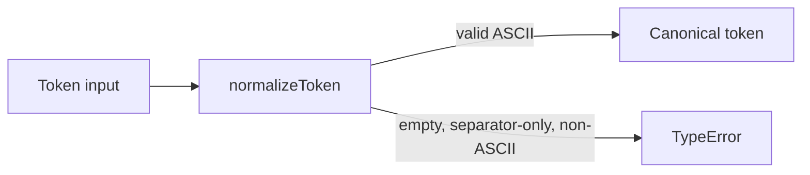
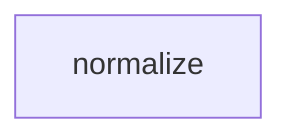

# Module: normalize

<!--SECTION:SPEC_ID-->
TOKEN-NORMALIZE
<!--/SECTION:SPEC_ID-->

<!--SECTION:MODULE_VISION-->
## Module Vision
Owns `normalizeToken`, the local deterministic ASCII token normalizer. Parent scope: [Scope](../token.spec.md), with its [MODULE_MAP](../token.spec.md#MODULE_MAP) and [PUBLIC_API_SURFACE](../token.spec.md#PUBLIC_API_SURFACE). This is the only module in `token`; no sibling or child modules exist.
<!--/SECTION:MODULE_VISION-->

<!--SECTION:OVERVIEW-->
## Overview
`normalizeToken` converts one valid ASCII input string into a canonical token and rejects invalid input.


_Путь нормализации токена — NOR-REQ-1, NOR-REQ-2._
<!--/SECTION:OVERVIEW-->

<!--SECTION:MODULE_USAGE_EXAMPLE-->
## Module Usage Example
```ts
import { normalizeToken } from "./normalize";

const token = normalizeToken("  Foo__BAR  ");
console.log(token);

try {
  normalizeToken("");
} catch (error) {
  if (error instanceof TypeError) {
    console.error("invalid token input");
  }
}
```
<!--/SECTION:MODULE_USAGE_EXAMPLE-->

<!--SECTION:MODULE_REQUIREMENTS-->
## Requirements
### NOR-REQ-1 [должен]
**Когда** передана непустая ASCII-строка, содержащая хотя бы один символ, отличный от пробела, underscore и hyphen, **модуль нормализации должен** обрезать крайние ASCII-пробелы, привести ASCII-буквы к lower-case и свернуть пробелы, underscore и hyphen в один hyphen. Уточняет TOK-REQ-1.
> Канонический токен нужен CLI и библиотечным потребителям.

### NOR-REQ-2 [должен · нештатная]
**Если** строка пустая, состоит только из разделителей или содержит не-ASCII символы, **то модуль нормализации должен** выбросить TypeError без ввода-вывода. Уточняет TOK-REQ-2.
> Невалидный вход нельзя маскировать корректным токеном.

| Input | Outcome |
|---|---|
| `"  Foo__BAR  "` | `"foo-bar"` |
| `""` | `TypeError` |
<!--/SECTION:MODULE_REQUIREMENTS-->

<!--SECTION:INTER_MODULE_DEPENDENCIES-->
## Inter-Module Dependencies
- **Depends on:** None — no other module exists in scope `token`.
- **Scope Reference (cross-scope):** None.
- **Provides to:** None within this scope; `normalizeToken` is consumed by external CLI and library callers.


_Межмодульных зависимостей нет._
<!--/SECTION:INTER_MODULE_DEPENDENCIES-->

<!--SECTION:ENTITY_INVENTORY-->
## Entity Inventory

_Это полный список сущностей модуля. Любое введение сущности execution-агентом помимо этого списка считается drift'ом и требует обновления spec._

| Name | Type | Purpose |
|------|------|---------|
| `normalizeToken` | Function | Нормализует ASCII-строку в канонический токен |

Ошибки: throw → `normalizeToken`

Single-entity inventory; no relational ER sketch applies.
<!--/SECTION:ENTITY_INVENTORY-->

<!--SECTION:ENTITY_SURFACES-->
## Entity Surfaces
One public function surface; no mutable state or additional entities.

<details>
<summary>Полные поверхности сущностей</summary>

### `normalizeToken`
- **Type:** Function
- **Purpose:** Normalize one ASCII token string deterministically.
- **Public Properties:** N/A
- **Public Operations:** `normalizeToken(input: string): string` — trim, lowercase and collapse separators; throws `TypeError` for invalid input.
- **Lifecycle:** Stateless; created by the module import and owned by the calling process.
- **Events Emitted:** N/A
- **Errors & Degradation:** `TypeError` thrown directly by `normalizeToken`; the function owns rejection and performs no I/O.
- **Consumers:**
  - Internal: none
  - External: CLI and library consumers
- **Usage Waiver (external: CLI and library consumers):** sole public entry point of this module.

</details>
<!--/SECTION:ENTITY_SURFACES-->

<!--SECTION:MODULE_CONTRACTS-->
## Module Contracts
One pure Service, `normalizeToken`; no Port or Adapter is defined.

Граф не рисуется: в модуле нет Port/Adapter, только Service `normalizeToken`.

Call Chain не рисуется: в инвентаре одна абстракция, порог ≥2 не достигнут.

<details>
<summary>Контракты DbC</summary>

### Service: `normalizeToken`
- **Purpose:** Normalize one ASCII token string deterministically.
- **Consumers:** External CLI and library consumers.
- **Runtime Backing:** `not-implemented`
- **Verification Levels:** `contract`, `unit`
- **Deferred Runtime Scope:** All runtime is deferred; no implementation is requested.

**Contract (DbC)**
- `normalizeToken`:
  - Pre: input is a string, all characters are ASCII, and after trimming ASCII spaces it contains at least one character other than space, underscore, and hyphen.
  - Post: returns the input with leading and trailing ASCII spaces removed, ASCII letters lowercased, and every run of spaces, underscores, and hyphens replaced by one hyphen.
  - On pre-violation: throws `TypeError` before any I/O.

**Invariants:** The operation is pure and deterministic, performs no I/O, and keeps no shared mutable state.

</details>
<!--/SECTION:MODULE_CONTRACTS-->

<!--SECTION:PUBLIC_OPTIONS-->
## Public Options & Policies
Not applicable: no public options, flags, or policies; behavior is fixed by the module contract.
<!--/SECTION:PUBLIC_OPTIONS-->

<!--SECTION:FILE_STRUCTURE-->
## File Structure
```
normalize/
└── normalize.ts
```

**File Mapping:**
- `normalize/normalize.ts`: public `normalizeToken` implementation.
<!--/SECTION:FILE_STRUCTURE-->

<!--SECTION:RESEARCH-->
## Research
Not applicable: no research documents for this bounded deterministic module.
<!--/SECTION:RESEARCH-->

<!--SECTION:MODULE_DECISION_LOG-->
## Module Decision Log
One recorded decision: the module uses a single pure function without a Port/Adapter layer.

<details>
<summary>Полные записи Decision Log</summary>

NOR-DL-1 2026-10-24 — нормализация реализуется одной чистой функцией без Port/Adapter (почему: детерминированное преобразование не требует состояния и подтверждённой вариативности; отвергнуто: Port/Adapter-слой; риск: нет).

</details>
<!--/SECTION:MODULE_DECISION_LOG-->

<!--SECTION:HANDOFF-->
## Handoff to Tasks
- **Implementation files to be created:** `normalize/normalize.ts`
- **Test files to be created:** `normalize/normalize.test.ts`
- **Stack dependencies:**
  - Language: `typescript` (resolves to `ai/directives/coding/typescript-rules.xml`)
  - Test framework: `node-test` (resolves to `ai/directives/testing/node-test.xml`)
- **Module Rules Additions:** None.
- **Open risks & validation needs:** Runtime behavior is unverified because no implementation is requested; operator approval remains pending.
- **Operator approval:** pending (Approval #1); no tickets created and no execution claimed.
<!--/SECTION:HANDOFF-->

<!--SECTION:IMPLEMENTATION_INSIGHTS-->
## Implementation Insights
Not applicable: no implementation has been executed, so there are no post-implementation learnings to record.
<!--/SECTION:IMPLEMENTATION_INSIGHTS-->
