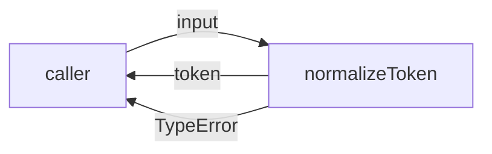
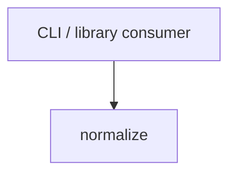

# Module: normalize

<!--SECTION:SPEC_ID-->
TOKEN-NORMALIZE
<!--/SECTION:SPEC_ID-->

<!--SECTION:MODULE_VISION-->
## Module Vision
The `normalize` module owns the single token-normalization responsibility inside the [token](../token.spec.md) scope: it turns one ASCII input string into the canonical token form defined by the scope and rejects invalid input without side effects. It has no child modules and no sibling modules in this scope; its public surface is the single `normalizeToken` function. The scope requirements it implements are listed in [REQUIREMENTS_AND_CONSTRAINTS](../token.spec.md#REQUIREMENTS_AND_CONSTRAINTS), and its place in the hierarchy is recorded in [MODULE_MAP](../token.spec.md#MODULE_MAP).
<!--/SECTION:MODULE_VISION-->

<!--SECTION:OVERVIEW-->
## Overview

_Путь нормализации токена и отклонения недопустимого входа — NOR-REQ-1, NOR-REQ-2._
<!--/SECTION:OVERVIEW-->

<!--SECTION:MODULE_USAGE_EXAMPLE-->
## Module Usage Example
```ts
import { normalizeToken } from "./normalize";

const token = normalizeToken("  Foo__BAR  ");
// token === "foo-bar"

try {
  normalizeToken("");
} catch (error) {
  // error instanceof TypeError
}
```
<!--/SECTION:MODULE_USAGE_EXAMPLE-->

<!--SECTION:MODULE_REQUIREMENTS-->
## Requirements
### NOR-REQ-1 [должен]
**Когда** передана ASCII-строка, содержащая хотя бы один символ, отличный от пробела, underscore и hyphen, **нормализатор должен** обрезать ведущие и замыкающие ASCII-пробелы, привести ASCII-буквы к нижнему регистру и свернуть каждую серию ASCII-пробелов, underscore и hyphen в один hyphen.

> Уточняет TOK-REQ-1: фиксирует точный состав преобразования и алфавит, чтобы CLI и библиотечные потребители получали один детерминированный токен.

### NOR-REQ-2 [должен · нештатная]
**Если** входная строка пуста, состоит только из ASCII-пробелов, underscore и hyphen или содержит хотя бы один не-ASCII символ, **то нормализатор должен** выбросить `TypeError` без ввода-вывода.

> Уточняет TOK-REQ-2: недопустимый вход нельзя маскировать пустым или частично нормализованным токеном, а отсутствие I/O делает отказ предсказуемым.

| Input | Outcome |
|---|---|
| `"  Foo__BAR  "` | `"foo-bar"` |
| `""` | `TypeError` |
<!--/SECTION:MODULE_REQUIREMENTS-->

<!--SECTION:INTER_MODULE_DEPENDENCIES-->
## Inter-Module Dependencies
- **Depends on:** None — `normalize` has no sibling module dependencies.
- **Scope Reference (cross-scope):** None — the module uses no cross-scope interface.
- **Provides to:** None within the scope; `normalizeToken` is provided to CLI and library consumers outside the scope.


_Модуль не зависит от соседей и отдаёт нормализацию внешним потребителям._
<!--/SECTION:INTER_MODULE_DEPENDENCIES-->

<!--SECTION:ENTITY_INVENTORY-->
## Entity Inventory

_Это полный список сущностей модуля. Любое введение сущности execution-агентом помимо этого списка считается drift'ом и требует обновления spec._

| Name | Type | Purpose |
|------|------|---------|
| `normalizeToken` | Function | Нормализует одну ASCII-строку в канонический токен |

Ошибки: throw → `normalizeToken`

ER-скетч не рисуется: в inventory одна сущность, связывать нечего.
<!--/SECTION:ENTITY_INVENTORY-->

<!--SECTION:ENTITY_SURFACES-->
## Entity Surfaces
One public function, `normalizeToken`, with no properties, events, or lifecycle beyond a single call.

<details>
<summary>Полные поверхности сущностей</summary>

### `normalizeToken`
- **Type:** Function
- **Purpose:** Преобразует одну ASCII-строку в канонический токен или отклоняет недопустимый вход.
- **Public Properties:** N/A
- **Public Operations:** `normalizeToken(input)` — normalizes one token string.
- **Lifecycle:** Stateless; created by the consuming process, invoked per call, holds no state between calls.
- **Events Emitted:** N/A
- **Errors & Degradation:** `TypeError` thrown directly for empty, separator-only, or non-ASCII input; the caller owns handling and presentation.
- **Consumers:**
  - Internal: none
  - External: CLI consumers and library consumers
- **Usage Waiver (external: CLI and library consumers):** The function is the module's entire public surface; a second internal usage cannot exist in this flat module.

</details>
<!--/SECTION:ENTITY_SURFACES-->

<!--SECTION:MODULE_CONTRACTS-->
## Module Contracts
The module defines one Service, `normalizeToken`, and no Ports or Adapters; the behavior is a pure function with no variability layer.

Граф не рисуется: в модуле нет Port/Adapter, только Service `normalizeToken`.

Call Chain не рисуется: в модуле одна абстракция (`normalizeToken`), сценарий линейный.

<details>
<summary>Контракты DbC</summary>

### Services

#### Service: `normalizeToken`
- **Purpose:** Нормализует одну ASCII-строку в канонический токен.
- **Consumers:** external CLI and library consumers; no internal sibling consumer.
- **Runtime Backing:** `not-implemented`
- **Verification Levels:** `contract`, `unit`
- **Deferred Runtime Scope:** None — the contract is fully specified; no implementation or runtime exists yet.

**Contract (DbC)**
- `normalizeToken`:
  - Pre: `input` is a string that is non-empty, is not composed only of ASCII spaces, underscores, and hyphens, and contains only ASCII characters.
  - Post: returns the input with leading and trailing ASCII spaces removed, ASCII letters lowercased, and every maximal run of ASCII spaces, underscores, and hyphens replaced by one hyphen.
  - On pre-violation: throws `TypeError` and performs no I/O.

**Invariants:** The operation is pure and deterministic: output depends only on input, no shared state is read or written, and no I/O occurs.

</details>
<!--/SECTION:MODULE_CONTRACTS-->

<!--SECTION:PUBLIC_OPTIONS-->
## Public Options & Policies
No public options or configurable policies; the normalization behavior is fixed by the module contract.

<details>
<summary>Опции и политики</summary>

No flags, options, or policies are exposed in v1. Any future option would require a contract change above; nothing is deferred to a ticket.

</details>
<!--/SECTION:PUBLIC_OPTIONS-->

<!--SECTION:FILE_STRUCTURE-->
## File Structure
```
normalize/
└── normalize.ts
```

**File Mapping:**
- `normalize.ts`: `normalizeToken` implementation
<!--/SECTION:FILE_STRUCTURE-->

<!--SECTION:RESEARCH-->
## Research
Not applicable: no research documents feed this module; its behavior is fully derived from the parent scope requirements.
<!--/SECTION:RESEARCH-->

<!--SECTION:MODULE_DECISION_LOG-->
## Module Decision Log
One decision recorded: the module exposes a direct pure function without a Port/Adapter layer.

<details>
<summary>Полные записи Decision Log</summary>

NOR-DL-1 2026-10-24 — `normalizeToken` is a direct Service/function with no Port or Adapter (почему: одна реализация и отсутствие подтверждённой вариативности; отвергнуто: Port/Adapter-слой без второго потребителя; риск: будущая замена реализации потребует локального рефакторинга).

</details>
<!--/SECTION:MODULE_DECISION_LOG-->

<!--SECTION:HANDOFF-->
## Handoff to Tasks
- **Implementation files to be created:** `normalize/normalize.ts`
- **Test files to be created:** `normalize/normalize.test.ts`
- **Stack dependencies:**
  - Language: `typescript` (resolves to `ai/directives/coding/typescript-rules.xml`)
  - Test framework: `vitest` (resolves to `ai/directives/testing/vitest-rules.xml`)
- **Module Rules Additions:** None.
- **Open risks & validation needs:** No implementation, runtime, or test result exists yet; validation must cover the ASCII-only boundary and the no-I/O rejection path.
- **Approval status:** pending-operator — no operator approval of this module spec exists, and no tickets or execution are claimed.
<!--/SECTION:HANDOFF-->

<!--SECTION:IMPLEMENTATION_INSIGHTS-->
## Implementation Insights
Not applicable: no implementation has been performed, so there are no post-implementation learnings to record.

<details>
<summary>Заметки по реализации</summary>

This appendix stays empty until an implementation round produces non-trivial learnings worth preserving.

</details>
<!--/SECTION:IMPLEMENTATION_INSIGHTS-->
