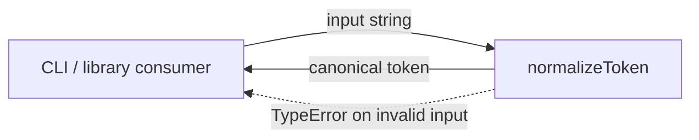
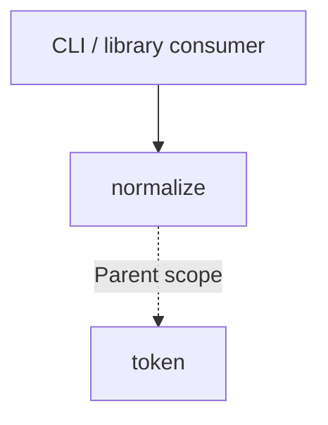

# Module: normalize

<!--SECTION:SPEC_ID-->
TOKEN-PIPELINE-NORMALIZE
<!--/SECTION:SPEC_ID-->

<!--SECTION:MODULE_VISION-->
## Module Vision
Owns deterministic token normalization for the `token` scope: one pure operation that turns an ASCII input string into a canonical lower-case hyphenated token and rejects invalid input before any side effect. Parent scope: [token](../../token.spec.md). No sibling modules, parent modules, or child modules exist in this isolated module draft.
<!--/SECTION:MODULE_VISION-->

<!--SECTION:OVERVIEW-->
## Overview


_Как один вызов normalizeToken превращает допустимый ввод в токен или завершается ошибкой — NOR-REQ-1, NOR-REQ-2._
<!--/SECTION:OVERVIEW-->

<!--SECTION:MODULE_USAGE_EXAMPLE-->
## Module Usage Example
```ts
import { normalizeToken } from "./normalize.js";

const token = normalizeToken("  Foo__BAR  ");
// token === "foo-bar"

try {
  normalizeToken("");
} catch (error) {
  if (!(error instanceof TypeError)) throw error;
  // invalid input is reported synchronously, without I/O
}
```
<!--/SECTION:MODULE_USAGE_EXAMPLE-->

<!--SECTION:MODULE_REQUIREMENTS-->
## Requirements
### NOR-REQ-1 [должен]
**Когда** передана ASCII-строка, содержащая хотя бы один символ, отличный от пробела, underscore и hyphen, **нормализатор должен** обрезать ведущие и замыкающие ASCII-пробелы, привести ASCII-буквы к нижнему регистру и свернуть последовательности пробелов, underscore и hyphen в один hyphen.
> Уточняет TOK-REQ-1 для модуля normalize; без единого детерминированного формата потребители получат разные токены для одного входа.

### NOR-REQ-2 [должен · нештатная]
**Если** вход пустой, состоит только из разделителей или содержит не-ASCII символ, **то нормализатор должен** выбросить TypeError без ввода-вывода.
> Уточняет TOK-REQ-2; ошибку нельзя маскировать пустым или искажённым токеном, иначе вызывающая сторона примет неверный ввод за нормализованный.

| Input | Outcome |
|---|---|
| `"  Foo__BAR  "` | `"foo-bar"` |
| `""` | `TypeError` |
<!--/SECTION:MODULE_REQUIREMENTS-->

<!--SECTION:INTER_MODULE_DEPENDENCIES-->
## Inter-Module Dependencies
- **Depends on:** None — this module has no sibling module dependencies.
- **Scope Reference (cross-scope):** None — the parent `token` scope supplies the contract.
- **Provides to:** `token` scope consumers (CLI and library).


_Зависимость normalize от родительского скоупа и его единственная потребительская граница._
<!--/SECTION:INTER_MODULE_DEPENDENCIES-->

<!--SECTION:ENTITY_INVENTORY-->
## Entity Inventory
_Это полный список сущностей модуля. Любое введение сущности execution-агентом помимо этого списка считается drift'ом и требует обновления spec._

| Name | Type | Purpose |
|------|------|---------|
| `normalizeToken` | Function | Нормализует допустимую ASCII-строку и отклоняет недопустимый ввод |

Ошибки: throw TypeError → `normalizeToken`

Инвентарь содержит одну сущность без связей, поэтому ER-набросок не рисуется.
<!--/SECTION:ENTITY_INVENTORY-->

<!--SECTION:ENTITY_SURFACES-->
## Entity Surfaces
Одна публичная функция покрывает всю поверхность модуля; её контракт описан ниже.

<details>
<summary>Полные поверхности сущностей</summary>

### `normalizeToken`
- **Type:** Function
- **Purpose:** Превращает допустимую ASCII-строку в канонический token и отклоняет недопустимый ввод.
- **Public Properties:** N/A
- **Public Operations:** `normalizeToken(input)` — вернуть нормализованный token или выбросить TypeError.
- **Lifecycle:** Вызывающая сторона вызывает функцию; состояние не создаётся и не завершается, вызов заканчивается возвратом значения или ошибкой.
- **Events Emitted:** N/A
- **Errors & Degradation:** `TypeError` выбрасывается синхронно самим `normalizeToken`; обработка и отображение ошибки принадлежат вызывающей стороне; ввода-вывода нет.
- **Consumers:**
  - Internal: None
  - External: CLI и библиотечные потребители
- **Usage Waiver (external: CLI и библиотечные потребители):** единственная публичная точка входа модуля; её вызовы и есть вся поверхность.

</details>
<!--/SECTION:ENTITY_SURFACES-->

<!--SECTION:MODULE_CONTRACTS-->
## Module Contracts
Модуль определяет один Service и не определяет Ports или Adapters.

Граф не рисуется: в модуле нет Port/Adapter, только Service `normalizeToken`.

Цепочка вызовов не рисуется: в инвентаре одна абстракция — `normalizeToken`.

<details>
<summary>Контракты DbC</summary>

### Services

#### Service: `normalizeToken`
- **Purpose:** Детерминированно нормализовать допустимый ASCII-ввод в канонический token.
- **Consumers:** CLI и библиотечные потребители.
- **Runtime Backing:** `not-implemented`
- **Verification Levels:** `contract`, `unit`
- **Deferred Runtime Scope:** Вся функция остаётся объявленной и не реализованной в этом authoring-черновике.

**Contract (DbC)** — одна операция:
- `normalizeToken`:
  - Pre: вход — строка, непустая, содержит хотя бы один символ, отличный от ASCII-пробела, underscore и hyphen, и состоит только из ASCII-символов.
  - Post: возвращается строка без ведущих и замыкающих ASCII-пробелов, с ASCII-буквами в нижнем регистре и каждой внутренней серией пробелов, underscore или hyphen, заменённой одним hyphen.
  - On pre-violation: синхронно выбрасывается TypeError без ввода-вывода.

**Invariants:** Функция чистая и детерминированная: одинаковый вход даёт одинаковый результат или ошибку, без состояния, ввода-вывода и внешних зависимостей.

</details>
<!--/SECTION:MODULE_CONTRACTS-->

<!--SECTION:PUBLIC_OPTIONS-->
## Public Options & Policies
Публичных опций в v1 нет: поведение полностью задано контрактом `normalizeToken`.

<details>
<summary>Опции и политики</summary>

Опции не предусмотрены и не откладываются; вызывающая сторона не настраивает нормализацию.

</details>
<!--/SECTION:PUBLIC_OPTIONS-->

<!--SECTION:FILE_STRUCTURE-->
## File Structure
```text
normalize/
├── normalize.ts
└── normalize.test.ts
```

**File Mapping:**
- `src/token/pipeline/normalize/normalize.ts`: реализация и публичный экспорт `normalizeToken`
- `src/token/pipeline/normalize/normalize.test.ts`: unit-тесты нормализации и отклонения ввода
<!--/SECTION:FILE_STRUCTURE-->

<!--SECTION:RESEARCH-->
## Research
No research documents feed this module; the deterministic contract is inherited from the parent `token` scope.
<!--/SECTION:RESEARCH-->

<!--SECTION:MODULE_DECISION_LOG-->
## Module Decision Log
Записано одно решение: чистая функция без Port/Adapter.

<details>
<summary>Полные записи Decision Log</summary>

NOR-DL-1 2026-10-24 — нормализация реализуется чистой функцией без Port/Adapter (почему: нет подтверждённой вариативности или внешней зависимости; отвергнуто: Port ради тестового шва — чистой функции шов не нужен; риск: нет).

</details>
<!--/SECTION:MODULE_DECISION_LOG-->

<!--SECTION:HANDOFF-->
## Handoff to Tasks
- **Implementation files to be created:** `src/token/pipeline/normalize/normalize.ts`
- **Test files to be created:** `src/token/pipeline/normalize/normalize.test.ts`
- **Stack dependencies:**
  - Language: `typescript` (resolves to `ai/directives/coding/typescript-rules.xml`)
  - Test framework: `node:test` (resolves to `ai/directives/testing/node-test.xml`)
- **Module Rules Additions:** None — no additions beyond the scope-wide baseline
- **Open risks & validation needs:** Реализация, тесты и runtime отсутствуют; граница определения ASCII для отклонения не-ASCII ввода требует проверки в задачах. Owner handoff остаётся pending-operator; тикеты не созданы.
<!--/SECTION:HANDOFF-->

<!--SECTION:IMPLEMENTATION_INSIGHTS-->
## Implementation Insights
Not applicable: implementation and audit-cycle compaction have not occurred, so there are no post-implementation learnings to preserve.

<details>
<summary>Заметки по реализации</summary>

No post-implementation notes exist for this authoring-only draft.

</details>
<!--/SECTION:IMPLEMENTATION_INSIGHTS-->
