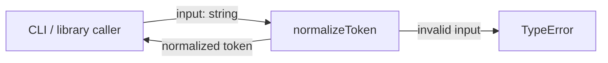
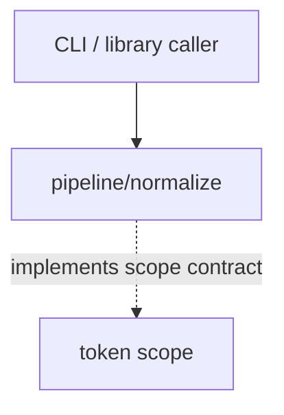

# Module: normalize

<!--SECTION:SPEC_ID-->
TOKEN-PIPELINE-NORMALIZE
<!--/SECTION:SPEC_ID-->

<!--SECTION:MODULE_VISION-->
## Module Vision

Модуль владеет единственной детерминированной операцией `normalizeToken`: привести ASCII-токен к нижнему регистру, убрать крайние ASCII-пробелы и свернуть разделители в один hyphen. Модуль не выполняет ввод-вывод, не хранит состояние и не транслитерирует Unicode.

Родительская спека: [token](../../token.spec.md). Parent/child modules отсутствуют: это единственный модуль декомпозиции `token`.
<!--/SECTION:MODULE_VISION-->

<!--SECTION:OVERVIEW-->
## Overview


_Преобразование входа в нормализованный токен и отказ на недопустимом входе — NOR-REQ-1, NOR-REQ-2._
<!--/SECTION:OVERVIEW-->

<!--SECTION:MODULE_USAGE_EXAMPLE-->
## Module Usage Example

```ts
import { normalizeToken } from "./normalize.js";

const token = normalizeToken("  Foo__BAR  ");
console.log(token);

try {
  normalizeToken("");
} catch (error) {
  console.error((error as TypeError).message);
}
```
<!--/SECTION:MODULE_USAGE_EXAMPLE-->

<!--SECTION:MODULE_REQUIREMENTS-->
## Requirements

### NOR-REQ-1 [должен]
**Когда** передана непустая ASCII-строка, содержащая хотя бы один символ, отличный от пробела, underscore и hyphen, **нормализатор должен** убрать крайние ASCII-пробелы, привести ASCII-буквы к нижнему регистру и свернуть каждую последовательность пробелов, underscore и hyphen в один hyphen.

> Уточняет TOK-REQ-1 для модуля `pipeline/normalize`: один детерминированный формат токена нужен CLI и библиотечным потребителям.

### NOR-REQ-2 [должен · нештатная]
**Если** входная строка пустая, состоит только из разделителей (пробелов, underscore и hyphen) или содержит не-ASCII символ, **то нормализатор должен** выбросить TypeError без ввода-вывода.

> Уточняет TOK-REQ-2 для модуля `pipeline/normalize`: ошибку входа нельзя маскировать пустым или искажённым токеном.

| Input | Outcome |
|---|---|
| `"  Foo__BAR  "` | `"foo-bar"` |
| `""` | `TypeError` |
<!--/SECTION:MODULE_REQUIREMENTS-->

<!--SECTION:INTER_MODULE_DEPENDENCIES-->
## Inter-Module Dependencies

- **Depends on:** None within `token`.
- **Scope Reference (cross-scope):** None; модуль реализует контракт библиотечного scope [token](../../token.spec.md).
- **Provides to:** None within `token`; внешние CLI и библиотечные потребители получают операцию через scope `token`.


_Модуль нормализации и его внешние потребители._
<!--/SECTION:INTER_MODULE_DEPENDENCIES-->

<!--SECTION:ENTITY_INVENTORY-->
## Entity Inventory

_Это полный список сущностей модуля. Любое введение сущности execution-агентом помимо этого списка считается drift'ом и требует обновления spec._

| Name | Type | Purpose |
|------|------|---------|
| `normalizeToken` | Function | Чистая функция нормализации ASCII-токена |

Ошибки: throw → `normalizeToken`

ER-эскиз не нужен: в инвентаре одна сущность, связей между сущностями нет.
<!--/SECTION:ENTITY_INVENTORY-->

<!--SECTION:ENTITY_SURFACES-->
## Entity Surfaces

Одна публичная функция `normalizeToken`; её поверхность и поведение при ошибке описаны ниже.

<details>
<summary>Полные поверхности сущностей</summary>

### `normalizeToken`
- **Type:** Function
- **Purpose:** Приводит допустимый ASCII-вход к каноническому токену.
- **Public Properties:** N/A
- **Public Operations:** нормализовать строку; отклонить пустой, separator-only или не-ASCII вход.
- **Lifecycle:** создаётся при импорте модуля как чистая функция; не имеет состояния и не завершается.
- **Events Emitted:** N/A
- **Errors & Degradation:** `TypeError` через `throw`; ошибку обрабатывает вызывающий код, модуль не выполняет ввод-вывод.
- **Consumers:**
  - Internal: none
  - External: CLI and library callers
- **Usage Waiver (external: CLI and library callers):** единственная публичная операция модуля; вынесена в отдельный модуль как именованная граница для CLI и библиотечных потребителей.

</details>
<!--/SECTION:ENTITY_SURFACES-->

<!--SECTION:MODULE_CONTRACTS-->
## Module Contracts

Модуль определяет один Service — чистую функцию `normalizeToken`; Ports и Adapters отсутствуют.

Граф не рисуется: в модуле нет Port/Adapter, только Service `normalizeToken`.

Call Chain не рисуется: в инвентаре одна абстракция (`normalizeToken`), вызывающий код и функция образуют один прямой вызов.

<details>
<summary>Контракты DbC</summary>

### Services

#### Service: `normalizeToken`
- **Purpose:** Детерминированно нормализовать ASCII-токен или явно отклонить недопустимый вход.
- **Consumers:** CLI and library callers
- **Runtime Backing:** `not-implemented`
- **Verification Levels:** `contract`, `unit`
- **Deferred Runtime Scope:** Всё заявленное поведение: реализация не создавалась.

**Contract (DbC)** — одна операция:

- `normalizeToken`:
  - Pre: вход — строка, содержащая только ASCII-символы и хотя бы один символ, отличный от пробела, underscore и hyphen.
  - Post: возвращена строка без крайних ASCII-пробелов, с ASCII-буквами в нижнем регистре и с каждой последовательностью пробелов, underscore и hyphen, заменённой одним hyphen; ввод-вывод и изменение состояния отсутствуют.
  - On pre-violation: выброшен `TypeError`; ввод-вывод отсутствует.

**Invariants:** функция чистая: результат зависит только от входа, состояние модуля не меняется, ошибка входа всегда выражается через `TypeError`.

</details>
<!--/SECTION:MODULE_CONTRACTS-->

<!--SECTION:PUBLIC_OPTIONS-->
## Public Options & Policies

Публичных опций и политик нет.

<details>
<summary>Опции и политики</summary>

No public flags, options or policies in v1; nothing is configurable or deferred to a later version.
</details>
<!--/SECTION:PUBLIC_OPTIONS-->

<!--SECTION:FILE_STRUCTURE-->
## File Structure

Планируемая модульная раскладка; в рамках этой authoring-задачи файлы не создавались.

```
normalize/
└── normalize.ts
```

**File Mapping:**
- `normalize.ts`: чистая функция `normalizeToken` и отказ через `TypeError`; Port/Adapter-слоёв нет.
<!--/SECTION:FILE_STRUCTURE-->

<!--SECTION:RESEARCH-->
## Research

Ресёрч не использовался: поведение полностью задано родительскими TOK-REQ-1 и TOK-REQ-2 и детерминированным контрактом токена.
<!--/SECTION:RESEARCH-->

<!--SECTION:MODULE_DECISION_LOG-->
## Module Decision Log

Записано одно решение: `normalizeToken` остаётся чистой функцией без Port/Adapter.

<details>
<summary>Полные записи Decision Log</summary>

NOR-DL-1 2026-10-24 — `normalizeToken` остаётся чистой функцией без Port/Adapter (почему: нет подтверждённой вариативности и тестового шва; отвергнуто: Port/Adapter — лишний слой для одной детерминированной операции; риск: внешние потребители привязываются к конкретной функции).

</details>
<!--/SECTION:MODULE_DECISION_LOG-->

<!--SECTION:HANDOFF-->
## Handoff to Tasks

- **Implementation files to be created:** `normalize.ts` (planning only; not created by this authoring pass).
- **Test files to be created:** `normalize.test.ts`.
- **Stack dependencies:**
  - Language: `typescript` (resolves to `ai/directives/coding/typescript-rules.xml`)
  - Test framework: `node-test` (resolves to `ai/directives/testing/node-test.xml`)
- **Module Rules Additions:** None.
- **Open risks & validation needs:** реализации нет, поэтому поведение TypeError, отказ на не-ASCII и separator-only входы ещё не проверены исполнением; операторское одобрение не получено, тикеты не создавались.
<!--/SECTION:HANDOFF-->

<!--SECTION:IMPLEMENTATION_INSIGHTS-->
## Implementation Insights

Not applicable: реализация не выполнялась, поэтому post-implementation learnings отсутствуют.

<details>
<summary>Заметки по реализации</summary>

No implementation notes: this artifact is an authoring-only module specification.
</details>
<!--/SECTION:IMPLEMENTATION_INSIGHTS-->
