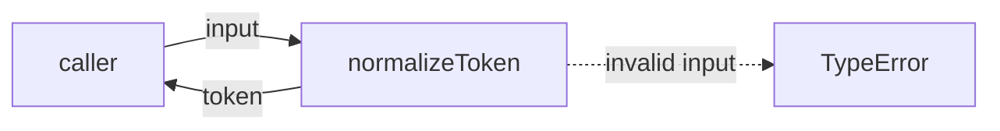
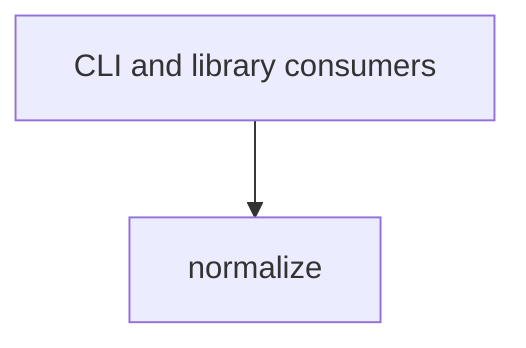

# Module: normalize

<!--SECTION:SPEC_ID-->
TOKEN-PIPELINE-NORMALIZE
<!--/SECTION:SPEC_ID-->

<!--SECTION:MODULE_VISION-->
## Module Vision
This module owns the single deterministic token-normalization operation used inside the `token` scope. It converts one input string into one canonical token and owns the rejection of unusable input; it owns no persistence, configuration, network access, or CLI parsing.

Parent scope: [token](../../token.spec.md). The scope declares one module, so this module has no siblings, parent modules, or child modules.

<!--/SECTION:MODULE_VISION-->

<!--SECTION:OVERVIEW-->
## Overview



_Путь вызова чистого нормализатора — NOR-REQ-1, NOR-REQ-2._

<!--/SECTION:OVERVIEW-->

<!--SECTION:MODULE_USAGE_EXAMPLE-->
## Module Usage Example

```ts
import { normalizeToken } from "./normalize.js";

const token = normalizeToken("  Foo__BAR  ");
console.log(token);

try {
  normalizeToken("");
} catch (error) {
  if (error instanceof TypeError) {
    console.error("invalid token");
  }
}
```

<!--/SECTION:MODULE_USAGE_EXAMPLE-->

<!--SECTION:MODULE_REQUIREMENTS-->
## Requirements

### NOR-REQ-1 [должен]
**Когда** передана ASCII-строка, которая содержит хотя бы один символ, отличный от пробела, underscore и hyphen, **нормализатор должен** обрезать крайние ASCII-пробелы, привести ASCII-буквы к lower-case и свернуть каждый прогон пробелов, underscore и hyphen в один hyphen.

> Уточняет TOK-REQ-1 для одного модуля: потребителям нужен один детерминированный формат токена без скрытого состояния.

### NOR-REQ-2 [должен · нештатная]
**Если** строка пустая, состоит только из разделителей или содержит не-ASCII символы, **то нормализатор должен** выбросить TypeError без ввода-вывода.

> Уточняет TOK-REQ-2: ошибочный вход нельзя маскировать пустым или изменённым корректным токеном.

Input/Outcome examples:

| Input | Outcome |
|---|---|
| `"  Foo__BAR  "` | `"foo-bar"` |
| `""` | `TypeError` |

<!--/SECTION:MODULE_REQUIREMENTS-->

<!--SECTION:INTER_MODULE_DEPENDENCIES-->
## Inter-Module Dependencies
- **Depends on:** None within this scope.
- **Scope Reference (cross-scope):** None at runtime; the scope depends on [infra-base](../../../infra-base/infra-base.spec.md) only for the local authoring environment.
- **Provides to:** External CLI and library consumers.



_Внешние потребители вызывают модуль; внутренних зависимостей нет._

<!--/SECTION:INTER_MODULE_DEPENDENCIES-->

<!--SECTION:ENTITY_INVENTORY-->
## Entity Inventory

_Это полный список сущностей модуля. Любое введение сущности execution-агентом помимо этого списка считается drift'ом и требует обновления spec._

| Name | Type | Purpose |
|------|------|---------|
| `normalizeToken` | Function | Pure local conversion of one input string into one canonical token. |

Ошибки: throw (TypeError) → `normalizeToken`

The inventory has one entity, so entities are not relationally connected and no ER sketch applies.

<!--/SECTION:ENTITY_INVENTORY-->

<!--SECTION:ENTITY_SURFACES-->
## Entity Surfaces
One public function surface: normalization in, canonical token out, TypeError on unusable input.

<details>
<summary>Полные поверхности сущностей</summary>

### `normalizeToken`
- **Type:** Function
- **Purpose:** Converts one input string into one lowercase, hyphen-separated token.
- **Public Properties:** N/A
- **Public Operations:**
  - Normalize one string into a canonical token.
- **Lifecycle:** Stateless pure function; created by module load and terminated when the call returns.
- **Events Emitted:** N/A
- **Errors & Degradation:** `TypeError` via throw, owned by `normalizeToken`; callers receive the rejection directly.
- **Consumers:**
  - Internal: `src/token/pipeline/normalize/normalize.ts`
  - External: CLI and library consumers of the `token` scope
- **Usage Waiver (external: CLI and library consumers):** sole public entry point of this module; every consumer call is a use.

</details>

<!--/SECTION:ENTITY_SURFACES-->

<!--SECTION:MODULE_CONTRACTS-->
## Module Contracts
One public pure function; no Ports or Adapters are defined because the module has no confirmed variability or test seam outside the function itself.

Граф не рисуется: в модуле нет Port/Adapter, только Function `normalizeToken`.

Цепочка вызовов не рисуется: в модуле одна абстракция — Function `normalizeToken`; единственный шаг вызова описан контрактом ниже.

<details>
<summary>Контракты DbC</summary>

### Services

#### Service: `normalizeToken`
- **Purpose:** Converts one string into one canonical local token.
- **Consumers:** CLI and library consumers; implementation file `src/token/pipeline/normalize/normalize.ts`.
- **Runtime Backing:** `not-implemented`
- **Verification Levels:** `contract`, `unit`
- **Deferred Runtime Scope:** None — no runtime exists in this authoring-only artifact.

**Contract (DbC)**
- `normalizeToken`:
  - Pre: input is a string containing at least one ASCII character other than space, underscore, or hyphen, and contains no non-ASCII character.
  - Post: returns a string with leading and trailing ASCII spaces removed, ASCII letters lowercased, and each run of spaces, underscores, or hyphens replaced by exactly one hyphen.
  - On pre-violation: throws `TypeError` without input/output or other side effects.

**Invariants:** The operation is deterministic and performs no I/O; equal inputs always produce equal outcomes.

</details>

<!--/SECTION:MODULE_CONTRACTS-->

<!--SECTION:PUBLIC_OPTIONS-->
## Public Options & Policies
No publicly observable options or policies exist; normalization has no configuration.

<details>
<summary>Опции и политики</summary>

No flags, options, or policies are bound to the contract, and none are deferred to a later version.

</details>

<!--/SECTION:PUBLIC_OPTIONS-->

<!--SECTION:FILE_STRUCTURE-->
## File Structure
```
normalize/
└── normalize.ts
```

**File Mapping:**
- `src/token/pipeline/normalize/normalize.ts`: `normalizeToken` implementation and its export

<!--/SECTION:FILE_STRUCTURE-->

<!--SECTION:RESEARCH-->
## Research
No research documents are registered for this module; the bounded deterministic operation cites no external research and no unregistered document exists.

<!--/SECTION:RESEARCH-->

<!--SECTION:MODULE_DECISION_LOG-->
## Module Decision Log
One decision recorded: the module deliberately uses a single pure function instead of a Port/Adapter layer.

<details>
<summary>Полные записи Decision Log</summary>

NOR-DL-1 2026-10-24 — keep one pure `normalizeToken` function and define no Port or Adapter (почему: no confirmed variability or test seam; отвергнуто: Port/Adapter layer for one deterministic function — needless abstraction; риск: none identified inside this module boundary) [verdict: pending-operator]

</details>

<!--/SECTION:MODULE_DECISION_LOG-->

<!--SECTION:HANDOFF-->
## Handoff to Tasks
- **Implementation files to be created:** `src/token/pipeline/normalize/normalize.ts`
- **Test files to be created:** `src/token/pipeline/normalize/normalize.test.ts`
- **Stack dependencies:**
  - Language: `typescript` (resolves to `ai/directives/coding/typescript-rules.xml`)
  - Test framework: `node:test` (resolves to `ai/directives/testing/node-test.xml`)
- **Module Rules Additions:** None.
- **Open risks & validation needs:** No implementation exists and no operator approval has been given; authoring remains pending. The ASCII-only rejection boundary must be verified when tasks are scaffolded.

<!--/SECTION:HANDOFF-->

<!--SECTION:IMPLEMENTATION_INSIGHTS-->
## Implementation Insights
Not applicable: no implementation exists, so no post-implementation learnings can be recorded.

<details>
<summary>Заметки по реализации</summary>

This section stays empty until a real implementation and audit cycle produce durable learnings.

</details>

<!--/SECTION:IMPLEMENTATION_INSIGHTS-->
