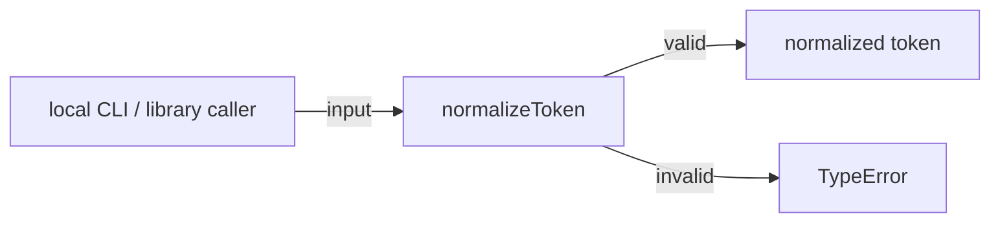
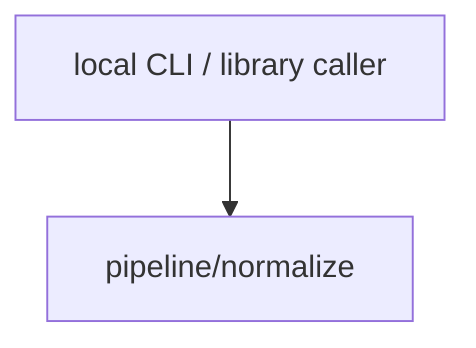

# Module: pipeline/normalize

<!--SECTION:SPEC_ID-->
TOKEN-PIPELINE-NORMALIZE
<!--/SECTION:SPEC_ID-->

<!--SECTION:MODULE_VISION-->
## Module Vision
The module owns the pure `normalizeToken` transformation for ASCII tokens inside the [`token` scope](../../token.spec.md): trimming, ASCII lowercasing, separator collapsing, and rejection of invalid input. Parent module: none. Child modules: none. Sibling modules: none.
<!--/SECTION:MODULE_VISION-->

<!--SECTION:OVERVIEW-->
## Overview

_Путь нормализации ASCII-токена и отклонения недопустимого входа — NOR-REQ-1, NOR-REQ-2._
<!--/SECTION:OVERVIEW-->

<!--SECTION:MODULE_USAGE_EXAMPLE-->
## Module Usage Example
```ts
import { normalizeToken } from "./normalize.js";

const token = normalizeToken("  Foo__BAR  ");

try {
  normalizeToken("");
} catch (error) {
  if (!(error instanceof TypeError)) {
    throw error;
  }
  console.error(error.message);
}
```
<!--/SECTION:MODULE_USAGE_EXAMPLE-->

<!--SECTION:MODULE_REQUIREMENTS-->
## Requirements
### NOR-REQ-1 [должен]
**Когда** на вход передана ASCII-строка, содержащая хотя бы один символ, отличный от пробела, underscore и hyphen, **нормализатор должен** обрезать крайние ASCII-пробелы, привести ASCII-буквы к lower-case и свернуть каждую серию ASCII-пробелов, underscore и hyphen в один hyphen, сохранив остальные ASCII-символы в исходном порядке.

> Refines TOK-REQ-1: the scope fixes the normalization intent; this module fixes the exact boundary rules, including preservation of other ASCII characters and the absence of I/O.

### NOR-REQ-2 [должен · нештатная]
**Если** входная строка пустая, состоит только из ASCII-пробелов, underscore и hyphen или содержит хотя бы один не-ASCII символ, **то нормализатор должен** выбросить TypeError и не выполнять ввод-вывод.

> Refines TOK-REQ-2: invalid input must not be masked as an empty token, and the module must stay local and deterministic.

| Input | Outcome |
|---|---|
| `"  Foo__BAR  "` | `"foo-bar"` |
| `""` | `TypeError` |
<!--/SECTION:MODULE_REQUIREMENTS-->

<!--SECTION:INTER_MODULE_DEPENDENCIES-->
## Inter-Module Dependencies
- **Depends on:** None — no sibling module exists in the `token` scope.
- **Scope Reference (cross-scope):** None — the module has no cross-scope interface dependency.
- **Provides to:** None — no sibling module consumes it; local CLI and library callers are external consumers, not scope modules.


_Модуль не имеет исходящих зависимостей и вызывается напрямую локальным потребителем._
<!--/SECTION:INTER_MODULE_DEPENDENCIES-->

<!--SECTION:ENTITY_INVENTORY-->
## Entity Inventory
| Name | Type | Purpose |
|------|------|---------|
| `normalizeToken` | Function | Pure ASCII token normalization and invalid-input rejection |

Ошибки: throw TypeError → `normalizeToken`

ER-эскиз не рисуется: в инвентаре одна сущность, связывать нечего.
<!--/SECTION:ENTITY_INVENTORY-->

<!--SECTION:ENTITY_SURFACES-->
## Entity Surfaces
The module exposes one stateless function surface; its complete contract is folded below.

<details>
<summary>Полные поверхности сущностей</summary>

### `normalizeToken`
- **Type:** Function
- **Purpose:** Normalizes an ASCII token or rejects an invalid input without side effects.
- **Public Properties:** N/A
- **Public Operations:** Normalize an input string; reject invalid input with TypeError.
- **Lifecycle:** No instance lifecycle; invoked per call and returns or throws immediately.
- **Events Emitted:** N/A
- **Errors & Degradation:** `TypeError` via throw; surfaced by the calling local CLI or library consumer, with no recovery or I/O inside the module.
- **Consumers:**
  - Internal: none
  - External: local CLI and library consumers
- **Usage Waiver (external: local CLI and library consumers):** the function is the module's sole public entry point for callers outside the module.

</details>
<!--/SECTION:ENTITY_SURFACES-->

<!--SECTION:MODULE_CONTRACTS-->
## Module Contracts
The module defines one stateless Service, `normalizeToken`; no Port or Adapter exists because there is no variability, state, or external dependency to abstract.

Граф не рисуется: в модуле нет Port/Adapter, только Service `normalizeToken`.

Цепочка вызовов не рисуется: в модуле одна абстракция, поэтому последовательности из двух и более участников нет.

<details>
<summary>Контракты DbC</summary>

### Services

#### Service: `normalizeToken`
- **Purpose:** Normalizes an ASCII token or throws TypeError for invalid input.
- **Consumers:** local CLI and library callers
- **Runtime Backing:** `not-implemented`
- **Verification Levels:** `contract`, `unit`
- **Deferred Runtime Scope:** All declared behavior — no implementation exists in this authoring round.
- **Usage Waiver (external: local CLI and library consumers):** the function is the module's sole public entry point.

**Contract (DbC)**
- `normalizeToken`:
  - Pre: `input` is a string in which every character is ASCII and at least one character is neither a space nor an underscore nor a hyphen
  - Post: returns the input with leading and trailing ASCII spaces removed, ASCII letters lowercased, each maximal run of ASCII spaces, underscores, and hyphens replaced by one hyphen, and all other ASCII characters preserved in their original order; performs no I/O
  - On pre-violation: throws TypeError without performing I/O

**Invariants:** the operation is deterministic and stateless; equal inputs always produce equal outcomes, and no I/O occurs.

</details>
<!--/SECTION:MODULE_CONTRACTS-->

<!--SECTION:PUBLIC_OPTIONS-->
## Public Options & Policies
Not applicable: `normalizeToken` exposes no publicly observable flags, options, or policies; its behavior is fixed by NOR-REQ-1 and NOR-REQ-2.
<!--/SECTION:PUBLIC_OPTIONS-->

<!--SECTION:FILE_STRUCTURE-->
## File Structure
```text
src/token/pipeline/normalize/
├── normalize.ts
└── normalize.test.ts
```

**File Mapping:**
- `normalize.ts`: the `normalizeToken` implementation
- `normalize.test.ts`: unit and contract tests for `normalizeToken`
<!--/SECTION:FILE_STRUCTURE-->

<!--SECTION:RESEARCH-->
## Research
Not applicable: no research documents feed this module; its behavior is fully specified by TOK-REQ-1 and TOK-REQ-2.
<!--/SECTION:RESEARCH-->

<!--SECTION:MODULE_DECISION_LOG-->
## Module Decision Log
One design decision is recorded: the module is a single pure function with no Port or Adapter.

<details>
<summary>Полные записи Decision Log</summary>

NOR-DL-1 2026-10-24 — Normalization is one pure stateless function with no Port or Adapter (почему: the transformation has no variability, state, or I/O; отвергнуто: Port/Adapter layering — no alternative implementation or test seam needs it; риск: a future alternative normalization needs a contract change).

</details>
<!--/SECTION:MODULE_DECISION_LOG-->

<!--SECTION:HANDOFF-->
## Handoff to Tasks
- **Implementation files to be created:** `src/token/pipeline/normalize/normalize.ts`
- **Test files to be created:** `src/token/pipeline/normalize/normalize.test.ts`
- **Stack dependencies:**
  - Language: `typescript` (resolves to `ai/directives/coding/typescript-rules.xml`)
  - Test framework: `node:test` (resolves to `ai/directives/testing/node-test.xml`)
- **Module Rules Additions:** None
- **Open risks & validation needs:** No implementation or runtime bootstrap exists; unit tests must cover trimming, ASCII lowercasing, separator collapsing, empty input, separator-only input, and non-ASCII input.
- **Owner handoff:** `pending-operator` — this specification is not approved and no task or implementation is authorized.
<!--/SECTION:HANDOFF-->

<!--SECTION:IMPLEMENTATION_INSIGHTS-->
## Implementation Insights
Not applicable: no implementation exists yet, so there are no post-implementation learnings.
<!--/SECTION:IMPLEMENTATION_INSIGHTS-->
