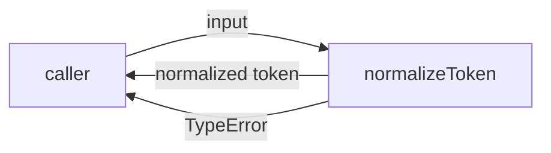
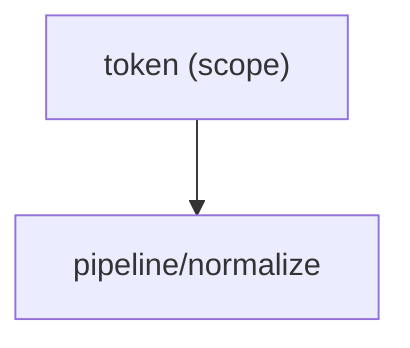

# Module: pipeline/normalize

<!--SECTION:SPEC_ID-->
TOKEN-PIPELINE-NORMALIZE
<!--/SECTION:SPEC_ID-->

<!--SECTION:MODULE_VISION-->
## Module Vision
Owns the pure `normalizeToken(input: string): string` transformation and its TypeError rejection for invalid input. Parent scope: [token](../../token.spec.md). This module has no parent or child modules; it is the single module of scope `token`.
<!--/SECTION:MODULE_VISION-->

<!--SECTION:OVERVIEW-->
## Overview

_Нормализация ASCII-токена и отказ на недопустимом вводе — NOR-REQ-1, NOR-REQ-2._
<!--/SECTION:OVERVIEW-->

<!--SECTION:MODULE_USAGE_EXAMPLE-->
## Module Usage Example
```ts
import { normalizeToken } from "./normalize.js";

const token = normalizeToken("  Foo__BAR  ");
console.log(token);

try {
  normalizeToken("");
} catch (error) {
  console.error(error instanceof TypeError ? "invalid token" : "unexpected");
}
```
<!--/SECTION:MODULE_USAGE_EXAMPLE-->

<!--SECTION:MODULE_REQUIREMENTS-->
## Requirements
### NOR-REQ-1 [должен]
**Когда** передана ASCII-строка с хотя бы одним символом, отличным от пробела, underscore и hyphen, **normalizeToken должен** обрезать крайние пробелы, привести ASCII-буквы к нижнему регистру и свернуть серии пробелов, underscore и hyphen в один hyphen.

> Уточняет TOK-REQ-1: фиксирует точную форму результата и набор разделителей на границе модуля.

### NOR-REQ-2 [должен · нештатная]
**Если** входная строка пустая, состоит только из разделителей или содержит не-ASCII символы, **то normalizeToken должен** выбросить TypeError без ввода-вывода.

> Уточняет TOK-REQ-2: недопустимый вход не должен превращаться в пустой корректный токен.

| Input | Outcome |
|---|---|
| `"  Foo__BAR  "` | `"foo-bar"` |
| `""` | `TypeError` |
<!--/SECTION:MODULE_REQUIREMENTS-->

<!--SECTION:INTER_MODULE_DEPENDENCIES-->
## Inter-Module Dependencies
- **Depends on:** None — no sibling modules inside scope `token`.
- **Scope Reference (cross-scope):** None.
- **Provides to:** None — the scope consumes the module directly.


_Положение модуля внутри скоупа._
<!--/SECTION:INTER_MODULE_DEPENDENCIES-->

<!--SECTION:ENTITY_INVENTORY-->
## Entity Inventory
_Это полный список сущностей модуля. Любое введение сущности execution-агентом помимо этого списка считается drift'ом и требует обновления spec._

| Name | Type | Purpose |
|------|------|---------|
| `normalizeToken` | Function | Чистая нормализация одного входного токена с отказом TypeError |

Ошибки: throw `TypeError` → `normalizeToken`

ER-скетч не рисуется: в инвентаре одна сущность, связывать нечего.
<!--/SECTION:ENTITY_INVENTORY-->

<!--SECTION:ENTITY_SURFACES-->
## Entity Surfaces
Одна публичная функция `normalizeToken`; ниже — её полная поверхность.

<details>
<summary>Полные поверхности сущностей</summary>

### `normalizeToken`
- **Type:** Function
- **Purpose:** Нормализует одну ASCII-строку в детерминированный токен.
- **Public Properties:** N/A
- **Public Operations:** `normalizeToken(input)` — вернуть нормализованный токен.
- **Lifecycle:** Не хранит состояния: вызывается на каждый вход и завершается.
- **Events Emitted:** N/A
- **Errors & Degradation:** `TypeError` через throw; вызывающая сторона обрабатывает его сама.
- **Consumers:**
  - Internal: N/A — нет соседних модулей.
  - External: local CLI и library consumers.
- **Usage Waiver (external: local CLI and library consumers):** Единственная публичная точка входа модуля.

</details>
<!--/SECTION:ENTITY_SURFACES-->

<!--SECTION:MODULE_CONTRACTS-->
## Module Contracts
Модуль определяет чистую Function `normalizeToken`; Port и Adapter не вводятся.

Граф не рисуется: в модуле нет Port/Adapter, только Function `normalizeToken`.

Call Chain не рисуется: в модуле одна абстракция, вызывающий код обращается к `normalizeToken` напрямую.

<details>
<summary>Контракты DbC</summary>

### Services

#### Service: `normalizeToken`
- **Purpose:** Преобразует допустимую ASCII-строку в нормализованный токен и отвергает недопустимый ввод.
- **Consumers:** local CLI и library consumers.
- **Runtime Backing:** `not-implemented`
- **Verification Levels:** `contract`, `unit`
- **Deferred Runtime Scope:** Реализация и тесты не создаются в этой задаче.

**Contract (DbC)**
- `normalizeToken(input)`:
  - Pre: вход — строка, содержащая хотя бы один символ, отличный от ASCII-пробела, underscore и hyphen, и не содержащая не-ASCII символов.
  - Post: возвращён токен без крайних пробелов, с ASCII-буквами в нижнем регистре и одиночными hyphen вместо серий пробелов, underscore и hyphen.
  - On pre-violation: выбрасывается TypeError без ввода-вывода.

**Invariants:** Результат зависит только от входа; функция не выполняет ввод-вывод и не хранит состояние.

</details>
<!--/SECTION:MODULE_CONTRACTS-->

<!--SECTION:PUBLIC_OPTIONS-->
## Public Options & Policies
Публичных опций и политик нет: поведение фиксировано контрактом `normalizeToken`.

<details>
<summary>Опции и политики</summary>

Модуль не принимает флагов или конфигурации. Любое изменение поведения требует изменения контракта `normalizeToken`, а не runtime-опции.

</details>
<!--/SECTION:PUBLIC_OPTIONS-->

<!--SECTION:FILE_STRUCTURE-->
## File Structure
```text
pipeline/normalize/
└── normalize.ts
```

**File Mapping:**
- `pipeline/normalize/normalize.ts`: функция `normalizeToken` с отказом TypeError.
<!--/SECTION:FILE_STRUCTURE-->

<!--SECTION:RESEARCH-->
## Research
No research documents are registered for this module; the draft derives from the parent scope and `docs/token-contract.md`.
<!--/SECTION:RESEARCH-->

<!--SECTION:MODULE_DECISION_LOG-->
## Module Decision Log
Одно решение: модуль остаётся чистой функцией без Port/Adapter.

<details>
<summary>Полные записи Decision Log</summary>

NOR-DL-1 2026-10-24 — модуль реализуется как чистая Function `normalizeToken` без Port/Adapter; где: specs/token/pipeline/normalize/normalize.spec.md#module-contracts (почему: детерминированное преобразование без вариативности и состояния не требует абстракции или тестового шва) [verdict: pending-operator]

</details>
<!--/SECTION:MODULE_DECISION_LOG-->

<!--SECTION:HANDOFF-->
## Handoff to Tasks
- **Implementation files to be created:** `pipeline/normalize/normalize.ts`
- **Test files to be created:** `pipeline/normalize/normalize.test.ts`
- **Stack dependencies:**
  - Language: `typescript` (resolves to `ai/directives/coding/typescript-rules.xml`)
  - Test framework: `node-test` (resolves to `ai/directives/testing/node-test.xml`)
- **Module Rules Additions:** None.
- **Open risks & validation needs:** Реализация и тесты не созданы. При реализации проверить границу ASCII, ввод только из разделителей и отсутствие ввода-вывода. Owner handoff остаётся pending-operator: Approval #1 не запрошен и не получен.
<!--/SECTION:HANDOFF-->

<!--SECTION:IMPLEMENTATION_INSIGHTS-->
## Implementation Insights
Not applicable: implementation does not exist yet; post-implementation learnings are added after audit-cycle compaction.

<details>
<summary>Заметки по реализации</summary>

No implementation insights recorded.

</details>
<!--/SECTION:IMPLEMENTATION_INSIGHTS-->
