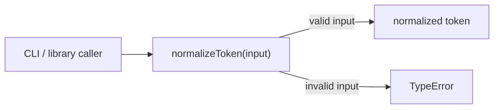
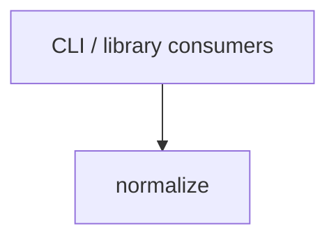

# Module: normalize

<!--SECTION:SPEC_ID-->
TOKEN-PIPELINE-NORMALIZE
<!--/SECTION:SPEC_ID-->

<!--SECTION:MODULE_VISION-->
## Module Vision

Модуль владеет детерминированной нормализацией одного строкового токена без ввода-вывода и без состояния. Он реализует библиотечный контракт скоупа [token](../../token.spec.md) и не имеет parent, child или sibling-модулей в текущей декомпозиции.
<!--/SECTION:MODULE_VISION-->

<!--SECTION:OVERVIEW-->
## Overview


_Главный путь нормализации одного токена — NOR-REQ-1._
<!--/SECTION:OVERVIEW-->

<!--SECTION:MODULE_USAGE_EXAMPLE-->
## Module Usage Example

```ts
import { normalizeToken } from "./normalize";

const token = normalizeToken("  Foo__BAR  ");
console.log(token);

try {
  normalizeToken("");
} catch (error) {
  if (error instanceof TypeError) {
    console.error("invalid token");
  }
}
```
<!--/SECTION:MODULE_USAGE_EXAMPLE-->

<!--SECTION:MODULE_REQUIREMENTS-->
## Requirements

### NOR-REQ-1 [должен]
**Когда** передана непустая ASCII-строка, содержащая хотя бы один символ, отличный от пробела, underscore и hyphen, **нормализатор должен** обрезать ведущие и замыкающие ASCII-пробелы, привести ASCII-буквы к нижнему регистру и свернуть каждую последовательность пробелов, underscore и hyphen в один hyphen.

> Реализует TOK-REQ-1: модуль фиксирует единственный детерминированный формат токена для CLI и библиотечных потребителей.

### NOR-REQ-2 [должен · нештатная]
**Если** входная строка пустая, состоит только из разделителей или содержит не-ASCII символы, **то нормализатор должен** выбросить TypeError без ввода-вывода.

> Реализует TOK-REQ-2: ошибку входа нельзя маскировать пустым корректным токеном.

| Input | Outcome |
|---|---|
| `"  Foo__BAR  "` | `"foo-bar"` |
| `""` | `TypeError` |
<!--/SECTION:MODULE_REQUIREMENTS-->

<!--SECTION:INTER_MODULE_DEPENDENCIES-->
## Inter-Module Dependencies
- **Depends on:** None — модуль не зависит от sibling-модулей.
- **Scope Reference (cross-scope):** None.
- **Provides to:** CLI и библиотечные потребители вне набора модулей; sibling-модулей нет.


_Единственный внешний потребительский вход в normalize._
<!--/SECTION:INTER_MODULE_DEPENDENCIES-->

<!--SECTION:ENTITY_INVENTORY-->
## Entity Inventory

_Это полный список сущностей модуля. Любое введение сущности execution-агентом помимо этого списка считается drift'ом и требует обновления spec._

| Name | Type | Purpose |
|------|------|---------|
| `normalizeToken` | Function | Чистая нормализация одного строкового токена |

Ошибки: throw TypeError → `normalizeToken`

ER-скетч не рисуется: в инвентаре одна сущность, связей между сущностями нет.
<!--/SECTION:ENTITY_INVENTORY-->

<!--SECTION:ENTITY_SURFACES-->
## Entity Surfaces

Одна публичная функция с чистым детерминированным поведением и единственным классовым исходом ошибки — TypeError.

<details>
<summary>Полные поверхности сущностей</summary>

### `normalizeToken`
- **Type:** Function
- **Purpose:** Преобразует одну строку в детерминированный токен.
- **Public Properties:** N/A
- **Public Operations:** `normalizeToken(input: string): string` — проверяет вход и возвращает нормализованный токен.
- **Lifecycle:** Создаётся при импорте модуля; не хранит состояние; завершение не требуется.
- **Events Emitted:** N/A
- **Errors & Degradation:** `TypeError` через throw; владелец — `normalizeToken`; потребитель обрабатывает и показывает ошибку.
- **Consumers:**
  - Internal: None — `normalizeToken` является публичной точкой входа модуля.
  - External: CLI и библиотечные потребители.
- **Usage Waiver (external: CLI и библиотечные потребители):** Единственная публичная точка входа модуля; отдельная внутренняя реализация не требуется.

</details>
<!--/SECTION:ENTITY_SURFACES-->

<!--SECTION:MODULE_CONTRACTS-->
## Module Contracts

Один чистый Service `normalizeToken`; Ports и Adapters отсутствуют, потому что подтверждённой вариативности или тестового шва нет.

Граф не рисуется: в модуле нет Port/Adapter, только Service `normalizeToken`.

Call Chain не рисуется: в инвентаре одна абстракция — Service `normalizeToken`, Port/Adapter отсутствуют.

<details>
<summary>Контракты DbC</summary>

### Services

#### Service: `normalizeToken`
- **Purpose:** Детерминированно нормализует один строковый токен.
- **Consumers:** `src/token/pipeline/normalize/normalize.ts`; CLI и библиотечные потребители.
- **Runtime Backing:** `not-implemented`
- **Verification Levels:** `contract`, `unit`
- **Deferred Runtime Scope:** Всё объявленное поведение существует только в спецификации; реализация и runtime в этой authoring-итерации не заявлены.

**Contract (DbC)** — one block per operation:
- `normalizeToken`:
  - Pre: `input` — строка; на успешном пути она непустая, не состоит только из разделителей и содержит только ASCII-символы.
  - Post: Возвращена строка с удалёнными ведущими и замыкающими ASCII-пробелами, ASCII-буквы приведены к нижнему регистру, каждая последовательность пробелов, underscore и hyphen свёрнута в один hyphen; ввод-вывод не выполняется.
  - On pre-violation: Выброшен `TypeError`; ввод-вывод не выполняется.

**Invariants:** Для одного и того же входа результат всегда один и тот же; функция не хранит состояние и не выполняет ввода-вывода.

</details>
<!--/SECTION:MODULE_CONTRACTS-->

<!--SECTION:PUBLIC_OPTIONS-->
## Public Options & Policies

Публичных флагов, опций и политик в v1 нет.

<details>
<summary>Опции и политики</summary>

Ни одна опция не объявлена и не отложена: модуль предоставляет только `normalizeToken` с фиксированным поведением.

</details>
<!--/SECTION:PUBLIC_OPTIONS-->

<!--SECTION:FILE_STRUCTURE-->
## File Structure
```
src/token/pipeline/normalize/
├── normalize.ts
└── normalize.test.ts
```

**File Mapping:**
- `src/token/pipeline/normalize/normalize.ts`: реализация `normalizeToken` и проверки входа.
- `src/token/pipeline/normalize/normalize.test.ts`: unit-тесты успешного пути и TypeError.
<!--/SECTION:FILE_STRUCTURE-->

<!--SECTION:RESEARCH-->
## Research

Ресёрч-документов нет: поведение модуля полностью задано детерминированным контрактом.
<!--/SECTION:RESEARCH-->

<!--SECTION:MODULE_DECISION_LOG-->
## Module Decision Log

Записано одно решение: чистая функция без Port/Adapter; вердикт ожидает оператора.

<details>
<summary>Полные записи Decision Log</summary>

NOR-DL-1 2026-10-24 — pure Service/function without Port or Adapter; где: specs/token/pipeline/normalize/normalize.spec.md#module-contracts (почему: одна детерминированная трансформация без подтверждённой вариативности или тестового шва) [verdict: pending-operator]

</details>
<!--/SECTION:MODULE_DECISION_LOG-->

<!--SECTION:HANDOFF-->
## Handoff to Tasks
- **Implementation files to be created:** `src/token/pipeline/normalize/normalize.ts`
- **Test files to be created:** `src/token/pipeline/normalize/normalize.test.ts`
- **Stack dependencies:**
  - Language: `typescript` (resolves to `ai/directives/coding/typescript-rules.xml`)
  - Test framework: `node-test` (resolves to `ai/directives/testing/node-test.xml`)
- **Module Rules Additions:** None — действует scope-wide baseline.
- **Open risks & validation needs:** Реализация и runtime отсутствуют; выбор TypeScript и node-test остаётся authoring-допущением для будущего scaffold. Operator approval не получен, owner handoff остаётся pending.
<!--/SECTION:HANDOFF-->

<!--SECTION:IMPLEMENTATION_INSIGHTS-->
## Implementation Insights

Not applicable — implementation отсутствует, поэтому post-implementation learnings ещё не существуют.
<!--/SECTION:IMPLEMENTATION_INSIGHTS-->
