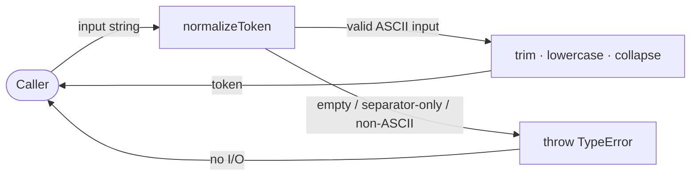
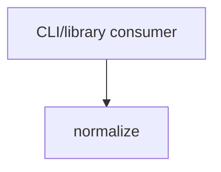

# Module: normalize

<!--SECTION:SPEC_ID-->
TOKEN-PIPELINE-NORMALIZE
<!--/SECTION:SPEC_ID-->

<!--SECTION:MODULE_VISION-->
## Module Vision
Own the pure `normalizeToken` transformation for the [`token` scope](../../token.spec.md): trim ASCII edge spaces, lowercase ASCII letters, and collapse separator runs into one hyphen, while rejecting invalid input explicitly. It implements [`TOK-REQ-1` and `TOK-REQ-2`](../../token.spec.md#REQUIREMENTS_AND_CONSTRAINTS) and is registered in the scope [`MODULE_MAP`](../../token.spec.md#MODULE_MAP). There is no parent or child module spec; `pipeline` is a grouping path, not a separate module.
<!--/SECTION:MODULE_VISION-->

<!--SECTION:OVERVIEW-->
## Overview

_Преобразование входа в токен или отказ TypeError — NOR-REQ-1, NOR-REQ-2._
<!--/SECTION:OVERVIEW-->

<!--SECTION:MODULE_USAGE_EXAMPLE-->
## Module Usage Example
```ts
import { normalizeToken } from "./pipeline/normalize/normalize";

const token: string = normalizeToken("  Foo__BAR  ");

try {
  normalizeToken("");
} catch (error) {
  if (error instanceof TypeError) {
    console.error("invalid token input");
  }
}
```
<!--/SECTION:MODULE_USAGE_EXAMPLE-->

<!--SECTION:MODULE_REQUIREMENTS-->
## Requirements
### NOR-REQ-1 [должен]
**Когда** на вход подана непустая ASCII-строка, содержащая хотя бы один символ вне пробела, underscore и hyphen, **нормализатор должен** обрезать крайние ASCII-пробелы, привести ASCII-буквы к нижнему регистру и свернуть каждую серию пробелов, underscore и hyphen в один hyphen.

> Уточняет TOK-REQ-1 для модуля normalize: один детерминированный формат токена нужен CLI и библиотечным потребителям.

### NOR-REQ-2 [должен · нештатная]
**Если** вход пустой, состоит только из разделителей (пробел, underscore, hyphen) или содержит не-ASCII символ, **то нормализатор должен** выбросить TypeError, не выполняя ввода-вывода.

> Уточняет TOK-REQ-2: ошибку входа нельзя маскировать пустым корректным токеном.

**Examples**

| Input | Outcome |
|---|---|
| `"  Foo__BAR  "` | `"foo-bar"` |
| `""` | `TypeError` |
<!--/SECTION:MODULE_REQUIREMENTS-->

<!--SECTION:INTER_MODULE_DEPENDENCIES-->
## Inter-Module Dependencies
- **Depends on:** None.
- **Scope Reference (cross-scope):** None.
- **Provides to:** None; only external CLI and library consumers use the function.


_Внешний потребитель вызывает normalize; соседних модулей нет._
<!--/SECTION:INTER_MODULE_DEPENDENCIES-->

<!--SECTION:ENTITY_INVENTORY-->
## Entity Inventory
_Это полный список сущностей модуля. Любое введение сущности execution-агентом помимо этого списка считается drift'ом и требует обновления spec._

| Name | Type | Purpose |
|------|------|---------|
| `normalizeToken` | Function | Нормализует ASCII-строку в токен или выбрасывает TypeError |

Ошибки: throw (TypeError) → normalizeToken

ER-эскиз не рисуется: единственная сущность, связывать нечего.
<!--/SECTION:ENTITY_INVENTORY-->

<!--SECTION:ENTITY_SURFACES-->
## Entity Surfaces
Одна публичная функция; её полная поверхность свёрнута ниже.

<details>
<summary>Полные поверхности сущностей</summary>

### `normalizeToken`
- **Type:** Function
- **Purpose:** Преобразует одну ASCII-строку в детерминированный токен или отвергает недопустимый вход.
- **Public Properties:** N/A
- **Public Operations:** `normalizeToken` — trim, lowercase, separator collapse.
- **Lifecycle:** Stateless module-level function; no instance is created and the caller owns each invocation.
- **Events Emitted:** N/A
- **Errors & Degradation:** `TypeError` via throw for empty, separator-only, or non-ASCII input; `normalizeToken` owns detection and the caller owns presentation.
- **Consumers:**
  - Internal: None; no sibling module consumes it.
  - External: CLI and library consumers.
- **Usage Waiver (external: CLI and library consumers):** The exported function is the module's only public surface, so its in-module usage count is intentionally one.

</details>
<!--/SECTION:ENTITY_SURFACES-->

<!--SECTION:MODULE_CONTRACTS-->
## Module Contracts
One Service function owns normalization directly; no Ports or Adapters are introduced. Граф не рисуется: в модуле нет Port/Adapter, только Service normalizeToken. Call Chain не рисуется: в инвентаре одна абстракция — normalizeToken, вызов один.

<details>
<summary>Контракты DbC</summary>

### Services

#### Service: `normalizeToken`
- **Purpose:** Нормализует одну ASCII-строку в токен или отвергает недопустимый вход.
- **Consumers:** CLI and library consumers; no sibling module.
- **Runtime Backing:** `not-implemented`
- **Verification Levels:** `contract`, `unit`
- **Deferred Runtime Scope:** All declared behavior; no implementation exists yet.

**Contract (DbC)** — one block per operation:
- `normalizeToken`:
  - Pre: `input` is a non-empty ASCII string containing at least one character outside space, underscore, and hyphen.
  - Post: Returns the string with leading and trailing ASCII spaces removed, ASCII letters lowercased, and each run of spaces, underscores, and hyphens replaced by one hyphen; performs no I/O.
  - On pre-violation: Throws `TypeError` when `input` is empty, separator-only, or contains a non-ASCII character; performs no I/O.

**Invariants:** Deterministic and pure — the same input always yields the same token or the same `TypeError`, with no I/O or retained state.

</details>
<!--/SECTION:MODULE_CONTRACTS-->

<!--SECTION:PUBLIC_OPTIONS-->
## Public Options & Policies
No configurable options or policies are exposed.

<details>
<summary>Опции и политики</summary>

None; the function has a fixed signature and no option flags or policy toggles.

</details>
<!--/SECTION:PUBLIC_OPTIONS-->

<!--SECTION:FILE_STRUCTURE-->
## File Structure
```
pipeline/
└── normalize/
    └── normalize.ts
```

**File Mapping:**
- `src/token/pipeline/normalize/normalize.ts`: `normalizeToken` implementation.
<!--/SECTION:FILE_STRUCTURE-->

<!--SECTION:RESEARCH-->
## Research
No research documents for this bounded deterministic draft.
<!--/SECTION:RESEARCH-->

<!--SECTION:MODULE_DECISION_LOG-->
## Module Decision Log
One decision records the direct pure-function contract.

<details>
<summary>Полные записи Decision Log</summary>

NOR-DL-1 2026-10-24 — keep normalization as a single pure function with no Port or Adapter (почему: one deterministic transformation has no confirmed variability or test seam; отвергнуто: a Port/Adapter layer without a second implementation; риск: a future alternate tokenization needs an explicit contract change).

</details>
<!--/SECTION:MODULE_DECISION_LOG-->

<!--SECTION:HANDOFF-->
## Handoff to Tasks
- **Implementation files to be created:** `src/token/pipeline/normalize/normalize.ts`
- **Test files to be created:** `src/token/pipeline/normalize/normalize.test.ts`
- **Stack dependencies:**
  - Language: `typescript` (resolves to `ai/directives/coding/typescript-rules.xml`)
  - Test framework: `node-test` (resolves to `ai/directives/testing/node-test.xml`)
- **Module Rules Additions:** None.
- **Open risks & validation needs:** Owner approval (Approval #1) remains pending; no implementation, tests, ticket, or execution receipt exists. The Input/Outcome examples must be verified once code is built.
<!--/SECTION:HANDOFF-->

<!--SECTION:IMPLEMENTATION_INSIGHTS-->
## Implementation Insights
Not applicable: no implementation exists yet, so there are no post-implementation learnings to preserve.
<!--/SECTION:IMPLEMENTATION_INSIGHTS-->
