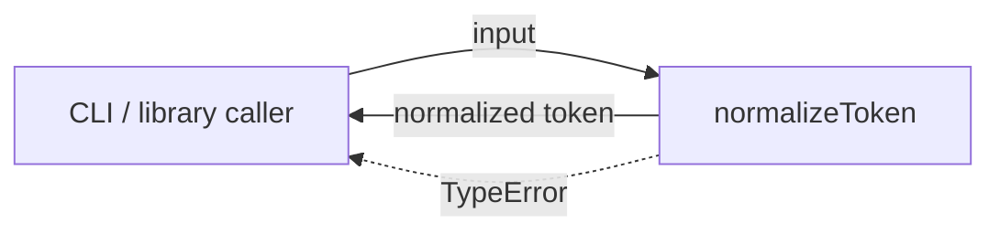
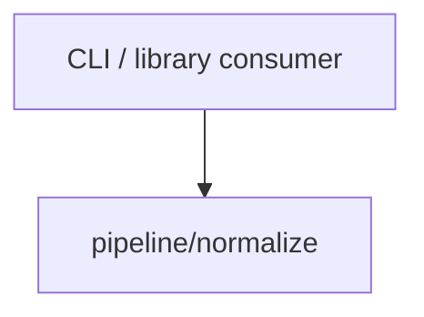

# Module: Token Normalize

<!--SECTION:SPEC_ID-->
TOKEN-PIPELINE-NORMALIZE
<!--/SECTION:SPEC_ID-->

<!--SECTION:MODULE_VISION-->
## Module Vision
Модуль владеет контрактом детерминированной нормализации токена в памяти. Он задаёт локальную операцию `normalizeToken` для CLI и библиотечных потребителей и не владеет CLI-обвязкой, вводом-выводом или хранением.

Родительский скоуп: [token](../../token.spec.md). Место в карте: [MODULE_MAP](../../token.spec.md#MODULE_MAP). Соседних, родительских и дочерних модулей нет.
<!--/SECTION:MODULE_VISION-->

<!--SECTION:OVERVIEW-->
## Overview

_Один локальный проход нормализации и отказ на недопустимом входе — NOR-REQ-1, NOR-REQ-2._
<!--/SECTION:OVERVIEW-->

<!--SECTION:MODULE_USAGE_EXAMPLE-->
## Module Usage Example
```ts
import { normalizeToken } from "./normalize.js";

const token = normalizeToken("  Foo__BAR  ");
console.log(token); // "foo-bar"

try {
  normalizeToken("");
} catch (error) {
  if (error instanceof TypeError) {
    console.error("Invalid token input");
  }
}
```
<!--/SECTION:MODULE_USAGE_EXAMPLE-->

<!--SECTION:MODULE_REQUIREMENTS-->
## Requirements
### NOR-REQ-1 [должен]
**Когда** передана непустая ASCII-строка, содержащая хотя бы один символ вне ASCII-пробела, underscore и hyphen, **нормализатор должен** обрезать крайние ASCII-пробелы, привести ASCII-буквы к нижнему регистру и свернуть каждый прогон ASCII-пробелов, underscore и hyphen в один hyphen.

> Уточняет [TOK-REQ-1](../../token.spec.md#REQUIREMENTS_AND_CONSTRAINTS): модуль фиксирует точный локальный результат нормализации, который вызывающий код получает без сетевого или дискового ввода-вывода.

### NOR-REQ-2 [должен · нештатная]
**Если** входная строка пустая, состоит только из ASCII-пробелов, underscore и hyphen или содержит не-ASCII символ, **то нормализатор должен** выбросить `TypeError` без ввода-вывода.

> Уточняет [TOK-REQ-2](../../token.spec.md#REQUIREMENTS_AND_CONSTRAINTS): недопустимый вход нельзя маскировать пустым или частично нормализованным токеном.

Примеры входа и результата:

| Input | Outcome |
|---|---|
| `"  Foo__BAR  "` | `"foo-bar"` |
| `""` | `TypeError` |
<!--/SECTION:MODULE_REQUIREMENTS-->

<!--SECTION:INTER_MODULE_DEPENDENCIES-->
## Inter-Module Dependencies
- **Depends on:** None — в скоупе token нет соседних модулей.
- **Scope Reference (cross-scope):** None — нормализация не использует кросс-скоупный контракт.
- **Provides to:** None — соседние модули не потребляют этот модуль; CLI и библиотечные вызывающие стороны внешние.


_Модуль вызывается внешним потребителем; рёбер к соседним модулям нет._
<!--/SECTION:INTER_MODULE_DEPENDENCIES-->

<!--SECTION:ENTITY_INVENTORY-->
## Entity Inventory
_Это полный список сущностей модуля. Любое введение сущности execution-агентом помимо этого списка считается drift'ом и требует обновления spec._

| Name | Type | Purpose |
|------|------|---------|
| `normalizeToken` | Function | Детерминированно нормализует строку в токен. |

Ошибки: throw (`TypeError`) → `normalizeToken`.

ER-скетч не рисуется: в inventory одна сущность, связывать нечего.
<!--/SECTION:ENTITY_INVENTORY-->

<!--SECTION:ENTITY_SURFACES-->
## Entity Surfaces
Одна публичная функция `normalizeToken`; свойства, события и жизненный цикл сведены к чистому вызову.

<details>
<summary>Полные поверхности сущностей</summary>

### `normalizeToken`
- **Type:** Function
- **Purpose:** Принимает строку и возвращает нормализованный токен либо выбрасывает `TypeError`.
- **Public Properties:** N/A
- **Public Operations:**
  - Нормализовать входную строку.
- **Lifecycle:** Вызывается по требованию, не хранит состояние и завершается возвратом значения или `TypeError`.
- **Events Emitted:** N/A
- **Errors & Degradation:** `TypeError` через throw; владелец — `normalizeToken`; ввода-вывода и fallback нет.
- **Consumers:**
  - Internal: нет; модуль состоит из одной функции.
  - External: CLI и библиотечные потребители.
- **Usage Waiver (external: CLI / library consumers):** Единственная публичная функция модуля; внешние потребители вызывают её напрямую.

</details>
<!--/SECTION:ENTITY_SURFACES-->

<!--SECTION:MODULE_CONTRACTS-->
## Module Contracts
Модуль определяет одну чистую функцию `normalizeToken`; Ports, Adapters и иные абстракции отсутствуют.

Граф не рисуется: в модуле нет Port/Adapter, только Function `normalizeToken`.

Call Chain не рисуется: в inventory одна абстракция, последовательность вызовов внутри модуля отсутствует.

<details>
<summary>Контракты DbC</summary>

### Services

#### Service: `normalizeToken`
- **Purpose:** Нормализовать входную строку в детерминированный токен.
- **Consumers:** CLI и библиотечные потребители.
- **Runtime Backing:** `not-implemented`
- **Verification Levels:** `contract`, `unit`
- **Deferred Runtime Scope:** Вся реализация отложена: код не создаётся в рамках authoring.

**Contract (DbC)**
- `normalizeToken`:
  - Pre: входная строка непустая после учёта разделителей и содержит только ASCII-символы, среди которых есть хотя бы один не-разделитель.
  - Post: возвращена строка без крайних ASCII-пробелов, с ASCII-буквами в нижнем регистре и с каждым прогоном ASCII-пробелов, underscore и hyphen, заменённым одним hyphen; для `"  Foo__BAR  "` результат — `"foo-bar"`.
  - On pre-violation: выброшен `TypeError`; ввода-вывода, частичного результата и fallback нет.

**Invariants:** Функция чистая и детерминированная: одинаковый вход даёт одинаковый результат или `TypeError`, без обращения к сети, диску и общему состоянию.

</details>
<!--/SECTION:MODULE_CONTRACTS-->

<!--SECTION:PUBLIC_OPTIONS-->
## Public Options & Policies
Публичных опций и политик нет: функция не принимает флагов и не настраивается.

<details>
<summary>Опции и политики</summary>

Не применимо: `normalizeToken` не имеет публично наблюдаемых флагов, режимов или политик; поведение полностью задано требованиями `NOR-REQ-1` и `NOR-REQ-2`.

</details>
<!--/SECTION:PUBLIC_OPTIONS-->

<!--SECTION:FILE_STRUCTURE-->
## File Structure
```
pipeline/normalize/
└── normalize.ts
```

**File Mapping:**
- `pipeline/normalize/normalize.ts`: чистая функция `normalizeToken` и проверка входных данных.
<!--/SECTION:FILE_STRUCTURE-->

<!--SECTION:RESEARCH-->
## Research
Нет зарегистрированных ресёрчей: модуль опирается только на родительский скоуп и детерминированный контракт `docs/token-contract.md`.
<!--/SECTION:RESEARCH-->

<!--SECTION:MODULE_DECISION_LOG-->
## Module Decision Log
Одна запись: чистая функция без Port/Adapter; подтверждение оператора ожидает.

<details>
<summary>Полные записи Decision Log</summary>

NOR-DL-1 2026-10-24 — Модуль предоставляет чистую функцию `normalizeToken` без Port/Adapter; где: specs/token/pipeline/normalize/normalize.spec.md#MODULE_CONTRACTS (почему: нет подтверждённой вариативности и тестового шва; отвергнуто: Port + Adapter слой; риск: замена алгоритма потребует изменения модуля) [verdict: pending-operator]

</details>
<!--/SECTION:MODULE_DECISION_LOG-->

<!--SECTION:HANDOFF-->
## Handoff to Tasks
- **Implementation files to be created:** `pipeline/normalize/normalize.ts` (в будущей задаче; этот authoring не создаёт код).
- **Test files to be created:** `pipeline/normalize/normalize.test.ts` (в будущей задаче).
- **Stack dependencies:**
  - Language: `TypeScript` (resolves to `ai/directives/coding/typescript-rules.xml`)
  - Test framework: `node-test` (resolves to `ai/directives/testing/node-test.xml`)
- **Module Rules Additions:** None

  | Rule | Category | Source |
  |------|----------|--------|
  | None | — | — |

- **Open risks & validation needs:** Реализация и тесты не созданы; поведение для separator-only и не-ASCII входов требует проверки в будущей задаче; операторское одобрение не получено.
<!--/SECTION:HANDOFF-->

<!--SECTION:IMPLEMENTATION_INSIGHTS-->
## Implementation Insights
Не применимо: реализация не создавалась, post-implementation learnings отсутствуют.
<!--/SECTION:IMPLEMENTATION_INSIGHTS-->
