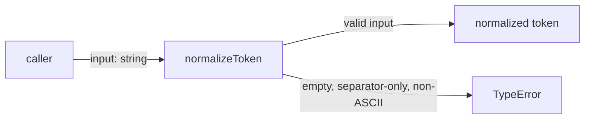
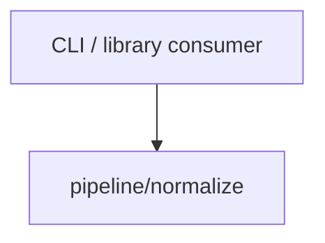

# Module: normalize

<!--SECTION:SPEC_ID-->
TOKEN-PIPELINE-NORMALIZE
<!--/SECTION:SPEC_ID-->

<!--SECTION:MODULE_VISION-->
## Module Vision
This module owns canonical token normalization inside the [token scope](../../token.spec.md): one local, deterministic `normalizeToken` function with no I/O, network, or persistence. It is the only module currently named by the [Module Map](../../token.spec.md#MODULE_MAP), has no sibling, parent, or child modules, and backs the scope's [Public API Surface](../../token.spec.md#PUBLIC_API_SURFACE).
<!--/SECTION:MODULE_VISION-->

<!--SECTION:OVERVIEW-->
## Overview

_Нормализация входа и отказ на недопустимом вводе — NOR-REQ-1, NOR-REQ-2._
<!--/SECTION:OVERVIEW-->

<!--SECTION:MODULE_USAGE_EXAMPLE-->
## Module Usage Example
```ts
import { normalizeToken } from "./pipeline/normalize";

const token = normalizeToken("  Foo__BAR  ");
console.log(token);

try {
  normalizeToken("");
} catch (error) {
  if (error instanceof TypeError) {
    console.error("input is not a valid token");
  }
}
```
<!--/SECTION:MODULE_USAGE_EXAMPLE-->

<!--SECTION:MODULE_REQUIREMENTS-->
## Requirements
### NOR-REQ-1 [должен]
**Когда** `normalizeToken` получает ASCII-строку, содержащую хотя бы один символ, отличный от пробела, underscore и hyphen, **нормализатор должен** обрезать ведущие и хвостовые ASCII-пробелы, привести ASCII-буквы к lower-case и свернуть каждый прогон пробелов, underscore и hyphen в один hyphen.
> Уточняет TOK-REQ-1 для локального детерминированного нормализатора.

### NOR-REQ-2 [должен · нештатная]
**Если** входная строка пустая, состоит только из разделителей (пробел, underscore, hyphen) или содержит не-ASCII символы, **то нормализатор должен** выбросить `TypeError` без ввода-вывода.
> Уточняет TOK-REQ-2: ошибочный вход не маскируется пустым корректным токеном.

| Input | Outcome |
|---|---|
| `"  Foo__BAR  "` | `"foo-bar"` |
| `""` | `TypeError` |
<!--/SECTION:MODULE_REQUIREMENTS-->

<!--SECTION:INTER_MODULE_DEPENDENCIES-->
## Inter-Module Dependencies
- **Depends on:** None — no sibling modules exist in scope `token`.
- **Scope Reference (cross-scope):** None — the module is local and self-contained.
- **Provides to:** None within the scope; the scope public API exposes `normalizeToken` to CLI and library consumers.


_Внешний потребитель вызывает единственный модуль скоупа; внутренних рёбер нет._
<!--/SECTION:INTER_MODULE_DEPENDENCIES-->

<!--SECTION:ENTITY_INVENTORY-->
## Entity Inventory
_Это полный список сущностей модуля. Любое введение сущности execution-агентом помимо этого списка считается drift'ом и требует обновления spec._

| Name | Type | Purpose |
|------|------|---------|
| `normalizeToken` | Function | Canonical token normalization and input rejection |

Ошибки: throw → `normalizeToken`

ER-набросок не рисуется: в модуле одна сущность, связывать нечего.
<!--/SECTION:ENTITY_INVENTORY-->

<!--SECTION:ENTITY_SURFACES-->
## Entity Surfaces
The module exposes one stateless function; its full surface is folded below.

<details>
<summary>Полные поверхности сущностей</summary>

### `normalizeToken`
- **Type:** Function
- **Purpose:** Normalize a string into the canonical lowercase token format or reject invalid input.
- **Public Properties:** N/A
- **Public Operations:** Normalize an input string to a canonical token; reject empty, separator-only, or non-ASCII input with `TypeError`.
- **Lifecycle:** Stateless and created per call; no retained state or termination step.
- **Events Emitted:** N/A
- **Errors & Degradation:** `TypeError` thrown by `normalizeToken` for empty, separator-only, or non-ASCII input; no I/O or degradation path.
- **Consumers:**
  - Internal: `pipeline/normalize/index.ts`
  - External: CLI and library consumers
- **Usage Waiver (external: CLI and library consumers):** Public API of the `token` scope despite a single production call site.

</details>
<!--/SECTION:ENTITY_SURFACES-->

<!--SECTION:MODULE_CONTRACTS-->
## Module Contracts
One stateless Service, `normalizeToken`, owns the normalization behavior; there is no Port, Adapter, or other abstraction.

Граф не рисуется: в модуле нет Port/Adapter, только Service `normalizeToken`.

Цепочка вызовов не рисуется: в модуле одна абстракция — Service `normalizeToken`.

<details>
<summary>Контракты DbC</summary>

### Services

#### Service: `normalizeToken`
- **Purpose:** Convert a valid ASCII string into a canonical lowercase hyphenated token.
- **Consumers:** `pipeline/normalize/index.ts`; CLI and library consumers.
- **Runtime Backing:** `not-implemented`
- **Verification Levels:** `contract`, `unit`
- **Deferred Runtime Scope:** All behavior; this authoring task requests no implementation.

**Contract (DbC)**
- `normalizeToken`:
  - Pre: The input is a string containing only ASCII characters and at least one character other than space, underscore, or hyphen.
  - Post: The result has leading and trailing ASCII spaces removed, ASCII letters lowercased, and every maximal run of space, underscore, or hyphen replaced by exactly one hyphen.
  - On pre-violation: Throw `TypeError` without I/O for empty, separator-only, or non-ASCII input.

**Invariants:** Deterministic and side-effect free; identical input yields an identical result, with no network, filesystem, or persistent state.

</details>
<!--/SECTION:MODULE_CONTRACTS-->

<!--SECTION:PUBLIC_OPTIONS-->
## Public Options & Policies
No public options or policies are configurable.

<details>
<summary>Опции и политики</summary>

None. The module exposes a single fixed operation, and no flag, policy, or alternate mode is bound to the contract above.

</details>
<!--/SECTION:PUBLIC_OPTIONS-->

<!--SECTION:FILE_STRUCTURE-->
## File Structure
```
pipeline/normalize/
├── normalize-token.ts
└── index.ts
```

**File Mapping:**
- `pipeline/normalize/normalize-token.ts`: `normalizeToken` implementation
- `pipeline/normalize/index.ts`: public module export
<!--/SECTION:FILE_STRUCTURE-->

<!--SECTION:RESEARCH-->
## Research
No research documents feed this module; the behavior is fully specified by the parent scope requirements.
<!--/SECTION:RESEARCH-->

<!--SECTION:MODULE_DECISION_LOG-->
## Module Decision Log
One recorded decision: the module is a pure function with no Port or Adapter.

<details>
<summary>Полные записи Decision Log</summary>

NOR-DL-1 2026-10-24 — выбрана чистая функция без Port/Adapter (почему: одна реализация и нет подтверждённой вариативности; отвергнуто: Port + Adapter — лишняя абстракция без второго потребителя; риск: нет).

</details>
<!--/SECTION:MODULE_DECISION_LOG-->

<!--SECTION:HANDOFF-->
## Handoff to Tasks
- **Status:** pending-operator — no approval, ticket creation, or execution is claimed by this draft.
- **Implementation files to be created:** Not created by this authoring task; planned as `pipeline/normalize/normalize-token.ts` and `pipeline/normalize/index.ts`.
- **Test files to be created:** Not created by this authoring task; planned as `pipeline/normalize/normalize-token.test.ts`.
- **Stack dependencies:**
  - Language: `TypeScript` (resolves to `ai/directives/coding/typescript-rules.xml`)
  - Test framework: `Vitest` (resolves to `ai/directives/testing/vitest-rules.xml`)
- **Module Rules Additions:** None.

- **Open risks & validation needs:** No implementation or runtime validation exists yet; operator approval remains pending. Non-ASCII detection must reject the whole input before any normalization.
<!--/SECTION:HANDOFF-->

<!--SECTION:IMPLEMENTATION_INSIGHTS-->
## Implementation Insights
Not applicable before implementation; no post-implementation learnings exist.

<details>
<summary>Заметки по реализации</summary>

None recorded. This authoring task creates no implementation, so there is no library wrap pattern, transaction subtlety, or fake-runtime pitfall to preserve.

</details>
<!--/SECTION:IMPLEMENTATION_INSIGHTS-->
