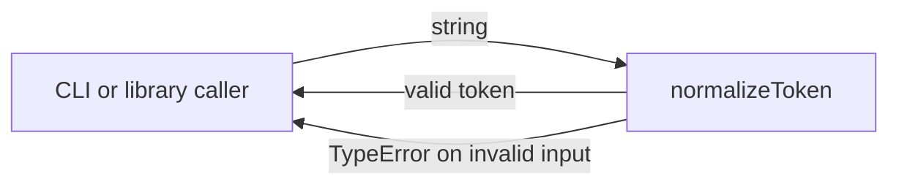
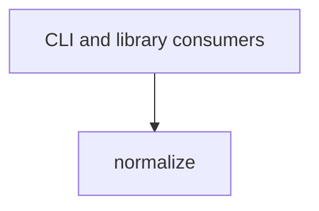

# Module: normalize

<!--SECTION:SPEC_ID-->
TOKEN-PIPELINE-NORMALIZE
<!--/SECTION:SPEC_ID-->

<!--SECTION:MODULE_VISION-->
## Module Vision
Модуль владеет единственной публичной операцией нормализации ASCII-токена для CLI и библиотечных потребителей. Он реализует часть [Scope](../../token.spec.md), заявленную в [MODULE_MAP](../../token.spec.md#MODULE_MAP), и не имеет родительских, дочерних или братских модулей в этой спеке.
<!--/SECTION:MODULE_VISION-->

<!--SECTION:OVERVIEW-->
## Overview

_Путь одного вызова нормализации с успешным и ошибочным исходом — NOR-REQ-1, NOR-REQ-2._
<!--/SECTION:OVERVIEW-->

<!--SECTION:MODULE_USAGE_EXAMPLE-->
## Module Usage Example
```ts
import { normalizeToken } from "./normalize.js";

const token = normalizeToken("  Foo__BAR  ");
console.log(token);

try {
  normalizeToken("");
} catch (error) {
  console.assert(error instanceof TypeError);
}
```
<!--/SECTION:MODULE_USAGE_EXAMPLE-->

<!--SECTION:MODULE_REQUIREMENTS-->
## Requirements
### NOR-REQ-1 [должен]
**Когда** передана ASCII-строка, которая содержит хотя бы одну ASCII-букву и не содержит символов вне ASCII-пробелов, underscore и hyphen, **нормализатор должен** обрезать крайние ASCII-пробелы, привести ASCII-буквы к нижнему регистру и заменить каждый непрерывный набор ASCII-пробелов, underscore и hyphen одним hyphen.

> Уточняет TOK-REQ-1: модуль фиксирует точный набор допустимых символов и форму результата для локального потребителя.

### NOR-REQ-2 [должен · нештатная]
**Если** вход пустой, состоит только из ASCII-пробелов, underscore и hyphen или содержит хотя бы один не-ASCII символ, **то нормализатор должен** выбросить TypeError без ввода-вывода.

> Уточняет TOK-REQ-2: явный отказ не даёт замаскировать неверный вход пустым или частичным токеном.

| Input | Outcome |
|---|---|
| `"  Foo__BAR  "` | `"foo-bar"` |
| `""` | `TypeError` |
| `"___---   "` | `TypeError` |
| `"café"` | `TypeError` |
<!--/SECTION:MODULE_REQUIREMENTS-->

<!--SECTION:INTER_MODULE_DEPENDENCIES-->
## Inter-Module Dependencies
- **Depends on:** None.
- **Scope Reference (cross-scope):** None.
- **Provides to:** External CLI and library consumers; no sibling modules.


_Модуль не зависит от братских модулей и вызывается внешними потребителями._
<!--/SECTION:INTER_MODULE_DEPENDENCIES-->

<!--SECTION:ENTITY_INVENTORY-->
## Entity Inventory
_Это полный список сущностей модуля. Любое введение сущности execution-агентом помимо этого списка считается drift'ом и требует обновления spec._

| Name | Type | Purpose |
|------|------|---------|
| `normalizeToken` | Function | Преобразует допустимую ASCII-строку в канонический токен. |

Ошибки: throw TypeError → `normalizeToken`

ER-скетч не приводится: в инвентаре одна сущность, связывать нечего.
<!--/SECTION:ENTITY_INVENTORY-->

<!--SECTION:ENTITY_SURFACES-->
## Entity Surfaces
Единственная поверхность — публичная функция `normalizeToken`; ниже её полное описание.

<details>
<summary>Полные поверхности сущностей</summary>

### `normalizeToken`
- **Type:** Function
- **Purpose:** Детерминированно приводит допустимую ASCII-строку к каноническому токену.
- **Public Properties:** N/A
- **Public Operations:** нормализовать строку в токен.
- **Lifecycle:** Вызывающий код создаёт вызов и владеет его результатом; функция не хранит состояние и завершается вместе с вызовом.
- **Events Emitted:** N/A
- **Errors & Degradation:** `TypeError` через throw для пустого, разделительного или не-ASCII входа; владелец — `normalizeToken`.
- **Consumers:**
  - Internal: `normalize.ts`
  - External: CLI and library consumers
- **Usage Waiver (external: CLI and library consumers):** Единственная публичная точка входа модуля; отдельные реализации не предусмотрены.

</details>
<!--/SECTION:ENTITY_SURFACES-->

<!--SECTION:MODULE_CONTRACTS-->
## Module Contracts
Модуль определяет один Service-контракт `normalizeToken`; Port и Adapter отсутствуют.

Граф не рисуется: в модуле нет Port/Adapter, только Service `normalizeToken`.

Цепочка вызовов не рисуется: в модуле одна сущность `normalizeToken`, нет Port/Adapter.

<details>
<summary>Контракты DbC</summary>

#### Service: `normalizeToken`
- **Purpose:** Детерминированно нормализовать допустимую ASCII-строку в канонический токен.
- **Consumers:** `normalize.ts`; внешние CLI и библиотечные потребители.
- **Runtime Backing:** `not-implemented`
- **Verification Levels:** `contract`, `unit`
- **Deferred Runtime Scope:** Всё заявленное поведение нормализации и отказа; исполняемая реализация в этой задаче не создаётся.

**Contract (DbC)**
- `normalizeToken`:
  - Pre: Вызывающий передаёт одно строковое значение; допустимое значение содержит хотя бы одну ASCII-букву и не содержит символов вне ASCII-пробелов, underscore и hyphen.
  - Post: Возвращается ASCII-токен в нижнем регистре без крайних ASCII-пробелов, где каждый непрерывный набор ASCII-пробелов, underscore и hyphen заменён одним hyphen.
  - On pre-violation: Выбрасывается `TypeError` без чтения или записи файлов, сети, переменных окружения и общего состояния.

**Invariants:** Результат зависит только от входной строки; функция не выполняет ввод-вывод и не изменяет внешнее состояние.

</details>
<!--/SECTION:MODULE_CONTRACTS-->

<!--SECTION:PUBLIC_OPTIONS-->
## Public Options & Policies
Публичных опций и политик нет.

<details>
<summary>Опции и политики</summary>

Модуль не объявляет флагов, настроек или отложенных опций в v1.

</details>
<!--/SECTION:PUBLIC_OPTIONS-->

<!--SECTION:FILE_STRUCTURE-->
## File Structure
```
normalize/
├── normalize.ts
└── normalize.test.ts
```

**File Mapping:**
- `normalize.ts`: чистая реализация `normalizeToken` (запланирована, не создана).
- `normalize.test.ts`: unit-тесты нормализации и отказов `TypeError` (запланированы, не созданы).
<!--/SECTION:FILE_STRUCTURE-->

<!--SECTION:RESEARCH-->
## Research
Not applicable: для этого ограниченного детерминированного модуля нет research-документов в `specs/token/research/`, которые нужно регистрировать.
<!--/SECTION:RESEARCH-->

<!--SECTION:MODULE_DECISION_LOG-->
## Module Decision Log
Записано одно решение: единственная чистая функция без Port/Adapter.

<details>
<summary>Полные записи Decision Log</summary>

NOR-DL-1 2026-10-24 — оставить `normalizeToken` единственным контрактом модуля без Port и Adapter (почему: одна детерминированная операция без подтверждённой вариативности; отвергнуто: Port с единственной реализацией — лишний слой; риск: будущая заменяемая реализация потребует нового решения).

</details>
<!--/SECTION:MODULE_DECISION_LOG-->

<!--SECTION:HANDOFF-->
## Handoff to Tasks
- **Status:** pending-operator
- **Operator decision:** pending
- **Implementation files to be created:** `normalize/normalize.ts` (planned; no implementation authored by this spec).
- **Test files to be created:** `normalize/normalize.test.ts` (planned; no tests authored by this spec).
- **Stack dependencies:**
  - Language: `typescript` (resolves to `ai/directives/coding/typescript-rules.xml`)
  - Test framework: `node-test` (resolves to `ai/directives/testing/node-test.xml`)
- **Module Rules Additions:** None.
- **Open risks & validation needs:** Independent semantic review and runtime validation are not performed; no tickets created and no execution approved.
<!--/SECTION:HANDOFF-->

<!--SECTION:IMPLEMENTATION_INSIGHTS-->
## Implementation Insights
Not applicable: реализация не создавалась, поэтому непостимплементационных наблюдений нет.

<details>
<summary>Заметки по реализации</summary>

No implementation insights are recorded for this authoring-only draft.

</details>
<!--/SECTION:IMPLEMENTATION_INSIGHTS-->
