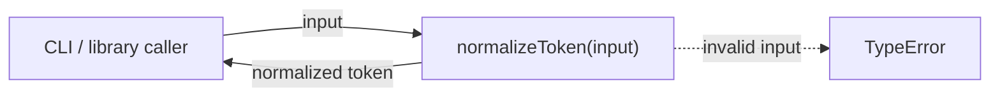
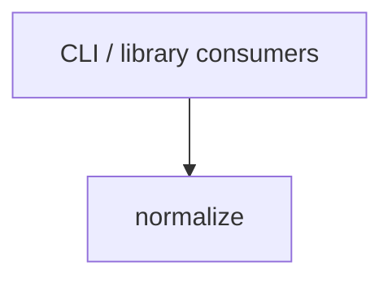

# Module: Normalize

<!--SECTION:SPEC_ID-->
TOKEN-PIPELINE-NORMALIZE
<!--/SECTION:SPEC_ID-->

<!--SECTION:MODULE_VISION-->
## Module Vision
Модуль `normalize` владеет локальной детерминированной нормализацией токена внутри скоупа [token](../../token.spec.md): единственная чистая операция `normalizeToken` без сети, персистентности и конфигурации. Отдельной parent-спеки нет: модуль зарегистрирован напрямую в [MODULE_MAP](../../token.spec.md#MODULE_MAP) скоупа; дочерних модулей нет. Реализация в этой задаче не запрашивается.
<!--/SECTION:MODULE_VISION-->

<!--SECTION:OVERVIEW-->
## Overview

_Вызов normalizeToken: валидный вход даёт нормализованный токен, невалидный — TypeError — NOR-REQ-1, NOR-REQ-2._
<!--/SECTION:OVERVIEW-->

<!--SECTION:MODULE_USAGE_EXAMPLE-->
## Module Usage Example
```ts
import { normalizeToken } from "./normalize.js";

const token = normalizeToken("  Foo__BAR  ");
console.log(token); // "foo-bar"

try {
  normalizeToken("");
} catch (error) {
  if (error instanceof TypeError) {
    console.error("invalid token input");
  }
}
```
<!--/SECTION:MODULE_USAGE_EXAMPLE-->

<!--SECTION:MODULE_REQUIREMENTS-->
## Requirements
### NOR-REQ-1 [должен]
**Когда** на вход подана непустая ASCII-строка, содержащая хотя бы один символ, отличный от пробела, underscore и hyphen, **нормализатор должен** обрезать ведущие и хвостовые ASCII-пробелы, привести ASCII-буквы к нижнему регистру и свернуть все серии пробелов, underscore и hyphen в один hyphen.

> Уточняет TOK-REQ-1 для модуля normalize: фиксирует точный набор разделителей и форму результата.

### NOR-REQ-2 [должен · нештатная]
**Если** вход пустой, состоит только из разделителей (пробел, underscore, hyphen) или содержит хотя бы один не-ASCII символ, **то нормализатор должен** выбросить TypeError без ввода-вывода.

> Уточняет TOK-REQ-2 для модуля normalize: ошибочный вход не превращается в пустой корректный токен, а побочных эффектов нет.

Проверочные сценарии `normalize-example` и `empty-input-rejection`:

| Input | Outcome |
|---|---|
| `"  Foo__BAR  "` | `"foo-bar"` |
| `""` | `TypeError` |
<!--/SECTION:MODULE_REQUIREMENTS-->

<!--SECTION:INTER_MODULE_DEPENDENCIES-->
## Inter-Module Dependencies
- **Depends on:** нет модулей внутри скоупа `token`.
- **Scope Reference (cross-scope):** нет; поведение полностью определено в [token](../../token.spec.md).
- **Provides to:** CLI и библиотечные потребители вне скоупа.


_Модуль normalize не зависит от соседних модулей и вызывается внешними потребителями._
<!--/SECTION:INTER_MODULE_DEPENDENCIES-->

<!--SECTION:ENTITY_INVENTORY-->
## Entity Inventory
_Это полный список сущностей модуля. Любое введение сущности execution-агентом помимо этого списка считается drift'ом и требует обновления spec._

| Name | Type | Purpose |
|------|------|---------|
| `normalizeToken` | Function | Нормализует токен или выбрасывает TypeError. |

Ошибки: throw → `normalizeToken`

ER-скетч не рисуется: в inventory одна сущность, связывать нечего.
<!--/SECTION:ENTITY_INVENTORY-->

<!--SECTION:ENTITY_SURFACES-->
## Entity Surfaces
Одна публичная функция `normalizeToken` без состояния; полная поверхность — ниже.

<details>
<summary>Полные поверхности сущностей</summary>

### `normalizeToken`
- **Type:** Function
- **Purpose:** Приводит валидный токен к канонической форме и отвергает невалидный вход.
- **Public Properties:** N/A
- **Public Operations:** `normalizeToken(input: string): string` — нормализует токен или выбрасывает TypeError.
- **Lifecycle:** Чистая функция; вызывается потребителем и не хранит состояние между вызовами.
- **Events Emitted:** N/A
- **Errors & Degradation:** `TypeError` через `throw`; владелец — `normalizeToken`; ввод-вывод не выполняется.
- **Consumers:**
  - Internal: нет внутренних потребителей в скоупе `token`.
  - External: CLI и библиотечные потребители.
- **Usage Waiver (external: CLI и библиотечные потребители):** Единственная публичная операция модуля; она существует как контракт для внешних потребителей, а не для внутреннего переиспользования.

</details>
<!--/SECTION:ENTITY_SURFACES-->

<!--SECTION:MODULE_CONTRACTS-->
## Module Contracts
Один чистый Function `normalizeToken`; Ports и Adapters не вводятся.

Граф не рисуется: в модуле нет Port/Adapter, только Function `normalizeToken`.

Call Chain не рисуется: в inventory одна абстракция (`normalizeToken`), сценарий вызова состоит из одного шага.

<details>
<summary>Контракты DbC</summary>

#### Service: `normalizeToken`
- **Purpose:** Нормализует ASCII-токен детерминированно и без побочных эффектов.
- **Consumers:** CLI и библиотечные потребители.
- **Runtime Backing:** `not-implemented`
- **Verification Levels:** `contract`, `unit`
- **Deferred Runtime Scope:** Вся реализация отложена: код не создаётся в этой authoring-задаче.

**Contract (DbC)**
- `normalizeToken`:
  - Pre: `input` — строка, содержащая хотя бы один ASCII-символ, отличный от пробела, underscore и hyphen, и не содержащая не-ASCII символов.
  - Post: возвращается непустая ASCII-строка без ведущих и хвостовых пробелов, с ASCII-буквами в нижнем регистре и без серий разделителей; каждая серия пробелов, underscore и hyphen заменена одним hyphen.
  - On pre-violation: выбрасывается `TypeError`; ввод-вывод не выполняется.

**Invariants:** Функция не хранит состояние и не выполняет ввод-вывод.

</details>
<!--/SECTION:MODULE_CONTRACTS-->

<!--SECTION:PUBLIC_OPTIONS-->
## Public Options & Policies
Публичных опций нет: `normalizeToken` принимает только входную строку и не читает конфигурацию или окружение.
<!--/SECTION:PUBLIC_OPTIONS-->

<!--SECTION:FILE_STRUCTURE-->
## File Structure
```
normalize/
└── normalize.ts
```

**File Mapping:**
- `normalize.ts`: экспорт `normalizeToken`.
<!--/SECTION:FILE_STRUCTURE-->

<!--SECTION:RESEARCH-->
## Research
Нет research-документов: модуль реализует уже зафиксированное в скоупе поведение без отдельного исследования.
<!--/SECTION:RESEARCH-->

<!--SECTION:MODULE_DECISION_LOG-->
## Module Decision Log
Записано одно решение: модуль сознательно обходится без Port/Adapter.

<details>
<summary>Полные записи Decision Log</summary>

NOR-DL-1 2026-10-24 — модуль обходится без Port и Adapter, поведение владеет чистая функция normalizeToken; где: specs/token/pipeline/normalize/normalize.spec.md#MODULE_CONTRACTS (почему: единственная реализация и отсутствие подтверждённой вариативности; отвергнуто: Port с единственным Adapter; риск: при появлении второй реализации потребуется рефакторинг) [verdict: pending-operator]

</details>
<!--/SECTION:MODULE_DECISION_LOG-->

<!--SECTION:HANDOFF-->
## Handoff to Tasks
- **Implementation files to be created:** `normalize/normalize.ts` (не создаётся в этой задаче)
- **Test files to be created:** `normalize/normalize.test.ts` (не создаётся в этой задаче)
- **Stack dependencies:**
  - Language: `typescript` (resolves to `ai/directives/coding/typescript-rules.xml`)
  - Test framework: `vitest` (resolves to `ai/directives/testing/vitest-rules.xml`)
- **Module Rules Additions:** None

  | Rule | Category | Source |
  |------|----------|--------|
  | None | — | — |

- **Open risks & validation needs:** Владельческий handoff остаётся `pending-operator`; реализация, тесты, тикеты и execution не созданы.
<!--/SECTION:HANDOFF-->

<!--SECTION:IMPLEMENTATION_INSIGHTS-->
## Implementation Insights
Не применимо: реализация не запрашивалась, post-implementation наблюдений нет.
<!--/SECTION:IMPLEMENTATION_INSIGHTS-->
