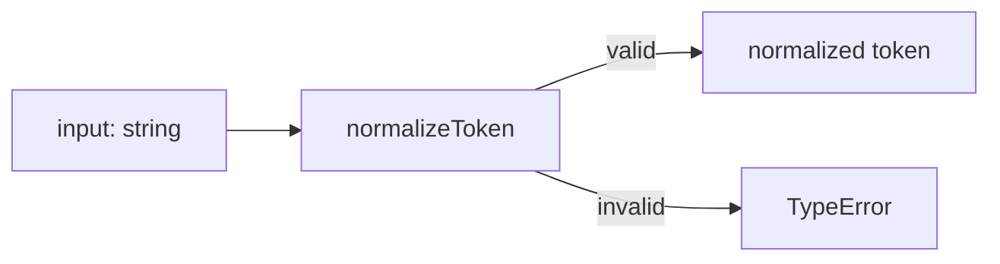
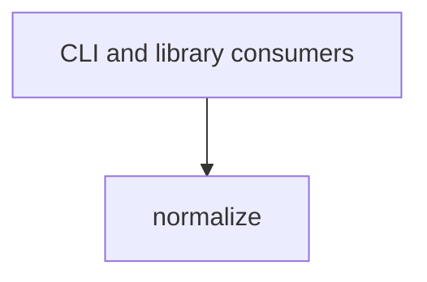

# Module: Normalize

<!--SECTION:SPEC_ID-->
TOKEN-PIPELINE-NORMALIZE
<!--/SECTION:SPEC_ID-->

<!--SECTION:MODULE_VISION-->
## Module Vision
Модуль `pipeline/normalize` владеет единственной операцией детерминированной нормализации входной строки в токен. Он реализует часть скоупа [token](../../token.spec.md), зафиксированную в [REQUIREMENTS_AND_CONSTRAINTS](../../token.spec.md#REQUIREMENTS_AND_CONSTRAINTS) и [PUBLIC_API_SURFACE](../../token.spec.md#PUBLIC_API_SURFACE), и не повторяет остальные обязанности скоупа.

Родительский модуль отсутствует: `normalize` — единственный модуль в [MODULE_MAP](../../token.spec.md#MODULE_MAP) скоупа `token`. Дочерних модулей нет; внешние потребители — локальный CLI и библиотечный код.
<!--/SECTION:MODULE_VISION-->

<!--SECTION:OVERVIEW-->
## Overview


_Путь нормализации входа в токен — NOR-REQ-1, NOR-REQ-2._
<!--/SECTION:OVERVIEW-->

<!--SECTION:MODULE_USAGE_EXAMPLE-->
## Module Usage Example
```ts
import { normalizeToken } from './normalize';

const token = normalizeToken('  Foo__BAR  ');
console.log(token);

try {
  normalizeToken('');
} catch (error) {
  if (!(error instanceof TypeError)) {
    throw error;
  }
}
```
<!--/SECTION:MODULE_USAGE_EXAMPLE-->

<!--SECTION:MODULE_REQUIREMENTS-->
## Requirements

### NOR-REQ-1 [должен]
**Когда** передана непустая ASCII-строка, содержащая хотя бы один символ, отличный от ASCII-пробела (U+0020), underscore и hyphen, **то нормализатор должен** обрезать ведущие и хвостовые ASCII-пробелы, привести ASCII-буквы `A`–`Z` к нижнему регистру и свернуть каждую последовательность ASCII-пробелов, `_` и `-` в один `-`.
> Уточняет и делает проверяемым для модуля `normalize` родительское требование TOK-REQ-1.

### NOR-REQ-2 [должен · нештатная]
**Если** входная строка пустая, состоит только из ASCII-пробелов, `_` и `-` или содержит хотя бы один не-ASCII символ, **то нормализатор должен** выбросить `TypeError` до любого файлового, сетевого или иного ввода-вывода.
> Уточняет и делает проверяемым для модуля `normalize` родительское требование TOK-REQ-2.

| Input | Outcome |
|---|---|
| `"  Foo__BAR  "` | `"foo-bar"` |
| `""` | `TypeError` |
<!--/SECTION:MODULE_REQUIREMENTS-->

<!--SECTION:INTER_MODULE_DEPENDENCIES-->
## Inter-Module Dependencies
- **Depends on:** нет модулей внутри скоупа.
- **Scope Reference (cross-scope):** нет; модуль входит в скоуп [token](../../token.spec.md).
- **Provides to:** внешние CLI- и библиотечные потребители; внутренних модулей-потребителей нет.


_Изолированный модуль без внутренних зависимостей._
<!--/SECTION:INTER_MODULE_DEPENDENCIES-->

<!--SECTION:ENTITY_INVENTORY-->
## Entity Inventory
_Это полный список сущностей модуля. Любое введение сущности execution-агентом помимо этого списка считается drift'ом и требует обновления spec._

| Name | Type | Purpose |
|------|------|---------|
| `normalizeToken` | Function | Чистая нормализация входной строки в детерминированный токен |

Ошибки: `throw TypeError` → `normalizeToken`.

ER-sketch не рисуется: в инвентаре одна сущность, связей между сущностями нет.
<!--/SECTION:ENTITY_INVENTORY-->

<!--SECTION:ENTITY_SURFACES-->
## Entity Surfaces
Единственная публичная поверхность — чистая функция `normalizeToken`; подробности ниже.

<details>
<summary>Полные поверхности сущностей</summary>

### `normalizeToken`
- **Type:** Function
- **Purpose:** Преобразует допустимую ASCII-строку в детерминированный токен и отклоняет недопустимый вход.
- **Public Properties:** N/A
- **Public Operations:** `normalizeToken` — нормализовать входную строку.
- **Lifecycle:** Вызывается потребителем при каждом преобразовании; состояние не создаётся и не сохраняется; завершается возвратом токена или выбросом `TypeError`.
- **Events Emitted:** N/A
- **Errors & Degradation:** `TypeError` механизмом `throw`; владелец — `normalizeToken`.
- **Consumers:**
  - Internal: `normalize.ts`
  - External: локальный CLI и библиотечные потребители
- **Usage Waiver (external: CLI and library consumers):** Единственный публичный экспорт модуля; это контракт для внешних потребителей, а не внутренняя абстракция.

</details>
<!--/SECTION:ENTITY_SURFACES-->

<!--SECTION:MODULE_CONTRACTS-->
## Module Contracts
Модуль определяет одну чистую функцию `normalizeToken`; Port и Adapter не вводятся.

Граф не рисуется: в модуле нет Port/Adapter, только Function `normalizeToken`.

Call Chain не рисуется: в модуле одна абстракция — Function `normalizeToken`.

<details>
<summary>Контракты DbC</summary>

### Services
#### Service: `normalizeToken`
- **Purpose:** Детерминированно нормализовать допустимую ASCII-строку в токен.
- **Consumers:** локальный CLI и библиотечные потребители; внутренних потребителей нет.
- **Runtime Backing:** `not-implemented`
- **Verification Levels:** `contract`, `unit`
- **Deferred Runtime Scope:** Вся нормализация — реализация не входит в эту спеку.

**Contract (DbC)**
- `normalizeToken`:
  - Pre: `input` — непустая ASCII-строка, содержащая хотя бы один символ, отличный от ASCII-пробела (U+0020), `_` и `-`.
  - Post: Ведущие и хвостовые ASCII-пробелы удалены; ASCII-буквы `A`–`Z` приведены к нижнему регистру; каждая последовательность ASCII-пробелов, `_` и `-` заменена одним `-`; результат не пуст, не начинается и не заканчивается на `-` и не содержит двух `-` подряд.
  - On pre-violation: Выбрасывает `TypeError` без файлового, сетевого или иного ввода-вывода.

**Invariants:** Функция не читает и не изменяет внешнее состояние, не выполняет ввода-вывода и при одинаковом входе всегда возвращает одинаковый результат.

</details>
<!--/SECTION:MODULE_CONTRACTS-->

<!--SECTION:PUBLIC_OPTIONS-->
## Public Options & Policies
Публичных опций и политик нет: контракт `normalizeToken` не имеет параметров конфигурации.

<details>
<summary>Опции и политики</summary>

Не применимо: модуль не предоставляет флагов, настроек или политик, кроме зафиксированного поведения `normalizeToken`.

</details>
<!--/SECTION:PUBLIC_OPTIONS-->

<!--SECTION:FILE_STRUCTURE-->
## File Structure
```
normalize/
├── normalize.ts
└── normalize.test.ts
```

**File Mapping:**
- `normalize.ts`: чистый экспорт `normalizeToken` — вся логика модуля.
- `normalize.test.ts`: unit-тесты NOR-REQ-1 и NOR-REQ-2.
<!--/SECTION:FILE_STRUCTURE-->

<!--SECTION:RESEARCH-->
## Research
Не применимо: research-документов для этого модуля нет; требования выведены из родительских TOK-REQ-1 и TOK-REQ-2.
<!--/SECTION:RESEARCH-->

<!--SECTION:MODULE_DECISION_LOG-->
## Module Decision Log
Записано одно решение: чистая функция без Port/Adapter.

<details>
<summary>Полные записи Decision Log</summary>

NOR-DL-1 2026-10-24 — оставить `normalizeToken` чистой функцией без Port и Adapter (почему: детерминированное локальное преобразование не имеет подтверждённой вариативности или тестового шва, оправдывающего абстракцию; отвергнуто: Port/Adapter как лишний слой; риск: при появлении альтернативных стратегий нормализации потребуется отдельное решение о расширении контракта).

</details>
<!--/SECTION:MODULE_DECISION_LOG-->

<!--SECTION:HANDOFF-->
## Handoff to Tasks
- **Implementation files to be created:** `normalize.ts`
- **Test files to be created:** `normalize.test.ts`
- **Stack dependencies:**
  - Language: `typescript` (resolves to `ai/directives/coding/typescript-rules.xml`)
  - Test framework: `node-test` (resolves to `ai/directives/testing/node-test.xml`)
- **Module Rules Additions:** None
- **Open risks & validation needs:** Текст сообщения `TypeError` не зафиксирован этой спекой; реализация не запрошена. Approval #1 остаётся `pending-operator`, тикеты не созданы.
<!--/SECTION:HANDOFF-->

<!--SECTION:IMPLEMENTATION_INSIGHTS-->
## Implementation Insights
Не применимо: реализация не запрошена, пост-имплементационных наблюдений нет.

<details>
<summary>Заметки по реализации</summary>

Не применимо до появления реализации; раздел остаётся пустым по существу.
</details>
<!--/SECTION:IMPLEMENTATION_INSIGHTS-->
