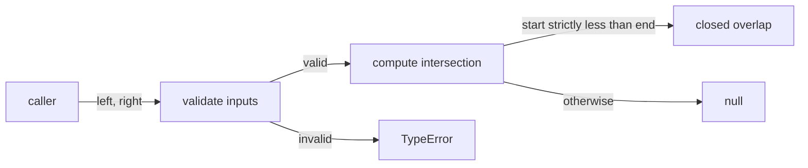
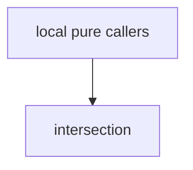

# Module: intersection

<!--SECTION:SPEC_ID-->
RANGES-INTERSECTION
<!--/SECTION:SPEC_ID-->

<!--SECTION:MODULE_VISION-->
## Module Vision
Owns only the pure intersection operation for two half-open ranges inside the `ranges` library scope. Parent scope: [ranges](../ranges.spec.md). No child modules.

Inherited domain from the parent scope: every range is an ordered pair `[start, end]` of finite safe integers with `start <= end`. Ranges are half-open: `start` is included and `end` is excluded. Empty ranges with `start = end` are valid. The module validates all inputs before returning any result. It performs no I/O and no mutation.
<!--/SECTION:MODULE_VISION-->

<!--SECTION:OVERVIEW-->
## Overview

_Путь вызова `intersectRanges` от валидации входов до результата или `TypeError` — RAN-REQ-1, RAN-REQ-2._
<!--/SECTION:OVERVIEW-->

<!--SECTION:MODULE_USAGE_EXAMPLE-->
## Module Usage Example
Planned consumer usage; the implementation is not created in this authoring phase.

```ts
import { intersectRanges } from "./intersection.ts";

const overlap = intersectRanges([-4, 2], [-1, 5]);
console.log(overlap);

try {
  intersectRanges([5, 1], [0, 9]);
} catch (error) {
  console.error(error);
}
```

| Input | Outcome |
|---|---|
| `intersectRanges([0,3],[3,6])` | `null` |
| `intersectRanges([-4,2],[-1,5])` | `[-1,2]` |
| `intersectRanges([2,2],[0,9])` | `null` |
| `intersectRanges([5,1],[0,9])` | `TypeError` |
<!--/SECTION:MODULE_USAGE_EXAMPLE-->

<!--SECTION:MODULE_REQUIREMENTS-->
## Requirements
No module-specific requirements. Implements parent requirements: RAN-REQ-1, RAN-REQ-2.
<!--/SECTION:MODULE_REQUIREMENTS-->

<!--SECTION:INTER_MODULE_DEPENDENCIES-->
## Inter-Module Dependencies
- **Depends on:** None.
- **Scope Reference (cross-scope):** None; the parent scope [ranges](../ranges.spec.md) defines the shared range domain.
- **Provides to:** local pure callers in the `ranges` scope.


_У модуля нет зависимостей от соседних модулей; единственный поток входящий — от локальных чистых вызывающих._
<!--/SECTION:INTER_MODULE_DEPENDENCIES-->

<!--SECTION:ENTITY_INVENTORY-->
## Entity Inventory

_Это полный список сущностей модуля. Любое введение сущности execution-агентом помимо этого списка считается drift'ом и требует обновления spec._

| Name | Type | Purpose |
|------|------|---------|
| `intersectRanges` | Function | Возвращает пересечение двух полуоткрытых диапазонов или `null`. |

Ошибки: throw → `intersectRanges`

ER-скетч не рисуется: в инвентаре одна сущность, связывать нечего.
<!--/SECTION:ENTITY_INVENTORY-->

<!--SECTION:ENTITY_SURFACES-->
## Entity Surfaces
Одна публичная сущность — чистая функция `intersectRanges`; Портов и Адаптеров нет.

<details>
<summary>Полные поверхности сущностей</summary>

### `intersectRanges`
- **Type:** Function
- **Purpose:** Возвращает пересечение двух полуоткрытых диапазонов или `null`, если пересечение пусто.
- **Public Properties:** N/A
- **Public Operations:** `intersectRanges(left, right)` — проверить входы и вычислить пересечение.
- **Lifecycle:** Чистая функция без состояния; существует в пределах одного вызова.
- **Events Emitted:** N/A
- **Errors & Degradation:** `TypeError` через `throw` при небезопасном целом или обратном диапазоне; владелец обработки — `intersectRanges`.
- **Consumers:**
  - Internal: нет; модуль зависит только от родительской спецификации `ranges`.
  - External: локальные чистые вызывающие в скоупе `ranges`.
- **Usage Waiver (external: local pure callers in `ranges`):** Публичная операция модуля; вызывающий использует её напрямую.

</details>
<!--/SECTION:ENTITY_SURFACES-->

<!--SECTION:MODULE_CONTRACTS-->
## Module Contracts
Одна чистая функция-сервис `intersectRanges`; Port и Adapter отсутствуют.

Граф не рисуется: в модуле нет Port/Adapter, только Service `intersectRanges`.

Call Chain не рисуется: в инвентаре одна абстракция — Function `intersectRanges`.

<details>
<summary>Контракты DbC</summary>

### Services

#### Service: `intersectRanges`
- **Purpose:** Вычислить пересечение двух полуоткрытых диапазонов после полной проверки входов.
- **Consumers:** локальные чистые вызывающие в скоупе `ranges`.
- **Runtime Backing:** `not-implemented`
- **Verification Levels:** `contract` | `unit`
- **Deferred Runtime Scope:** Всё поведение модуля; реализация в этой authoring-фазе не создана.

**Contract (DbC)**
- `intersectRanges`:
  - Pre: `left` и `right` — упорядоченные пары `[start, end]` конечных безопасных целых, где `start <= end`; пустые диапазоны `start = end` допустимы.
  - Post: Если `max(left.start, right.start)` строго меньше `min(left.end, right.end)`, возвращает `[max(left.start, right.start), min(left.end, right.end)]`; иначе возвращает `null`. Касание и пустое пересечение дают `null`. Входы не изменяются.
  - On pre-violation: Выбрасывает `TypeError`, если любая граница не является безопасным целым или диапазон обратный (`start > end`), включая случаи, когда другой диапазон пуст или диапазоны не пересекаются. Не переупорядочивает и не исправляет обратный диапазон.

**Invariants:** Все входы проверяются до любого результата; функция не выполняет I/O и не мутирует аргументы.

</details>
<!--/SECTION:MODULE_CONTRACTS-->

<!--SECTION:PUBLIC_OPTIONS-->
## Public Options & Policies
Публичных опций и политик нет.

<details>
<summary>Опции и политики</summary>

Нет флагов, опций или политик; модуль не потребляет и не откладывает настраиваемое поведение.

</details>
<!--/SECTION:PUBLIC_OPTIONS-->

<!--SECTION:FILE_STRUCTURE-->
## File Structure
Планируемая структура модуля; в authoring-фазе файлы не создаются.

```
intersection/
├── intersection.ts
└── intersection.test.ts
```

**File Mapping:**
- `intersection.ts`: планируемая реализация `intersectRanges`.
- `intersection.test.ts`: планируемые контрактные и unit-тесты для `RAN-REQ-1` и `RAN-REQ-2`.
<!--/SECTION:FILE_STRUCTURE-->

<!--SECTION:RESEARCH-->
## Research
No research documents for this module. Behavior is defined by parent requirements `RAN-REQ-1` and `RAN-REQ-2`.
<!--/SECTION:RESEARCH-->

<!--SECTION:MODULE_DECISION_LOG-->
## Module Decision Log
Решений уровня модуля нет; поведение делегировано родительским требованиям.

<details>
<summary>Полные записи Decision Log</summary>

None.

</details>
<!--/SECTION:MODULE_DECISION_LOG-->

<!--SECTION:HANDOFF-->
## Handoff to Tasks
- **Status:** pending-operator
- **Operator decision:** pending
- **Implementation files to be created:** `intersection.ts` (planned; not created).
- **Test files to be created:** `intersection.test.ts` (planned; not created).
- **Stack dependencies:**
  - Language: `typescript` (resolves to `ai/directives/coding/typescript-rules.xml`)
  - Test framework: `node-test` (resolves to `ai/directives/testing/node-test.xml`)
- **Module Rules Additions:** None.

- **Open risks & validation needs:** Операторское одобрение не получено; реализация, тесты и тикеты не созданы. Валидация должна подтвердить `TypeError` для небезопасных границ и обратных диапазонов до реализации.

No implementation, execution, or approval is claimed.
<!--/SECTION:HANDOFF-->

<!--SECTION:IMPLEMENTATION_INSIGHTS-->
## Implementation Insights
Реализация ещё не начата; пост-реализационных наблюдений нет.

<details>
<summary>Заметки по реализации</summary>

None.

</details>
<!--/SECTION:IMPLEMENTATION_INSIGHTS-->
