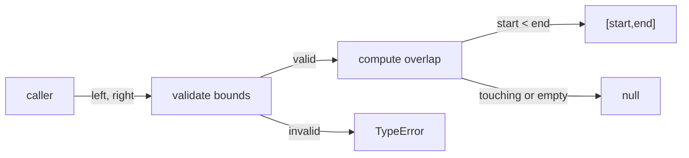
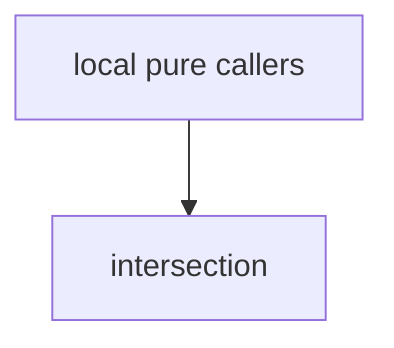

# Module: intersection

<!--SECTION:SPEC_ID-->
RANGES-INTERSECTION
<!--/SECTION:SPEC_ID-->

<!--SECTION:MODULE_VISION-->
## Module Vision

`intersection` owns the pure operation `intersectRanges` inside the [Scope](../ranges.spec.md): it decides whether two ordered half-open ranges overlap and, when they do, returns their common range. It owns no new domain behavior — the range definition, validation rule, and outcome semantics are inherited from the scope. The module is a leaf: it has no sibling modules, no child modules, and no cross-module composition.
<!--/SECTION:MODULE_VISION-->

<!--SECTION:OVERVIEW-->
## Overview


_Проверка входов и вычисление пересечения полуоткрытых диапазонов — RAN-REQ-1, RAN-REQ-2._
<!--/SECTION:OVERVIEW-->

<!--SECTION:MODULE_USAGE_EXAMPLE-->
## Module Usage Example

```ts
import { intersectRanges } from "./intersection.ts";

const overlap = intersectRanges([-4, 2], [-1, 5]);
// overlap === [-1, 2] — happy path

const touching = intersectRanges([0, 3], [3, 6]);
// touching === null — touching ranges do not overlap

try {
  intersectRanges([5, 1], [0, 9]);
} catch (error) {
  // error instanceof TypeError — reversed range is rejected, never repaired
}
```

| Input | Outcome |
|---|---|
| `intersectRanges([0,3],[3,6])` | `null` |
| `intersectRanges([-4,2],[-1,5])` | `[-1,2]` |
| `intersectRanges([2,2],[0,9])` | `null` |
| `intersectRanges([5,1],[0,9])` | `TypeError` |
<!--/SECTION:MODULE_USAGE_EXAMPLE-->

<!--SECTION:MODULE_REQUIREMENTS-->
## Requirements

No module-specific requirements. Implements parent requirements: RAN-REQ-1, RAN-REQ-2.
<!--/SECTION:MODULE_REQUIREMENTS-->

<!--SECTION:INTER_MODULE_DEPENDENCIES-->
## Inter-Module Dependencies

- **Depends on:** none within `ranges`.
- **Scope Reference (cross-scope):** none.
- **Provides to:** none within `ranges`; the operation is called directly by local pure callers.


_Единственный модуль внутри scope ranges и его локальные потребители._
<!--/SECTION:INTER_MODULE_DEPENDENCIES-->

<!--SECTION:ENTITY_INVENTORY-->
## Entity Inventory

_Это полный список сущностей модуля. Любое введение сущности execution-агентом помимо этого списка считается drift'ом и требует обновления spec._

| Name | Type | Purpose |
|------|------|---------|
| `intersectRanges` | Function | Возвращает пересечение двух полуоткрытых диапазонов или `null`. |

ER sketch не рисуется: в инвентаре одна сущность, связывать нечего.

Ошибки: throw → `intersectRanges`
<!--/SECTION:ENTITY_INVENTORY-->

<!--SECTION:ENTITY_SURFACES-->
## Entity Surfaces

Одна публичная функция без состояния: принимает два диапазона, возвращает пересечение или `null`, на недопустимом входе выбрасывает `TypeError`.

<details>
<summary>Полные поверхности сущностей</summary>

### `intersectRanges`

- **Type:** Function
- **Purpose:** Вычисляет пересечение двух полуоткрытых диапазонов или `null`, если пересечение пусто.
- **Public Properties:** N/A
- **Public Operations:** пересечение левого и правого диапазонов с проверкой входов
- **Lifecycle:** вызывается локальным потребителем; не хранит состояние и завершается сразу после возврата результата
- **Events Emitted:** N/A
- **Errors & Degradation:** `TypeError` через throw при любом недопустимом входе; владелец — `intersectRanges`, обработка остаётся на вызывающей стороне
- **Consumers:**
  - Internal: local pure callers
  - External: N/A
- **Usage Waiver:** Единственная публичная операция модуля; потребляется локальными pure-вызовами.

</details>
<!--/SECTION:ENTITY_SURFACES-->

<!--SECTION:MODULE_CONTRACTS-->
## Module Contracts

Модуль определяет один чистый Service `intersectRanges`; Ports и Adapters не вводятся, потому что вариативности и внешнего рантайма нет.

Граф не рисуется: в модуле нет Port/Adapter, только Service `intersectRanges`.

Call Chain не рисуется: в инвентаре одна абстракция — `intersectRanges`.

<details>
<summary>Контракты DbC</summary>

### Service: `intersectRanges`

- **Purpose:** Вычисляет общий полуоткрытый диапазон двух корректных диапазонов.
- **Consumers:** local pure callers
- **Runtime Backing:** `not-implemented`
- **Verification Levels:** `contract`, `unit`
- **Deferred Runtime Scope:** None

**Contract (DbC)** — one block per operation:

- `intersectRanges`:
  - Pre: `left` и `right` — упорядоченные пары `[start,end]` из конечных safe integers, где `start <= end`; пустой диапазон `start=end` допустим.
  - Post: возвращает `[max(left.start, right.start), min(left.end, right.end)]` только если его начало строго меньше конца; иначе возвращает `null`; касание и пустое пересечение дают `null`.
  - On pre-violation: выбрасывает `TypeError` при любом не-safe-integer bound или перевёрнутом диапазоне, в том числе когда другой диапазон пуст или диапазоны не пересекаются; входы не переупорядочиваются и не исправляются.

**Invariants:** не изменяет входные массивы и не выполняет I/O.

</details>
<!--/SECTION:MODULE_CONTRACTS-->

<!--SECTION:PUBLIC_OPTIONS-->
## Public Options & Policies

Публичных флагов и политик нет: сигнатура фиксирована, поведение наследуется от scope.

<details>
<summary>Опции и политики</summary>

No publicly observable flags, options, or policies are defined by this module.

</details>
<!--/SECTION:PUBLIC_OPTIONS-->

<!--SECTION:FILE_STRUCTURE-->
## File Structure

```
intersection/
└── intersection.ts
```

**File Mapping:**
- `intersection/intersection.ts`: pure `intersectRanges` operation
<!--/SECTION:FILE_STRUCTURE-->

<!--SECTION:RESEARCH-->
## Research

No research documents for this bounded module.
<!--/SECTION:RESEARCH-->

<!--SECTION:MODULE_DECISION_LOG-->
## Module Decision Log

Решений по модулю нет: поведение и границы полностью наследуются от scope.

<details>
<summary>Полные записи Decision Log</summary>

No module-level decisions recorded.

</details>
<!--/SECTION:MODULE_DECISION_LOG-->

<!--SECTION:HANDOFF-->
## Handoff to Tasks

- **Status:** pending-operator
- **Operator decision:** pending
- **Implementation files to be created:** `intersection/intersection.ts`
- **Test files to be created:** `intersection/intersection.test.ts`
- **Stack dependencies:**
  - Language: `TypeScript` (resolves to `ai/directives/coding/typescript-rules.xml`)
  - Test framework: `node-test` (resolves to `ai/directives/testing/node-test.xml`)
- **Module Rules Additions:** None — the scope-wide baseline applies unchanged.
- **Open risks & validation needs:** Operator approval is pending and no implementation, tests, tickets, or execution are authorized. The seeded `package.json` carries no TypeScript or test toolchain; confirm the TypeScript execution path and `node:test` setup at scaffold time.
<!--/SECTION:HANDOFF-->

<!--SECTION:IMPLEMENTATION_INSIGHTS-->
## Implementation Insights

Not applicable: no implementation has occurred yet, so there are no post-implementation learnings to record.

<details>
<summary>Заметки по реализации</summary>

No implementation notes yet.

</details>
<!--/SECTION:IMPLEMENTATION_INSIGHTS-->
