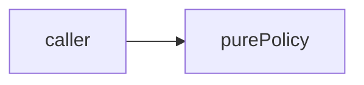

# delivery: library specification

<!--SECTION:SPEC_ID-->
DELIVERY
<!--/SECTION:SPEC_ID-->

<!--SECTION:SCOPE_TYPE-->
## scope-type
library
<!--/SECTION:SCOPE_TYPE-->

<!--SECTION:VISION-->
## Vision & Primary Goal
Pure delivery operations. All numeric inputs are finite safe integers. Attempts and maximum-attempt counts are positive. Times and delays are nonnegative. Validate all inputs before returning any result; never perform network I/O, wait, read a clock or mutate state.
<!--/SECTION:VISION-->

<!--SECTION:OVERVIEW-->
## Overview

_Local deterministic policy, no effects._
<!--/SECTION:OVERVIEW-->

<!--SECTION:GOLDEN_DX-->
## Target Experience
| Input | Outcome |
|---|---|
| `shouldRetry(1,3,503)` | `true` |
| `shouldRetry(3,3,429)` | `false` |
| `shouldRetry(1,3,408)` | `false` |
| `shouldRetry(0,3,200)` | `TypeError` |
<!--/SECTION:GOLDEN_DX-->

<!--SECTION:SCOPE_DEPENDENCIES-->
## Scope Dependencies
- **Depends on:** infra-base
- **Provides to:** local pure callers.
[Tooling](../infra-base/infra-base.spec.md)
<!--/SECTION:SCOPE_DEPENDENCIES-->

<!--SECTION:REQUIREMENTS_AND_CONSTRAINTS-->
## Requirements & Constraints
### DEL-REQ-1 [должен]
**Когда** переданы допустимые входы, **модуль должен** соблюдать контракт: Return true iff (status is 429 OR status is from 500 through 599 inclusive) AND attempt < maxAttempts. Other valid statuses return false; in particular 408 is not retryable. This entire rule is already parent-owned; introduce no new child requirement.
> Preserve the declared boundary semantics.

### DEL-REQ-2 [должен · нештатная]
**Если** входы недопустимы, **то модуль должен** выбросить TypeError. A nonpositive/non-safe-integer attempt or maxAttempts, or a status outside the integer range 100..599, throws TypeError before deciding eligibility. attempt >= maxAttempts is valid and returns false, not an input error.
> Invalid inputs are not ordinary negative results.

### Out-of-Scope
- Network, persistence, mutation and clock reads.

### Runtime & Deferred Scope
Not implemented; draft only.

### Rules
No additional activated rule set.
<!--/SECTION:REQUIREMENTS_AND_CONSTRAINTS-->

<!--SECTION:DATA_FLOW-->
## Data Flow

_Local deterministic policy, no effects._
<!--/SECTION:DATA_FLOW-->

<!--SECTION:PUBLIC_API_SURFACE-->
## Public API Surface
shouldRetry(attempt: number, maxAttempts: number, status: number): boolean
<!--/SECTION:PUBLIC_API_SURFACE-->

<!--SECTION:ARCHITECTURE-->
## Architecture
Pure functions without lifecycle, ports or adapters.

_Local deterministic policy, no effects._
<!--/SECTION:ARCHITECTURE-->

<!--SECTION:MODULE_MAP-->
## Module Map
### Modules
- [retry](retry/retry.spec.md) — planned pure operation.

### Inter-Module Dependency Map
No sibling dependencies.
<!--/SECTION:MODULE_MAP-->

<!--SECTION:RESEARCH-->
## Research
No research documents for this bounded operation.
<!--/SECTION:RESEARCH-->

<!--SECTION:DECISION_LOG-->
## Decision Log

Details

DEL-DL-1 — operator approval remains pending; no implementation authorized.

<!--/SECTION:DECISION_LOG-->

<!--SECTION:BOOTSTRAP_REQUIREMENTS-->
## Prerequisites
No external bootstrap.

Audit
The harness supplies local tooling.

<!--/SECTION:BOOTSTRAP_REQUIREMENTS-->

<!--SECTION:HANDOFF-->
## Handoff to Modules
- **Status:** pending-operator
- **Operator decision:** pending
No tickets or implementation approved.
<!--/SECTION:HANDOFF-->
