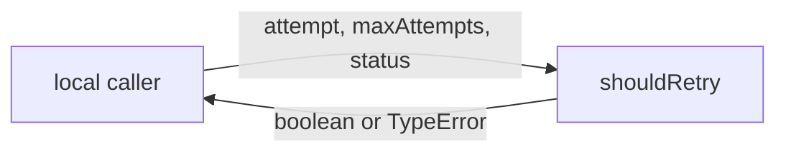
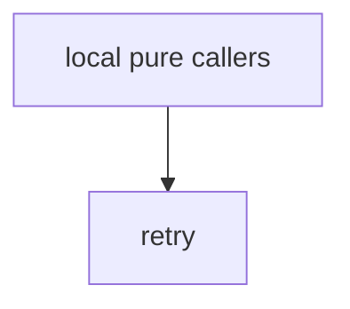

# Module: retry

<!--SECTION:SPEC_ID-->
DELIVERY-RETRY
<!--/SECTION:SPEC_ID-->

<!--SECTION:MODULE_VISION-->
## Module Vision
Модуль `retry` владеет единственной чистой проверкой права на повтор запроса. Публичная сигнатура: `shouldRetry(attempt: number, maxAttempts: number, status: number): boolean`. Поведение полностью задано родительским скоупом [delivery](../delivery.spec.md): [Requirements & Constraints](../delivery.spec.md#REQUIREMENTS_AND_CONSTRAINTS) и [Public API Surface](../delivery.spec.md#PUBLIC_API_SURFACE). Модуль входит в [Module Map](../delivery.spec.md#MODULE_MAP); соседних, родительских и дочерних модулей у него нет.
<!--/SECTION:MODULE_VISION-->

<!--SECTION:OVERVIEW-->
## Overview


_Чистая проверка права на повтор: входы валидируются, решение не имеет эффектов — DEL-REQ-1, DEL-REQ-2._
<!--/SECTION:OVERVIEW-->

<!--SECTION:MODULE_USAGE_EXAMPLE-->
## Module Usage Example
`shouldRetry` — чистая функция, инициализация не требуется.

```ts
import { shouldRetry } from "./retry.js";

const retryable = shouldRetry(1, 3, 503); // true
const notRetryable = shouldRetry(1, 3, 408); // false

try {
  shouldRetry(0, 3, 200);
} catch (error) {
  if (!(error instanceof TypeError)) throw error;
}
```

| Input | Outcome |
|---|---|
| `shouldRetry(1,3,503)` | `true` |
| `shouldRetry(3,3,429)` | `false` |
| `shouldRetry(1,3,408)` | `false` |
| `shouldRetry(0,3,200)` | `TypeError` |
<!--/SECTION:MODULE_USAGE_EXAMPLE-->

<!--SECTION:MODULE_REQUIREMENTS-->
## Requirements
No module-specific requirements. Implements parent requirements: DEL-REQ-1, DEL-REQ-2.
<!--/SECTION:MODULE_REQUIREMENTS-->

<!--SECTION:INTER_MODULE_DEPENDENCIES-->
## Inter-Module Dependencies
- **Depends on:** Нет модулей этого скоупа.
- **Scope Reference (cross-scope):** [infra-base](../../infra-base/infra-base.spec.md) — только локальный tooling авторинга, доменного контракта не добавляет.
- **Provides to:** Локальные чистые вызывающие стороны; соседних модулей нет.


_Внешних доменных зависимостей нет: единственное ребро — локальный вызов `retry`._
<!--/SECTION:INTER_MODULE_DEPENDENCIES-->

<!--SECTION:ENTITY_INVENTORY-->
## Entity Inventory

_Это полный список сущностей модуля. Любое введение сущности execution-агентом помимо этого списка считается drift'ом и требует обновления spec._

| Name | Type | Purpose |
|------|------|---------|
| `shouldRetry` | Function | Чистая проверка права на повтор по попытке, лимиту и HTTP-статусу |

Ошибки: throw `TypeError` → `shouldRetry`

ER-набросок не рисуется: в инвентаре одна сущность, связей между сущностями нет.
<!--/SECTION:ENTITY_INVENTORY-->

<!--SECTION:ENTITY_SURFACES-->
## Entity Surfaces
Единственная сущность — чистая функция `shouldRetry`; её поверхность состоит из одного вызова и одного типа ошибки.

<details>
<summary>Полные поверхности сущностей</summary>

### `shouldRetry`
- **Type:** Function
- **Purpose:** Решает, разрешён ли повтор запроса по номеру попытки, максимуму попыток и HTTP-статусу.
- **Public Properties:** N/A
- **Public Operations:** `shouldRetry(attempt, maxAttempts, status)` → `boolean`; выбрасывает `TypeError` при недопустимых входах.
- **Lifecycle:** Stateless: создаётся при импорте модуля, состояния завершения нет.
- **Events Emitted:** N/A
- **Errors & Degradation:** `TypeError` через throw до принятия решения; обработка и показ ошибки принадлежат вызывающей стороне.
- **Consumers:**
  - Internal: `src/delivery/retry/retry.ts`
  - External: локальные чистые вызывающие стороны
- **Usage Waiver (external: local pure callers):** Единственная публичная операция модуля, требуемая DEL-REQ-1 и DEL-REQ-2; не спекулятивная абстракция.

</details>
<!--/SECTION:ENTITY_SURFACES-->

<!--SECTION:MODULE_CONTRACTS-->
## Module Contracts
Модуль не вводит Port/Adapter: единственный Service — чистая функция `shouldRetry`, её DbC приведён ниже.

Граф не рисуется: в модуле нет Port/Adapter, только Service `shouldRetry`.

Call Chain не рисуется: в инвентаре одна абстракция — Service `shouldRetry`.

<details>
<summary>Контракты DbC</summary>

### Services

#### Service: `shouldRetry`
- **Purpose:** Возвращает решение о праве на повтор без каких-либо эффектов.
- **Consumers:** локальные чистые вызывающие стороны; `src/delivery/retry/retry.ts`.
- **Runtime Backing:** `not-implemented`
- **Verification Levels:** `contract`, `unit`
- **Deferred Runtime Scope:** Реализация не начата; runtime-поведение в этом черновике не заявлено.

**Contract (DbC)**
- `shouldRetry(attempt, maxAttempts, status)`:
  - Pre: `attempt` и `maxAttempts` — положительные конечные safe integers; `status` — целое число в диапазоне 100..599.
  - Post: Возвращает `true` тогда и только тогда, когда (`status` равен 429 ИЛИ `status` находится в диапазоне 500..599 включительно) И `attempt < maxAttempts`; иначе возвращает `false`, в том числе для 408.
  - On pre-violation: Выбрасывает `TypeError` до принятия решения о допустимости; `attempt >= maxAttempts` — допустимый вход и возвращает `false`, а не ошибку входа.

**Invariants**: Эффектов нет: модуль никогда не выполняет сетевой ввод-вывод, не ждёт, не читает часы и не мутирует состояние; каждый допустимый вызов возвращает `boolean`, каждый недопустимый — выбрасывает `TypeError`.

</details>
<!--/SECTION:MODULE_CONTRACTS-->

<!--SECTION:PUBLIC_OPTIONS-->
## Public Options & Policies
Публичных опций и политик нет: поведение фиксировано родительскими требованиями.

<details>
<summary>Опции и политики</summary>

Публично наблюдаемых флагов и политик нет; ничего не отложено на будущую версию.

</details>
<!--/SECTION:PUBLIC_OPTIONS-->

<!--SECTION:FILE_STRUCTURE-->
## File Structure
```
src/delivery/retry/
└── retry.ts
```

**File Mapping:**
- `src/delivery/retry/retry.ts`: `shouldRetry` и валидация его входов.
<!--/SECTION:FILE_STRUCTURE-->

<!--SECTION:RESEARCH-->
## Research
Research-документов нет: контракт полностью задан родительским скоупом [delivery](../delivery.spec.md).
<!--/SECTION:RESEARCH-->

<!--SECTION:MODULE_DECISION_LOG-->
## Module Decision Log
Решений уровня модуля нет: поведение и отсутствие Port/Adapter уже заданы родительским скоупом.

<details>
<summary>Полные записи Decision Log</summary>

Записей `RET-DL-N` нет.

</details>
<!--/SECTION:MODULE_DECISION_LOG-->

<!--SECTION:HANDOFF-->
## Handoff to Tasks
- **Status:** pending-operator
- **Operator decision:** pending
- **Implementation files to be created:** `src/delivery/retry/retry.ts`
- **Test files to be created:** `src/delivery/retry/retry.test.ts`
- **Stack dependencies:**
  - Language: `TypeScript` (resolves to `ai/directives/coding/typescript-rules.xml`)
  - Test framework: `node:test` (resolves to `ai/directives/testing/node-test.xml`)
- **Module Rules Additions:** None
- **Open risks & validation needs:** No implementation, tickets or verification claim; operator approval remains pending.
<!--/SECTION:HANDOFF-->

<!--SECTION:IMPLEMENTATION_INSIGHTS-->
## Implementation Insights
Нет: раздел пуст до появления реализации и audit-cycle compaction.

<details>
<summary>Заметки по реализации</summary>

Post-implementation learnings отсутствуют.

</details>
<!--/SECTION:IMPLEMENTATION_INSIGHTS-->
