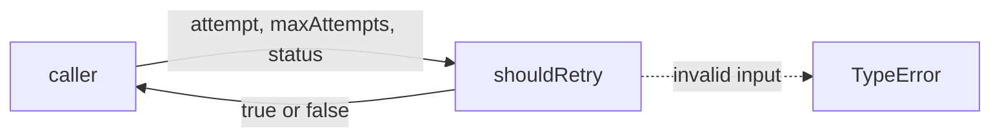
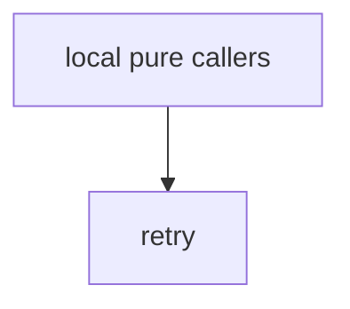

# Module: retry

<!--SECTION:SPEC_ID-->
DELIVERY-RETRY
<!--/SECTION:SPEC_ID-->

<!--SECTION:MODULE_VISION-->
## Module Vision
Модуль `retry` владеет единственной чистой операцией `shouldRetry` в скоупе [delivery](../delivery.spec.md): решает, повторять ли попытку по номеру попытки, лимиту и HTTP-статусу. Родительских и дочерних модулей нет; поведение целиком унаследовано от `DEL-REQ-1` и `DEL-REQ-2`.
<!--/SECTION:MODULE_VISION-->

<!--SECTION:OVERVIEW-->
## Overview


_Одна чистая проверка решает, повторять ли попытку — DEL-REQ-1, DEL-REQ-2._

<!--/SECTION:OVERVIEW-->

<!--SECTION:MODULE_USAGE_EXAMPLE-->
## Module Usage Example

```ts
import { shouldRetry } from './retry.ts';

const retry = shouldRetry(1, 3, 503);
if (retry) {
  // caller schedules its own retry; this module only decides eligibility
}

try {
  shouldRetry(0, 3, 200);
} catch (error) {
  if (!(error instanceof TypeError)) throw error;
}
```

| Input | Outcome |
|---|---|
| `shouldRetry(1,3,503)` | `true` |
| `shouldRetry(3,3,429)` | `false` |
| `shouldRetry(1,3,408)` | `false` |
| `shouldRetry(0,3,200)` | `TypeError` |

<!--/SECTION:MODULE_USAGE_EXAMPLE-->

<!--SECTION:MODULE_REQUIREMENTS-->
## Requirements
No module-specific requirements. Implements parent requirements: DEL-REQ-1, DEL-REQ-2.
<!--/SECTION:MODULE_REQUIREMENTS-->

<!--SECTION:INTER_MODULE_DEPENDENCIES-->
## Inter-Module Dependencies
- **Depends on:** нет — у модуля нет соседних модулей внутри скоупа.
- **Scope Reference (cross-scope):** на уровне модуля нет; родительский скоуп `delivery` ссылается на [infra-base](../../infra-base/infra-base.spec.md) как на инструментальную зависимость.
- **Provides to:** локальные чистые вызывающие стороны.


<!--/SECTION:INTER_MODULE_DEPENDENCIES-->

<!--SECTION:ENTITY_INVENTORY-->
## Entity Inventory

_Это полный список сущностей модуля. Любое введение сущности execution-агентом помимо этого списка считается drift'ом и требует обновления spec._

| Name | Type | Purpose |
|------|------|---------|
| `shouldRetry` | Function | Решает, повторять ли попытку, по номеру попытки, лимиту и HTTP-статусу |

Ошибки: throw (`TypeError`) → `shouldRetry`.

ER-набросок не рисуется: инвентарь состоит из одной несвязанной сущности.
<!--/SECTION:ENTITY_INVENTORY-->

<!--SECTION:ENTITY_SURFACES-->
## Entity Surfaces
Одна публичная функция без состояния; поверхность ограничена решением о повторе и выбросом `TypeError` на недопустимом вводе.

<details>
<summary>Полные поверхности сущностей</summary>

### `shouldRetry`
- **Type:** Function
- **Purpose:** Решает, повторять ли попытку, по номеру попытки, лимиту и HTTP-статусу.
- **Public Properties:** N/A
- **Public Operations:** решить, допустим ли повтор для переданных `attempt`, `maxAttempts` и `status`.
- **Lifecycle:** вызывающая сторона создаёт вызов; функция не хранит состояния и завершается возвратом значения или выбросом ошибки.
- **Events Emitted:** N/A
- **Errors & Degradation:** `TypeError` через throw для неположительного или небезопасного целого `attempt`/`maxAttempts` и для `status` вне диапазона 100..599; обработку ошибки владеет вызывающая сторона.
- **Consumers:**
  - Internal: локальные чистые вызывающие стороны через публичный API модуля
  - External: local pure callers
- **Usage Waiver (external: local pure callers):** Публичная точка входа библиотеки; вызывается из чистой политики доставки.

</details>
<!--/SECTION:ENTITY_SURFACES-->

<!--SECTION:MODULE_CONTRACTS-->
## Module Contracts
Портов и адаптеров нет: единственная чистая операция `shouldRetry` оформлена контрактом Service.

Граф не рисуется: в модуле нет Port/Adapter, только Service `shouldRetry`.

Цепочка вызовов не рисуется: в инвентаре меньше двух абстракций — один Service `shouldRetry`.

<details>
<summary>Контракты DbC</summary>

### Services

#### Service: `shouldRetry`
- **Purpose:** Решает, повторять ли попытку, по номеру попытки, лимиту и HTTP-статусу.
- **Consumers:** локальные чистые вызывающие стороны через публичный API модуля
- **Runtime Backing:** `not-implemented`
- **Verification Levels:** `contract`, `unit`
- **Deferred Runtime Scope:** None

**Contract (DbC)**
- `shouldRetry`:
  - Pre: `attempt` и `maxAttempts` — конечные безопасные целые положительные числа; `status` — целое число в диапазоне 100..599 включительно.
  - Post: возвращает `true` тогда и только тогда, когда `status` равен 429 или лежит в 500..599 включительно, и при этом `attempt < maxAttempts`; для остальных допустимых входов возвращает `false`, в частности для 408.
  - On pre-violation: выбрасывает `TypeError` до принятия решения о допустимости повтора.

**Invariants:** функция чистая — не выполняет сетевой ввод-вывод, не ждёт, не читает часы и не изменяет состояние; для допустимых входов результат детерминирован.

</details>
<!--/SECTION:MODULE_CONTRACTS-->

<!--SECTION:PUBLIC_OPTIONS-->
## Public Options & Policies
Публичных опций и политик нет.

<details>
<summary>Опции и политики</summary>

Нет флагов, опций или конфигурируемых политик; повтор полностью определяется аргументами `shouldRetry`.

</details>
<!--/SECTION:PUBLIC_OPTIONS-->

<!--SECTION:FILE_STRUCTURE-->
## File Structure
```
retry/
├── retry.ts
└── retry.test.ts
```

**File Mapping:**
- `retry/retry.ts`: чистая функция `shouldRetry`
- `retry/retry.test.ts`: контрактные и модульные проверки `shouldRetry`
<!--/SECTION:FILE_STRUCTURE-->

<!--SECTION:RESEARCH-->
## Research
No research documents.
<!--/SECTION:RESEARCH-->

<!--SECTION:MODULE_DECISION_LOG-->
## Module Decision Log
Записей нет: границы и поведение модуля заданы родительским скоупом.

<details>
<summary>Полные записи Decision Log</summary>

No module-level decisions recorded.

</details>
<!--/SECTION:MODULE_DECISION_LOG-->

<!--SECTION:HANDOFF-->
## Handoff to Tasks
- **Implementation files to be created:** `retry/retry.ts`
- **Test files to be created:** `retry/retry.test.ts`
- **Stack dependencies:**
  - Language: `typescript` (resolves to `ai/directives/coding/typescript-rules.xml`)
  - Test framework: `node-test` (resolves to `ai/directives/testing/node-test.xml`)
- **Module Rules Additions:** None.

  | Rule | Category | Source |
  |------|----------|--------|
  | None | - | - |

- **Open risks & validation needs:** Реализация и runtime-проверка ещё не выполнены.
- **Status:** pending-operator
- **Operator decision:** pending
No tickets or implementation approved.
<!--/SECTION:HANDOFF-->

<!--SECTION:IMPLEMENTATION_INSIGHTS-->
## Implementation Insights
Реализация ещё не начата; пост-имплементационных наблюдений нет.

<details>
<summary>Заметки по реализации</summary>

No implementation insights yet.

</details>
<!--/SECTION:IMPLEMENTATION_INSIGHTS-->
