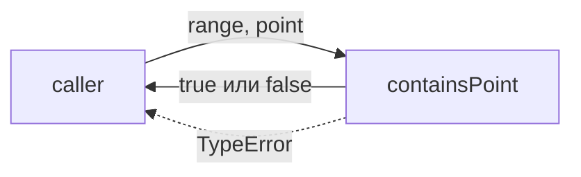
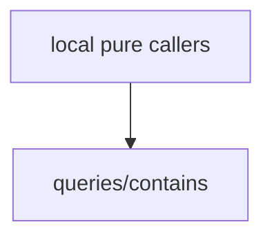

# Module: queries/contains

<!--SECTION:SPEC_ID-->
RANGES-QUERIES-CONTAINS
<!--/SECTION:SPEC_ID-->

<!--SECTION:MODULE_VISION-->
## Module Vision

`queries/contains` владеет одной чистой операцией проверки принадлежности точки полуоткрытому диапазону. Родительская спека — [ranges](../../ranges.spec.md); модуль реализует [REQUIREMENTS_AND_CONSTRAINTS](../../ranges.spec.md#REQUIREMENTS_AND_CONSTRAINTS) и занимает место в [MODULE_MAP](../../ranges.spec.md#MODULE_MAP). Соседних, родительских и дочерних модулей внутри скоупа нет.
<!--/SECTION:MODULE_VISION-->

<!--SECTION:OVERVIEW-->
## Overview


_Один чистый вызов: членство либо TypeError — CON-REQ-1, CON-REQ-2._
<!--/SECTION:OVERVIEW-->

<!--SECTION:MODULE_USAGE_EXAMPLE-->
## Module Usage Example

```ts
import { containsPoint } from './contains.js';

const inside: boolean = containsPoint([2, 5], 2);
const outside: boolean = containsPoint([2, 5], 5);

try {
  containsPoint([2, 5], 2.5);
} catch (error) {
  if (error instanceof TypeError) {
    // invalid point rejected before any membership result
  }
}
```

| Input | Outcome |
|---|---|
| `containsPoint([2,5],2)` | `true` |
| `containsPoint([2,5],5)` | `false` |
| `containsPoint([2,2],2)` | `false` |
| `containsPoint([2,5],2.5)` | `TypeError` |
<!--/SECTION:MODULE_USAGE_EXAMPLE-->

<!--SECTION:MODULE_REQUIREMENTS-->
## Requirements

### CON-REQ-1 [должен]
**Когда** переданы допустимые `range` и `point`, **containsPoint должен** вернуть `true` ровно при `start <= point` и `point < end`, а для пустого диапазона и для допустимой точки вне диапазона вернуть `false`.

> Уточняет RAN-REQ-1: полуоткрытая граница и пустой диапазон остаются наследованными, а локальный положительный исход задан здесь; без него принадлежность трактовалась бы произвольно.

### CON-REQ-2 [должен · нештатная]
**Если** `range` не является упорядоченной парой `[start,end]` конечных безопасных целых с `start <= end` или `point` не является конечным безопасным целым, **то containsPoint должен** выбросить `TypeError` даже тогда, когда принадлежность иначе была бы `false`.

> Уточняет RAN-REQ-2: недопустимый вход — не обычный отрицательный результат; проверка выполняется до любого результата, поэтому `TypeError` не зависит от того, что сказала бы проверка принадлежности.
<!--/SECTION:MODULE_REQUIREMENTS-->

<!--SECTION:INTER_MODULE_DEPENDENCIES-->
## Inter-Module Dependencies

- **Depends on:** None.
- **Scope Reference (cross-scope):** None.
- **Provides to:** None — the operation is consumed by local pure callers.


_Модуль вызывается локальными чистыми вызывающими; связей с соседними модулями нет._
<!--/SECTION:INTER_MODULE_DEPENDENCIES-->

<!--SECTION:ENTITY_INVENTORY-->
## Entity Inventory

_Это полный список сущностей модуля. Любое введение сущности execution-агентом помимо этого списка считается drift'ом и требует обновления spec._

| Name | Type | Purpose |
|------|------|---------|
| `containsPoint` | Function | Returns whether a point lies in a half-open range, or throws TypeError on invalid input |

Ошибки: throw `TypeError` → `containsPoint`

Одна сущность — ER-скетч не требуется: связей между сущностями нет.
<!--/SECTION:ENTITY_INVENTORY-->

<!--SECTION:ENTITY_SURFACES-->
## Entity Surfaces

Одна чистая функция `containsPoint`: проверка принадлежности и отказ `TypeError` на недопустимом входе.

<details>
<summary>Полные поверхности сущностей</summary>

### `containsPoint`

- **Type:** Function
- **Purpose:** Определяет принадлежность точки полуоткрытому диапазону и отвергает недопустимые входы.
- **Public Properties:** N/A
- **Public Operations:** `containsPoint(range, point)` — проверка принадлежности точки диапазону.
- **Lifecycle:** Чистая функция без создания и завершения; вызывающий владеет вызовом.
- **Events Emitted:** N/A
- **Errors & Degradation:** `TypeError` через `throw`; владелец — `containsPoint`, обработка остаётся у вызывающего кода.
- **Consumers:**
  - Internal: `queries/contains/contains.ts`
  - External: local pure callers
- **Usage Waiver (external: local pure callers):** единственная публичная операция модуля, существующая ради вызывающего кода.

</details>
<!--/SECTION:ENTITY_SURFACES-->

<!--SECTION:MODULE_CONTRACTS-->
## Module Contracts

Модуль определяет одну чистую функцию `containsPoint`; Port и Adapter не вводятся.

Граф не рисуется: в модуле нет Port/Adapter, только Function `containsPoint`.

Call Chain не рисуется: в модуле одна абстракция — Function `containsPoint`.

<details>
<summary>Контракты DbC</summary>

#### Service: `containsPoint`

- **Purpose:** Проверяет принадлежность точки полуоткрытому диапазону и отвергает недопустимые входы.
- **Consumers:** local pure callers
- **Runtime Backing:** `not-implemented`
- **Verification Levels:** `contract`, `unit`
- **Deferred Runtime Scope:** None

**Contract (DbC)** — one block per operation:

- `containsPoint`:
  - Pre: `range` is an ordered pair `[start,end]` of finite safe integers with `start <= end`, and `point` is a finite safe integer.
  - Post: returns `true` exactly when `start <= point` and `point < end`; an empty range or a valid point outside the range returns `false`.
  - On pre-violation: throws `TypeError`, even when membership would otherwise be `false`.

</details>
<!--/SECTION:MODULE_CONTRACTS-->

<!--SECTION:PUBLIC_OPTIONS-->
## Public Options & Policies

Публичных опций и политик нет.

<details>
<summary>Опции и политики</summary>

Нет публично наблюдаемых флагов, опций или политик; ничего не отложено на будущие версии.

</details>
<!--/SECTION:PUBLIC_OPTIONS-->

<!--SECTION:FILE_STRUCTURE-->
## File Structure

```
queries/contains/
├── contains.spec.md
└── contains.ts
```

**File Mapping:**
- `queries/contains/contains.ts`: pure `containsPoint` implementation (to be created by a task)
- `queries/contains/contains.spec.md`: this specification
<!--/SECTION:FILE_STRUCTURE-->

<!--SECTION:RESEARCH-->
## Research

No research documents for this module.
<!--/SECTION:RESEARCH-->

<!--SECTION:MODULE_DECISION_LOG-->
## Module Decision Log

Одна запись: единственная операция реализуется чистой функцией без Port/Adapter.

<details>
<summary>Полные записи Decision Log</summary>

CON-DL-1 2026-10-25 — единственная операция модуля остаётся чистой Function без Port/Adapter (почему: у неё нет изменяемой зависимости и подтверждённой вариативности; отвергнуто: Port ради тестового шва без второго поведения; риск: будущая подмена реализации потребует нового контракта).

</details>
<!--/SECTION:MODULE_DECISION_LOG-->

<!--SECTION:HANDOFF-->
## Handoff to Tasks

- **Implementation files to be created:** `queries/contains/contains.ts`
- **Test files to be created:** `queries/contains/contains.test.ts`
- **Stack dependencies:**
  - Language: `typescript` (resolves to `ai/directives/coding/typescript-rules.xml`)
  - Test framework: `node-test` (resolves to `ai/directives/testing/node-test.xml`)
- **Module Rules Additions:** None.
- **Open risks & validation needs:** Спека остаётся `pending-operator`; Approval #1 не запрошено; реализация, тикеты и выполнение не начаты.
<!--/SECTION:HANDOFF-->

<!--SECTION:IMPLEMENTATION_INSIGHTS-->
## Implementation Insights

Постымплементационных наблюдений нет — модуль не реализован.

<details>
<summary>Заметки по реализации</summary>

Наблюдения появятся после реализации и аудита; текущий документ фиксирует только контракт.

</details>
<!--/SECTION:IMPLEMENTATION_INSIGHTS-->
