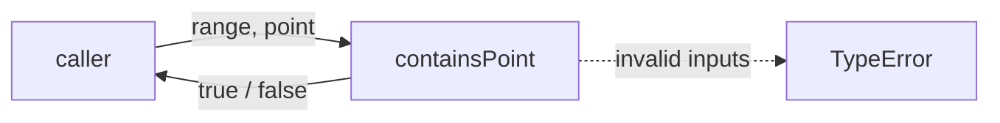
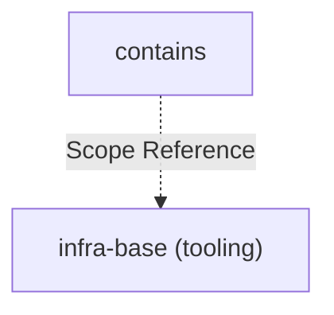

# Module: contains

<!--SECTION:SPEC_ID-->
RANGES-QUERIES-CONTAINS
<!--/SECTION:SPEC_ID-->

<!--SECTION:MODULE_VISION-->
## Module Vision

Модуль `contains` владеет единственной чистой операцией проверки вхождения точки в полуинтервал. Он не выполняет I/O, не мутирует входы и не повторяет ответственность родительского скоупа.

Родительский скоуп: [ranges](../../ranges.spec.md). Parent/child modules отсутствуют.

<!--/SECTION:MODULE_VISION-->

<!--SECTION:OVERVIEW-->
## Overview



_Проверка точки в полуинтервале и отказ на недопустимом входе — CON-REQ-1, CON-REQ-2, CON-REQ-3._

<!--/SECTION:OVERVIEW-->

<!--SECTION:MODULE_USAGE_EXAMPLE-->
## Module Usage Example

```ts
import { containsPoint } from "./contains";

const inside = containsPoint([2, 5], 2);
const atEnd = containsPoint([2, 5], 5);
const empty = containsPoint([2, 2], 2);

try {
  containsPoint([2, 5], 2.5);
} catch (error) {
  if (!(error instanceof TypeError)) throw error;
}
```

| Input | Outcome |
|---|---|
| `containsPoint([2,5],2)` | `true` |
| `containsPoint([2,5],5)` | `false` |
| `containsPoint([2,2],2)` | `false` |
| `containsPoint([2,5],2.5)` | `TypeError` |

<!--/SECTION:MODULE_USAGE_EXAMPLE-->

<!--SECTION:MODULE_REQUIREMENTS-->
## Requirements

### CON-REQ-1 [должен]
**Когда** переданы допустимый range `[start,end]` и допустимый point, **модуль должен** вернуть `true` тогда и только тогда, когда `start <= point` И `point < end`.

> Уточняет RAN-REQ-1: полуинтервал включает start и исключает end; без этого граница модуля разошлась бы с родительским контрактом.

### CON-REQ-2 [должен]
**Когда** допустимый point не попадает в допустимый range, включая пустой range `start=end`, **модуль должен** вернуть `false`, а не выбросить исключение.

> Уточняет RAN-REQ-1: валидный вход вне диапазона — обычный отрицательный результат, а не нештатная ситуация.

### CON-REQ-3 [должен · нештатная]
**Если** range не является упорядоченной парой конечных safe integers с `start <= end` ИЛИ point не является конечным safe integer, **то модуль должен** выбросить `TypeError` до проверки членства, даже если результат мог бы быть `false`.

> Уточняет RAN-REQ-1 и RAN-REQ-2: недопустимый вход обнаруживается до любого результата; иначе ложное `false` скрыло бы нарушение домена.

<!--/SECTION:MODULE_REQUIREMENTS-->

<!--SECTION:INTER_MODULE_DEPENDENCIES-->
## Inter-Module Dependencies

- **Depends on:** нет — у модуля нет зависимостей от соседних модулей.
- **Scope Reference (cross-scope):** [infra-base](../../../infra-base/infra-base.spec.md) — только tooling, без runtime-связи.
- **Provides to:** нет — потребители модуля не объявлены.



_Модуль не зависит от соседних модулей; внешняя ссылка — только tooling-скоуп infra-base._

<!--/SECTION:INTER_MODULE_DEPENDENCIES-->

<!--SECTION:ENTITY_INVENTORY-->
## Entity Inventory

_Это полный список сущностей модуля. Любое введение сущности execution-агентом помимо этого списка считается drift'ом и требует обновления spec._

| Name | Type | Purpose |
|------|------|---------|
| `containsPoint` | Function | Проверяет вхождение точки в полуинтервал |

Ошибки: throw `TypeError` → `containsPoint`

ER-скетч не рисуется: в inventory одна сущность.

<!--/SECTION:ENTITY_INVENTORY-->

<!--SECTION:ENTITY_SURFACES-->
## Entity Surfaces

Единственная поверхность модуля — чистая функция `containsPoint` с валидацией входа и ошибкой `TypeError`.

<details>
<summary>Полные поверхности сущностей</summary>

### `containsPoint`
- **Type:** Function
- **Purpose:** Проверяет, входит ли допустимая точка в допустимый полуинтервал.
- **Public Properties:** N/A
- **Public Operations:** Проверка вхождения point в range.
- **Lifecycle:** Функция без состояния; создаётся вызовом и завершается возвратом результата.
- **Events Emitted:** N/A
- **Errors & Degradation:** `TypeError` через throw; владелец — `containsPoint`, обработка — вызывающая сторона.
- **Consumers:**
  - Internal: `./contains`
  - External: local pure callers
- **Usage Waiver (external: local pure callers):** Публичная функция библиотеки; потребители находятся вне модуля.

</details>

<!--/SECTION:ENTITY_SURFACES-->

<!--SECTION:MODULE_CONTRACTS-->
## Module Contracts

Поведение реализует единственная чистая функция `containsPoint`; Port/Adapter отсутствуют.

Граф не рисуется: в модуле нет Port/Adapter, только Service `containsPoint`.

Call Chain не рисуется: в инвентаре одна абстракция — функция `containsPoint`.

<details>
<summary>Контракты DbC</summary>

### Services

#### Service: `containsPoint`
- **Purpose:** Проверяет вхождение точки в полуинтервал `[start,end)`.
- **Consumers:** local pure callers
- **Runtime Backing:** `not-implemented`
- **Verification Levels:** `contract`, `unit`
- **Deferred Runtime Scope:** Реализация отложена; артефакт создаётся только как спецификация.

**Contract (DbC)** — одна операция:
- `containsPoint`:
  - Pre: range — упорядоченная пара конечных safe integers с `start <= end`; point — конечный safe integer.
  - Post: возвращает `true` тогда и только тогда, когда `start <= point` И `point < end`; возвращает `false` для пустого range и для допустимого point вне range.
  - On pre-violation: выбрасывает `TypeError` до возврата любого результата.

**Invariants:** Чистая операция без I/O и мутации; валидация всех входов предшествует результату.

</details>

<!--/SECTION:MODULE_CONTRACTS-->

<!--SECTION:PUBLIC_OPTIONS-->
## Public Options & Policies

Публичных опций нет.

<details>
<summary>Опции и политики</summary>

Модуль не принимает флагов, настроек или политик; поведение полностью определено контрактом `containsPoint`.

</details>

<!--/SECTION:PUBLIC_OPTIONS-->

<!--SECTION:FILE_STRUCTURE-->
## File Structure

```
contains/
├── contains.ts
└── contains.test.ts
```

**File Mapping:**
- `contains.ts`: реализация `containsPoint` (planned, not implemented)
- `contains.test.ts`: модульные тесты (planned, not implemented)

<!--/SECTION:FILE_STRUCTURE-->

<!--SECTION:RESEARCH-->
## Research

Ресёрч-документов для этого модуля нет.

<!--/SECTION:RESEARCH-->

<!--SECTION:MODULE_DECISION_LOG-->
## Module Decision Log

Решения уровня модуля не зафиксированы: границы и поведение заданы brief.

<details>
<summary>Полные записи Decision Log</summary>

Записей нет.

</details>

<!--/SECTION:MODULE_DECISION_LOG-->

<!--SECTION:HANDOFF-->
## Handoff to Tasks

- **Implementation files to be created:** `contains.ts` (planned, not implemented)
- **Test files to be created:** `contains.test.ts` (planned, not implemented)
- **Stack dependencies:**
  - Language: `typescript` (resolves to `ai/directives/coding/typescript-rules.xml`)
  - Test framework: `node-test` (resolves to `ai/directives/testing/node-test.xml`)
- **Module Rules Additions:** None

  | Rule | Category | Source |
  |------|----------|--------|
  | — | — | — |

- **Open risks & validation needs:** Операторское одобрение не получено; реализация и тикеты не созданы.
- **Status:** pending-operator
- **Operator decision:** pending

<!--/SECTION:HANDOFF-->

<!--SECTION:IMPLEMENTATION_INSIGHTS-->
## Implementation Insights

Постимплементационных наблюдений нет: модуль ещё не реализован.

<details>
<summary>Заметки по реализации</summary>

Нет заметок.

</details>

<!--/SECTION:IMPLEMENTATION_INSIGHTS-->
