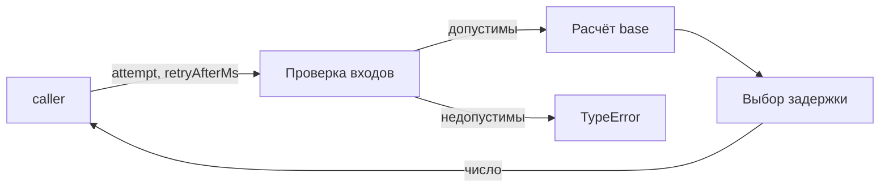
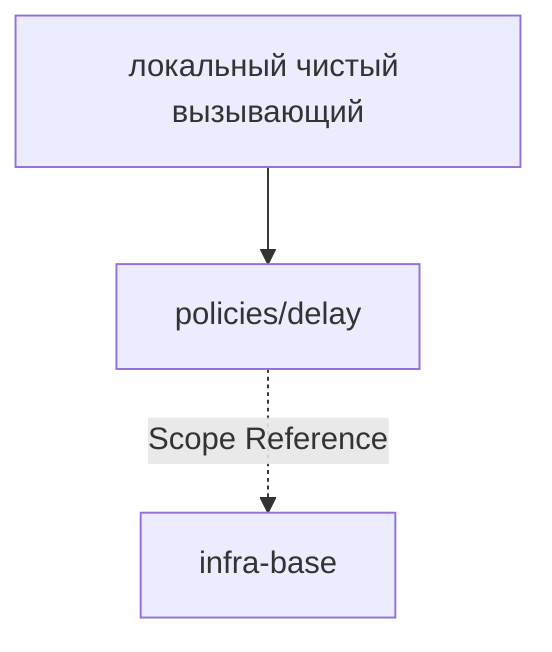

# Module: delay

<!--SECTION:SPEC_ID-->
DELIVERY-POLICIES-DELAY
<!--/SECTION:SPEC_ID-->

<!--SECTION:MODULE_VISION-->
## Module Vision
Модуль владеет чистым расчётом задержки повтора: экспоненциальная база с потолком 30000 и серверная подсказка без потолка. Родительский скоуп — [delivery](../../delivery.spec.md). Соседних, родительских и дочерних модулей нет.
<!--/SECTION:MODULE_VISION-->

<!--SECTION:OVERVIEW-->
## Overview


_Проверка входов, расчёт и отказ — DEL-REQ-1, DEL-REQ-2, DEL-REQ-3._
<!--/SECTION:OVERVIEW-->

<!--SECTION:MODULE_USAGE_EXAMPLE-->
## Module Usage Example

```ts
import { retryDelay } from './delay.js';

const first = retryDelay(1, null);
const evenAttempt = retryDelay(6, 0);
const serverHint = retryDelay(1, 60000);

try {
  retryDelay(0, null);
} catch (error) {
  if (!(error instanceof TypeError)) throw error;
}
```

| Input | Outcome |
|---|---|
| `retryDelay(1,null)` | `1000` |
| `retryDelay(6,0)` | `30000` |
| `retryDelay(1,60000)` | `60000` |
| `retryDelay(1,-1)` | `TypeError` |
<!--/SECTION:MODULE_USAGE_EXAMPLE-->

<!--SECTION:MODULE_REQUIREMENTS-->
## Requirements

### DEL-REQ-1 [должен]
**Когда** `attempt` — положительное безопасное целое, **функция `retryDelay` должна** вычислить `base = min(30000, 1000 * 2^(attempt - 1))` и вернуть его, если `retryAfterMs` равен `null`.

> Уточняет родительский DEL-REQ-1: родительский скоуп задаёт числовой домен и запрет эффектов, но не формулу задержки; без неё модуль не даёт наблюдаемого результата.

### DEL-REQ-2 [должен]
**Когда** `attempt` — положительное безопасное целое, а `retryAfterMs` — неотрицательное безопасное целое, **функция `retryDelay` должна** вернуть `max(base, retryAfterMs)`, не ограничивать подсказку сверху значением 30000 и сохранять ноль как допустимую подсказку, а не требование нулевой задержки.

> Уточняет родительский DEL-REQ-1: потолок 30000 относится только к экспоненциальной базе; серверная подсказка выше 30000 остаётся действующей.

### DEL-REQ-3 [должен · нештатная]
**Если** `attempt` не положительное безопасное целое или `retryAfterMs` не `null` и при этом отрицательный либо не является конечным безопасным целым, **то функция `retryDelay` должна** выбросить `TypeError` до возврата результата.

> Уточняет родительский DEL-REQ-2: недопустимые входы дают отказ, а не обычный отрицательный результат; проверка всех входов до возврата сохраняет родительский запрет на побочные эффекты.

### DEL-REQ-4 [должен]
**Функция `retryDelay` должна** возвращать детерминированное значение без случайного разброса и без ожидания.

> Уточняет родительский DEL-REQ-1: повторные вызовы с теми же входами обязаны совпадать; случайный разброс и сон нарушили бы чистоту родительского скоупа.
<!--/SECTION:MODULE_REQUIREMENTS-->

<!--SECTION:INTER_MODULE_DEPENDENCIES-->
## Inter-Module Dependencies
- **Depends on:** нет соседних модулей.
- **Scope Reference (cross-scope):** [infra-base](../../../infra-base/infra-base.spec.md) — только tooling, без импорта в рантайме.
- **Provides to:** нет модулей внутри скоупа; функция доступна локальным чистым вызывающим.


_Место модуля задержек: локальный вызывающий и ссылка на инфраструктуру._
<!--/SECTION:INTER_MODULE_DEPENDENCIES-->

<!--SECTION:ENTITY_INVENTORY-->
## Entity Inventory

_Это полный список сущностей модуля. Любое введение сущности execution-агентом помимо этого списка считается drift'ом и требует обновления spec._

| Name | Type | Purpose |
|------|------|---------|
| `retryDelay` | Function | Чистый расчёт задержки повтора по номеру попытки и серверной подсказке |

Ошибки: throw (TypeError) → retryDelay

ER-эскиз не рисуется: в инвентаре одна сущность без связей.
<!--/SECTION:ENTITY_INVENTORY-->

<!--SECTION:ENTITY_SURFACES-->
## Entity Surfaces
Модуль раскрывает одну функцию `retryDelay`; полная поверхность ниже.

<details>
<summary>Полные поверхности сущностей</summary>

### `retryDelay`
- **Type:** Function
- **Purpose:** Чистый расчёт задержки повтора по номеру попытки и серверной подсказке.
- **Public Properties:** N/A — функция без состояния.
- **Public Operations:** Расчёт задержки повтора `retryDelay(attempt, retryAfterMs)`.
- **Lifecycle:** Не хранит состояния; вызывающий начинает и завершает вызов в рамках одного выражения.
- **Events Emitted:** N/A
- **Errors & Degradation:** `TypeError` через `throw` при недопустимых входах; владелец — `retryDelay`.
- **Consumers:**
  - Internal: нет внутренних потребителей до реализации.
  - External: локальные чистые вызывающие.
- **Usage Waiver (external: локальные чистые вызывающие):** Единственная публичная функция модуля; её поверхность задаёт весь контракт задержки.

</details>
<!--/SECTION:ENTITY_SURFACES-->

<!--SECTION:MODULE_CONTRACTS-->
## Module Contracts
Модуль определяет одну чистую функцию `retryDelay`; Port и Adapter не вводятся.

Публичная сигнатура: `retryDelay(attempt: number, retryAfterMs: number | null): number`.

Граф не рисуется: в модуле нет Port/Adapter, только Function `retryDelay`.

Цепочка вызовов не рисуется: в модуле одна функция без посредников.

<details>
<summary>Контракты DbC</summary>

### Services

#### Service: `retryDelay`
- **Purpose:** Считать задержку повтора по номеру попытки и серверной подсказке.
- **Consumers:** локальные чистые вызывающие.
- **Runtime Backing:** `not-implemented`
- **Verification Levels:** `contract`, `unit`
- **Deferred Runtime Scope:** Вся реализация отложена до одобрения и выполнения задач.

**Contract (DbC)**
- `retryDelay`:
  - Pre: `attempt` — положительное безопасное целое; `retryAfterMs` равен `null` или лежит в диапазоне неотрицательных безопасных целых.
  - Post: Возвращает `base` при `null` и `max(base, retryAfterMs)` при числе, где `base = min(30000, 1000 * 2^(attempt - 1))`; подсказка выше 30000 не ограничивается.
  - On pre-violation: Выбрасывает `TypeError` до возврата результата.

**Invariants:** Результат детерминирован; функция не выполняет сетевой ввод-вывод, не ждёт, не читает часы и не изменяет состояние.

</details>
<!--/SECTION:MODULE_CONTRACTS-->

<!--SECTION:PUBLIC_OPTIONS-->
## Public Options & Policies
Публичных флагов нет: поведение задают параметры `attempt` и `retryAfterMs`.

<details>
<summary>Опции и политики</summary>

- Конфигурируемых флагов нет.
- `retryAfterMs` — единственная вариативная подсказка; потолок 30000 применяется только к экспоненциальной базе.
- Джиттер и сон не поддерживаются и не откладываются как опция.

</details>
<!--/SECTION:PUBLIC_OPTIONS-->

<!--SECTION:FILE_STRUCTURE-->
## File Structure
```
src/delivery/policies/delay/
└── delay.ts
```

**File Mapping:**
- `src/delivery/policies/delay/delay.ts`: чистая функция `retryDelay`.
<!--/SECTION:FILE_STRUCTURE-->

<!--SECTION:RESEARCH-->
## Research
Нет ресёрч-документов для этого ограниченного модуля.
<!--/SECTION:RESEARCH-->

<!--SECTION:MODULE_DECISION_LOG-->
## Module Decision Log
Отдельных решений уровня модуля нет: границы заданы родительским скоупом и брифом модуля.

<details>
<summary>Полные записи Decision Log</summary>

Записей нет.

</details>
<!--/SECTION:MODULE_DECISION_LOG-->

<!--SECTION:HANDOFF-->
## Handoff to Tasks
- **Implementation files to be created:** `src/delivery/policies/delay/delay.ts`
- **Test files to be created:** `tests/delivery/policies/delay/delay.test.ts`
- **Stack dependencies:**
  - Language: `typescript` (resolves to `ai/directives/coding/typescript-rules.xml`)
  - Test framework: `node-test` (resolves to `ai/directives/testing/node-test.xml`)
- **Module Rules Additions:** None.
- **Open risks & validation needs:** Одобрение оператора ожидает; реализация не начата, доказательств выполнения нет. Примеры использования в спеке — спецификация, а не результаты тестов.
- **Status:** `pending-operator`
- **Operator decision:** pending
- **Approval #1:** pending
<!--/SECTION:HANDOFF-->

<!--SECTION:IMPLEMENTATION_INSIGHTS-->
## Implementation Insights
Послереализационных наблюдений пока нет: модуль не реализован.

<details>
<summary>Заметки по реализации</summary>

Записей нет.

</details>
<!--/SECTION:IMPLEMENTATION_INSIGHTS-->
