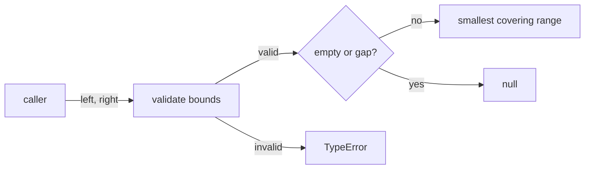
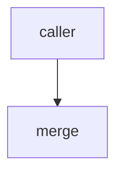

# Module: merge

<!--SECTION:SPEC_ID-->
RANGES-MERGE
<!--/SECTION:SPEC_ID-->

<!--SECTION:MODULE_VISION-->
## Module Vision
The `merge` module owns one pure operation inside the [ranges scope](../ranges.spec.md): combine two
valid half-open ranges into their smallest covering range when they overlap or touch, and return
`null` when either range is empty or a positive gap separates them. It has no ports, adapters, I/O,
mutation, or retained lifecycle state.
<!--/SECTION:MODULE_VISION-->

<!--SECTION:OVERVIEW-->
## Overview


_Путь вызова mergeRanges: валидация, проверка пустоты/разрыва и результат — MER-REQ-1, MER-REQ-2, MER-REQ-3._
<!--/SECTION:OVERVIEW-->

<!--SECTION:MODULE_USAGE_EXAMPLE-->
## Module Usage Example

```ts
import { mergeRanges } from "./merge";

const merged = mergeRanges([0, 3], [3, 6]);
if (merged === null) {
  throw new Error("expected a covering range");
}

try {
  mergeRanges([5, 1], [0, 9]);
} catch (error) {
  if (!(error instanceof TypeError)) {
    throw error;
  }
}
```

| Input | Outcome |
|---|---|
| `mergeRanges([0,3],[3,6])` | `[0,6]` |
| `mergeRanges([0,2],[3,6])` | `null` |
| `mergeRanges([2,2],[0,9])` | `null` |
| `mergeRanges([5,1],[0,9])` | `TypeError` |
<!--/SECTION:MODULE_USAGE_EXAMPLE-->

<!--SECTION:MODULE_REQUIREMENTS-->
## Requirements

### MER-REQ-1 [должен]
**Когда** оба диапазона непусты и пересекаются или соприкасаются, **модуль должен** вернуть их наименьший покрывающий диапазон.

> Новое поведение модуля; уточняет RAN-REQ-1: родительская спека задаёт домен диапазонов, но не операцию слияния. Касание границы `[0,3]` и `[3,6]` — точка слияния, а не разрыв.

### MER-REQ-2 [должен]
**Когда** хотя бы один диапазон пуст или между диапазонами есть положительный разрыв, **модуль должен** вернуть `null` и не возвращать покрывающий диапазон через разрыв.

> Уточняет RAN-REQ-1: пустой диапазон (start=end) не с чем сливать, а положительный разрыв нельзя маскировать покрытием. Это обычный отрицательный результат, не ошибка.

### MER-REQ-3 [должен · нештатная]
**Если** границы недопустимы или диапазон перевёрнут (start > end), **то модуль должен** выбросить `TypeError` до проверки пустоты или разрыва и не изменять ни один входной массив.

> Уточняет RAN-REQ-2: проверка входа предшествует любой логике и отрицательному результату; мутация запрещена. Пример `mergeRanges([5,1],[0,9])` обязан дать `TypeError`, а не `null`.
<!--/SECTION:MODULE_REQUIREMENTS-->

<!--SECTION:INTER_MODULE_DEPENDENCIES-->
## Inter-Module Dependencies
- **Depends on:** None; no sibling modules inside `ranges`.
- **Scope Reference (cross-scope):** None.
- **Provides to:** local pure callers of the `ranges` library.


_Вызов merge потребителем; зависимостей от соседних модулей нет._
<!--/SECTION:INTER_MODULE_DEPENDENCIES-->

<!--SECTION:ENTITY_INVENTORY-->
## Entity Inventory

_Это полный список сущностей модуля. Любое введение сущности execution-агентом помимо этого списка считается drift'ом и требует обновления spec._

| Name | Type | Purpose |
|------|------|---------|
| `mergeRanges` | Function | Чистое слияние двух валидных диапазонов в наименьший покрывающий диапазон. |

Ошибки: throw `TypeError` → `mergeRanges`

Инвентарь состоит из одной сущности; связей для ER-наброска нет.
<!--/SECTION:ENTITY_INVENTORY-->

<!--SECTION:ENTITY_SURFACES-->
## Entity Surfaces
Одна публичная функция; её полная поверхность раскрыта ниже.

<details>
<summary>Полные поверхности сущностей</summary>

### `mergeRanges`
- **Type:** Function
- **Purpose:** Сливает два валидных полуоткрытых диапазона в наименьший покрывающий диапазон или возвращает `null`.
- **Public Properties:** N/A
- **Public Operations:** `mergeRanges(left, right)`
- **Lifecycle:** Создаётся вызывающим кодом на каждый вызов; состояние между вызовами не сохраняется.
- **Events Emitted:** N/A
- **Errors & Degradation:** `TypeError` выбрасывается синхронно при недопустимых границах или перевёрнутом диапазоне до проверки пустоты или разрыва; владелец — `mergeRanges`.
- **Consumers:**
  - Internal: N/A
  - External: локальные чистые вызывающие коды библиотеки `ranges`.
- **Usage Waiver:** Единственная публичная операция модуля; существует как контракт родительского RAN-REQ-1.

</details>
<!--/SECTION:ENTITY_SURFACES-->

<!--SECTION:MODULE_CONTRACTS-->
## Module Contracts
Модуль определяет одну чистую функцию `mergeRanges`; Port и Adapter отсутствуют.

Граф не рисуется: в модуле нет Port/Adapter, только Function `mergeRanges`.

Call Chain не рисуется: в модуле одна абстракция — Function `mergeRanges`.

<details>
<summary>Контракты DbC</summary>

### Services

#### Service: `mergeRanges`
- **Purpose:** Сливает два валидных полуоткрытых диапазона в наименьший покрывающий диапазон или возвращает `null`.
- **Consumers:** локальные чистые вызывающие коды библиотеки `ranges`.
- **Runtime Backing:** `not-implemented`
- **Verification Levels:** `contract`, `unit`
- **Deferred Runtime Scope:** Реализация и тесты отсутствуют; спецификация описывает только контракт.

**Contract (DbC)**
- `mergeRanges`:
  - Pre: `left` и `right` — упорядоченные пары `[start, end]` из конечных безопасных целых чисел, где `start <= end`.
  - Post: Если оба диапазона непусты и пересекаются или соприкасаются, возвращается наименьший покрывающий диапазон; если хотя бы один диапазон пуст или между ними положительный разрыв, возвращается `null`; входные массивы не изменяются.
  - On pre-violation: Выбрасывается `TypeError` до проверки пустоты или разрыва; входные массивы не изменяются.

**Invariants:** Входные массивы не мутируются; любой возвращённый диапазон является полуоткрытой парой с `start <= end` и покрывает оба входа.

</details>
<!--/SECTION:MODULE_CONTRACTS-->

<!--SECTION:PUBLIC_OPTIONS-->
## Public Options & Policies
None — no publicly observable options or policies.

<details>
<summary>Опции и политики</summary>

None. The module exposes no flags, options, or policies beyond its fixed contract.

</details>
<!--/SECTION:PUBLIC_OPTIONS-->

<!--SECTION:FILE_STRUCTURE-->
## File Structure
```
src/
└── ranges/
    └── merge.ts
test/
└── ranges/
    └── merge.test.ts
```

**File Mapping:**
- `src/ranges/merge.ts`: реализация `mergeRanges` (создаётся будущей задачей, сейчас отсутствует).
- `test/ranges/merge.test.ts`: unit-тесты контракта и четырёх примеров (создаются будущей задачей, сейчас отсутствуют).
<!--/SECTION:FILE_STRUCTURE-->

<!--SECTION:RESEARCH-->
## Research
No research documents; this module relies only on the parent scope contract and the supplied brief.
<!--/SECTION:RESEARCH-->

<!--SECTION:MODULE_DECISION_LOG-->
## Module Decision Log
No module-level decisions are recorded; the scope approval remains pending.

<details>
<summary>Полные записи Decision Log</summary>

No module-level Decision Log entries. Approval of this module remains pending-operator.

</details>
<!--/SECTION:MODULE_DECISION_LOG-->

<!--SECTION:HANDOFF-->
## Handoff to Tasks
- **Status:** pending-operator — no implementation, tickets, or execution claim.
- **Implementation files to be created:** `src/ranges/merge.ts` (future task; not created by this authoring pass).
- **Test files to be created:** `test/ranges/merge.test.ts` (future task; not created by this authoring pass).
- **Stack dependencies:**
  - Language: `typescript` (resolves to `ai/directives/coding/typescript-rules.xml`)
  - Test framework: `node-test` (resolves to `ai/directives/testing/node-test.xml`)
- **Module Rules Additions:** None
- **Open risks & validation needs:** Operator approval is pending; no implementation or verification result exists. The four usage examples are the acceptance oracle.
<!--/SECTION:HANDOFF-->

<!--SECTION:IMPLEMENTATION_INSIGHTS-->
## Implementation Insights
No post-implementation learnings; the module has no implementation yet.

<details>
<summary>Заметки по реализации</summary>

None — this appendix is filled only after implementation and audit-cycle compaction.

</details>
<!--/SECTION:IMPLEMENTATION_INSIGHTS-->
