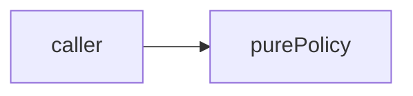

# ranges: library specification

<!--SECTION:SPEC_ID-->
RANGES
<!--/SECTION:SPEC_ID-->

<!--SECTION:SCOPE_TYPE-->
## scope-type
library
<!--/SECTION:SCOPE_TYPE-->

<!--SECTION:VISION-->
## Vision & Primary Goal
Pure ranges operations. Every range is an ordered pair [start,end] of finite safe integers with start <= end. Ranges are half-open: start is included and end excluded. Empty ranges start=end are valid. Validate all inputs before returning any result. No I/O or mutation.
<!--/SECTION:VISION-->

<!--SECTION:OVERVIEW-->
## Overview

_Local deterministic policy, no effects._
<!--/SECTION:OVERVIEW-->

<!--SECTION:GOLDEN_DX-->
## Target Experience
Pure callers validate inputs without I/O.
<!--/SECTION:GOLDEN_DX-->

<!--SECTION:SCOPE_DEPENDENCIES-->
## Scope Dependencies
- **Depends on:** infra-base
- **Provides to:** local pure callers.
[Tooling](../infra-base/infra-base.spec.md)
<!--/SECTION:SCOPE_DEPENDENCIES-->

<!--SECTION:REQUIREMENTS_AND_CONSTRAINTS-->
## Requirements & Constraints
### RAN-REQ-1 [должен]
**Когда** переданы допустимые входы, **модуль должен** соблюдать контракт: Every range is an ordered pair [start,end] of finite safe integers with start <= end. Ranges are half-open: start is included and end excluded. Empty ranges start=end are valid. Validate all inputs before returning any result. No I/O or mutation.
> Preserve the declared boundary semantics.

### RAN-REQ-2 [должен · нештатная]
**Если** входы недопустимы, **то модуль должен** выбросить TypeError. Validate all numeric domain restrictions before returning. No mutation or I/O.
> Invalid inputs are not ordinary negative results.

### Out-of-Scope
- Network, persistence, mutation and clock reads.

### Runtime & Deferred Scope
Not implemented; draft only.

### Rules
No additional activated rule set.
<!--/SECTION:REQUIREMENTS_AND_CONSTRAINTS-->

<!--SECTION:DATA_FLOW-->
## Data Flow

_Local deterministic policy, no effects._
<!--/SECTION:DATA_FLOW-->

<!--SECTION:PUBLIC_API_SURFACE-->
## Public API Surface
Common input validation policy; concrete child behavior is module-owned.
<!--/SECTION:PUBLIC_API_SURFACE-->

<!--SECTION:ARCHITECTURE-->
## Architecture
Pure functions without lifecycle, ports or adapters.

_Local deterministic policy, no effects._
<!--/SECTION:ARCHITECTURE-->

<!--SECTION:MODULE_MAP-->
## Module Map
### Modules
- [merge](merge/merge.spec.md) — planned pure operation.

### Inter-Module Dependency Map
No sibling dependencies.
<!--/SECTION:MODULE_MAP-->

<!--SECTION:RESEARCH-->
## Research
No research documents for this bounded operation.
<!--/SECTION:RESEARCH-->

<!--SECTION:DECISION_LOG-->
## Decision Log

Details

RAN-DL-1 — operator approval remains pending; no implementation authorized.

<!--/SECTION:DECISION_LOG-->

<!--SECTION:BOOTSTRAP_REQUIREMENTS-->
## Prerequisites
No external bootstrap.

Audit
The harness supplies local tooling.

<!--/SECTION:BOOTSTRAP_REQUIREMENTS-->

<!--SECTION:HANDOFF-->
## Handoff to Modules
- **Status:** pending-operator
- **Operator decision:** pending
No tickets or implementation approved.
<!--/SECTION:HANDOFF-->
