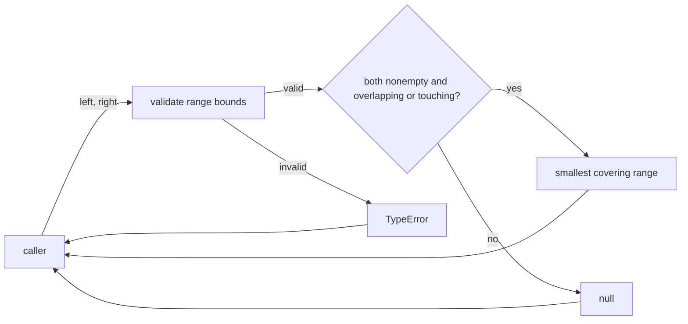
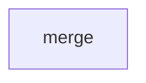
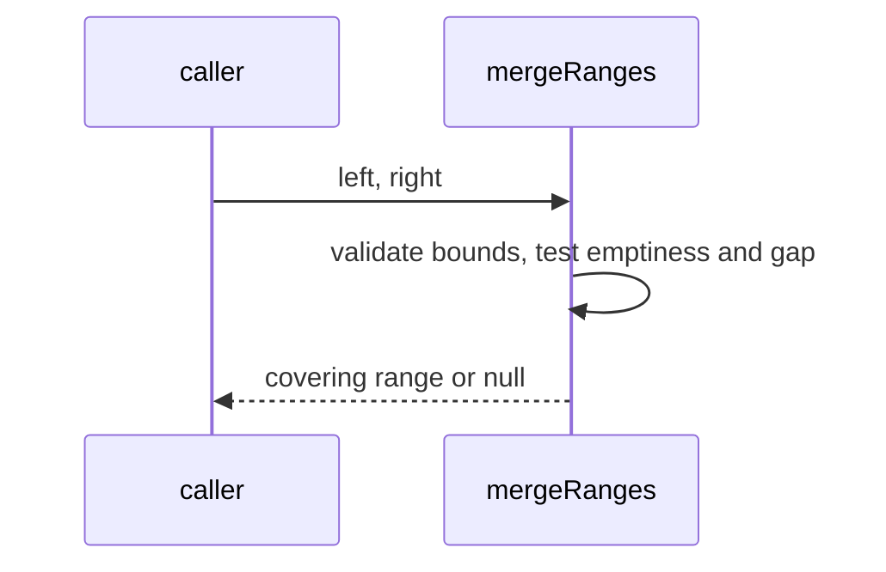

# Module: merge

<!--SECTION:SPEC_ID-->
RANGES-MERGE
<!--/SECTION:SPEC_ID-->

<!--SECTION:MODULE_VISION-->
## Module Vision
`merge` owns the pure `mergeRanges` operation inside the `ranges` scope. It validates the shared
range domain and combines two nonempty ranges that overlap or touch into their smallest covering
range; an empty range or a positive gap yields `null`. Parent scope:
[ranges](../ranges.spec.md) — [REQUIREMENTS_AND_CONSTRAINTS](../ranges.spec.md#REQUIREMENTS_AND_CONSTRAINTS),
[PUBLIC_API_SURFACE](../ranges.spec.md#PUBLIC_API_SURFACE). No sibling, parent, or child modules.
<!--/SECTION:MODULE_VISION-->

<!--SECTION:OVERVIEW-->
## Overview

_Путь одного вызова mergeRanges: проверка границ, затем слияние или null — MER-REQ-1, MER-REQ-2, MER-REQ-3._
<!--/SECTION:OVERVIEW-->

<!--SECTION:MODULE_USAGE_EXAMPLE-->
## Module Usage Example
```ts
import { mergeRanges } from "./merge";

const merged = mergeRanges([0, 3], [3, 6]);
if (merged === null) {
  throw new Error("touching ranges must merge");
}

const separated = mergeRanges([0, 2], [3, 6]);
if (separated !== null) {
  throw new Error("a positive gap must not merge");
}

try {
  mergeRanges([5, 1], [0, 9]);
} catch (error) {
  if (!(error instanceof TypeError)) throw error;
}
```

| Input | Outcome |
|---|---|
| `mergeRanges([0,3],[3,6])` | `[0,6]` |
| `mergeRanges([0,2],[3,6])` | `null` |
| `mergeRanges([2,2],[0,9])` | `null` |
| `mergeRanges([5,1],[0,9])` | `TypeError` |
<!--/SECTION:MODULE_USAGE_EXAMPLE-->

<!--SECTION:MODULE_REQUIREMENTS-->
## Requirements
### MER-REQ-1 [должен]
**Когда** оба диапазона непусты и пересекаются или соприкасаются, **модуль должен** вернуть их
минимальный покрывающий диапазон `[min(start), max(end)]`.

> Refines RAN-REQ-1: the parent input domain and half-open semantics are preserved; touching
> boundaries are mergeable, unlike intersection.

### MER-REQ-2 [должен]
**Когда** хотя бы один диапазон пуст или между диапазонами есть положительный разрыв, **модуль
должен** вернуть `null`.

> Refines RAN-REQ-1: an empty range or a positive gap is not mergeable, so no covering range may
> span a gap.

### MER-REQ-3 [должен · нештатная]
**Если** переданы недопустимые границы или обратный диапазон, **то модуль должен** выбросить
`TypeError` до проверки пустоты или разрыва и не изменять ни один вход.

> Refines RAN-REQ-2: invalid bounds and reversed ranges are rejected before any result;
> validation precedes emptiness and gap checks, and both inputs remain unchanged.
<!--/SECTION:MODULE_REQUIREMENTS-->

<!--SECTION:INTER_MODULE_DEPENDENCIES-->
## Inter-Module Dependencies
- **Depends on:** None.
- **Scope Reference (cross-scope):** None.
- **Provides to:** No sibling modules in this scope.


_Модуль merge не имеет межузовых зависимостей._
<!--/SECTION:INTER_MODULE_DEPENDENCIES-->

<!--SECTION:ENTITY_INVENTORY-->
## Entity Inventory
Closed-world inventory for this module.

| Name | Type | Purpose |
|------|------|---------|
| `mergeRanges` | Function | Merges two half-open ranges when they overlap or touch; returns null for an empty range or positive gap |
| `Range` | Value Object | Ordered half-open `[start,end]` pair of finite safe integers |

Ошибки: throw TypeError → mergeRanges

```text
mergeRanges ──consumes──▶ Range
  - left: Range            - start: finite safe integer
  - right: Range           - end: finite safe integer
```
<!--/SECTION:ENTITY_INVENTORY-->

<!--SECTION:ENTITY_SURFACES-->
## Entity Surfaces
`mergeRanges` is the public function; `Range` is the immutable input value it validates.

<details>
<summary>Полные поверхности сущностей</summary>

### `mergeRanges`
- **Type:** Function
- **Purpose:** Combines two nonempty half-open ranges that overlap or touch, or reports that they cannot be merged.
- **Public Properties:** N/A
- **Public Operations:** Merge two ranges, returning a covering `[start,end]` or `null`
- **Lifecycle:** Stateless; created by importing the module, with no termination step.
- **Events Emitted:** N/A
- **Errors & Degradation:** `TypeError` via throw, owned by `mergeRanges`; callers decide how to handle it.
- **Consumers:**
  - Internal: `merge.ts`
  - External: local pure callers of the `ranges` scope

### `Range`
- **Type:** Value Object
- **Purpose:** Carries one ordered half-open interval `[start,end]` with finite safe integer bounds.
- **Public Properties:** `start` is included; `end` is excluded; `start <= end`; both bounds are finite safe integers.
- **Public Operations:** N/A
- **Lifecycle:** Caller-provided immutable value; no lifecycle beyond the call.
- **Events Emitted:** N/A
- **Errors & Degradation:** No own errors; invalid values are rejected by `mergeRanges` with `TypeError`.
- **Consumers:**
  - Internal: `mergeRanges`
  - External: local pure callers of the `ranges` scope

</details>
<!--/SECTION:ENTITY_SURFACES-->

<!--SECTION:MODULE_CONTRACTS-->
## Module Contracts
One pure Service, `mergeRanges`; no Ports or Adapters. Граф не рисуется: в модуле нет Port/Adapter, только Service mergeRanges.


_Основной путь вызова mergeRanges — MER-REQ-1, MER-REQ-2._

<details>
<summary>Контракты DbC</summary>

### Services

#### Service: `mergeRanges`
- **Purpose:** Merges two half-open ranges when they overlap or touch and otherwise reports the unmergeable case.
- **Consumers:** external: local pure callers of the `ranges` scope
- **Runtime Backing:** `not-implemented`
- **Verification Levels:** `contract`, `unit`
- **Deferred Runtime Scope:** None

**Contract (DbC)** — one block per operation:
- `mergeRanges`:
  - Pre: `left` and `right` are ordered pairs `[start,end]` of finite safe integers with `start <= end`; both inputs are immutable.
  - Post: returns the smallest covering `[min(start), max(end)]` when both ranges are nonempty and overlap or touch; returns `null` when either range is empty or a positive gap separates them.
  - On pre-violation: throws `TypeError` before checking emptiness or a gap; neither input is mutated.

</details>
<!--/SECTION:MODULE_CONTRACTS-->

<!--SECTION:PUBLIC_OPTIONS-->
## Public Options & Policies
No public options or policies; the operation accepts only the two range inputs.

<details>
<summary>Опции и политики</summary>

None. The shared range domain is fixed by the `ranges` scope.

</details>
<!--/SECTION:PUBLIC_OPTIONS-->

<!--SECTION:FILE_STRUCTURE-->
## File Structure
```
merge/
└── merge.ts
```

**File Mapping:**
- `merge.ts`: `mergeRanges` function and `Range` value type
<!--/SECTION:FILE_STRUCTURE-->

<!--SECTION:RESEARCH-->
## Research
No research documents back this bounded operation.
<!--/SECTION:RESEARCH-->

<!--SECTION:MODULE_DECISION_LOG-->
## Module Decision Log
No module-level decisions recorded.

<details>
<summary>Полные записи Decision Log</summary>

None.

</details>
<!--/SECTION:MODULE_DECISION_LOG-->

<!--SECTION:HANDOFF-->
## Handoff to Tasks
- **Implementation files to be created:** `merge/merge.ts`
- **Test files to be created:** `merge/merge.test.ts`
- **Stack dependencies:**
  - Language: `typescript` (resolves to `ai/directives/coding/typescript-rules.xml`)
  - Test framework: `vitest` (resolves to `ai/directives/testing/vitest-rules.xml`)
- **Module Rules Additions:** None.
- **Open risks & validation needs:** Approval #1 pending-operator; no implementation, tickets, or execution authorized. Validation must cover touching boundaries, positive gaps, empty ranges, reversed bounds, and non-mutation.
- **Status:** pending-operator — approval not granted; no implementation or ticket creation performed.
<!--/SECTION:HANDOFF-->

<!--SECTION:IMPLEMENTATION_INSIGHTS-->
## Implementation Insights
No post-implementation insights; implementation has not started.

<details>
<summary>Заметки по реализации</summary>

None.

</details>
<!--/SECTION:IMPLEMENTATION_INSIGHTS-->
