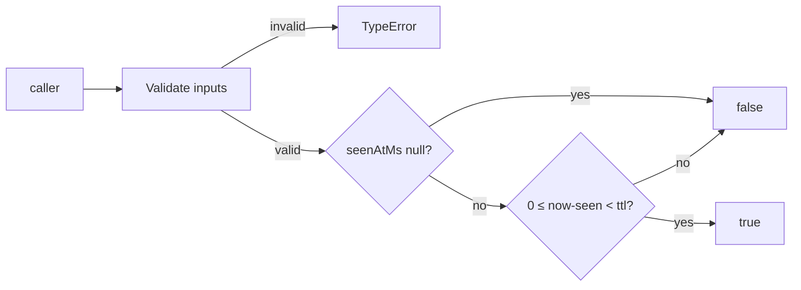
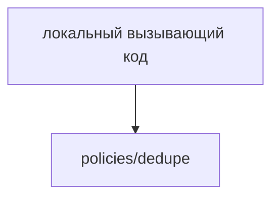

# Module: Dedupe

<!--SECTION:SPEC_ID-->
DELIVERY-POLICIES-DEDUPE
<!--/SECTION:SPEC_ID-->

<!--SECTION:MODULE_VISION-->
## Module Vision
Модуль `policies/dedupe` владеет одной чистой предикатной операцией `isDuplicate`: по отметке `seenAtMs`, текущему времени `nowMs` и окну `ttlMs` решает, является ли отметка дубликатом. Владелец — scope [delivery](../../delivery.spec.md); sibling-модулей и child-модулей нет.

Родительские требования: [REQUIREMENTS_AND_CONSTRAINTS](../../delivery.spec.md#REQUIREMENTS_AND_CONSTRAINTS), [MODULE_MAP](../../delivery.spec.md#MODULE_MAP), [PUBLIC_API_SURFACE](../../delivery.spec.md#PUBLIC_API_SURFACE). Поведение — новый локальный delta внутри parent input constraints: валидация всех числовых входов предшествует любому результату.
<!--/SECTION:MODULE_VISION-->

<!--SECTION:OVERVIEW-->
## Overview

_Валидация входов и проверка окна TTL для одного предиката дубликата — DED-REQ-1, DED-REQ-2._
<!--/SECTION:OVERVIEW-->

<!--SECTION:MODULE_USAGE_EXAMPLE-->
## Module Usage Example
```ts
import { isDuplicate } from './dedupe.js'

const nowMs = 1_000
const ttlMs = 100

isDuplicate(nowMs - 1, nowMs, ttlMs)
isDuplicate(null, nowMs, 0)

try {
  isDuplicate(nowMs + 1, nowMs, 0)
} catch (error) {
  if (!(error instanceof TypeError)) throw error
}
```

| Input | Outcome |
|---|---|
| `isDuplicate(100,110,10)` | `false` |
| `isDuplicate(100,109,10)` | `true` |
| `isDuplicate(null,100,0)` | `false` |
| `isDuplicate(101,100,0)` | `TypeError` |
<!--/SECTION:MODULE_USAGE_EXAMPLE-->

<!--SECTION:MODULE_REQUIREMENTS-->
## Requirements
Модуль владеет только предикатом `isDuplicate`. Parent input constraints `DEL-REQ-1` и `DEL-REQ-2` сохраняются; ограничения про attempts и maximum-attempts не применяются, потому что таких входов у операции нет.

### DED-REQ-1 [должен]
**Когда** переданы допустимые входы, **модуль должен** вернуть `false`, если `seenAtMs` равен `null`; иначе вернуть `true` ровно тогда, когда `0 <= nowMs - seenAtMs < ttlMs`. Равенство `ttlMs` считается истёкшим; при `ttlMs = 0` для допустимых входов результат всегда `false`. Уточняет `DEL-REQ-1`.
> Проверка выполняется после валидации, без чтения часов, без сетевого I/O и без изменения состояния.

### DED-REQ-2 [должен · нештатная]
**Если** вход недопустим — отрицательное или не safe-integer значение времени или `ttlMs`, либо непустой `seenAtMs` больше `nowMs` (в том числе при `ttlMs = 0`), — **то модуль должен** выбросить `TypeError` до возврата результата. `nowMs` и `ttlMs` валидируются и при `seenAtMs = null`. Уточняет `DEL-REQ-2` и входные ограничения `DEL-REQ-1`.
> Невалидный вход не является обычным отрицательным результатом.
<!--/SECTION:MODULE_REQUIREMENTS-->

<!--SECTION:INTER_MODULE_DEPENDENCIES-->
## Inter-Module Dependencies
- **Depends on:** нет модулей внутри scope.
- **Scope Reference (cross-scope):** нет; parent constraints задаёт [delivery](../../delivery.spec.md).
- **Provides to:** локальный вызывающий код scope `delivery`; sibling-модулей нет.


_Модуль вызывается только локальным кодом; sibling-зависимостей нет._
<!--/SECTION:INTER_MODULE_DEPENDENCIES-->

<!--SECTION:ENTITY_INVENTORY-->
## Entity Inventory
_Это полный список сущностей модуля. Любое введение сущности execution-агентом помимо этого списка считается drift'ом и требует обновления spec._

| Name | Type | Purpose |
|------|------|---------|
| `isDuplicate` | Function | Проверяет, попадает ли отметка `seenAtMs` в окно `ttlMs` относительно `nowMs`. |

Ошибки: throw → `isDuplicate`

Одна сущность без связей — ER-набросок не требуется.
<!--/SECTION:ENTITY_INVENTORY-->

<!--SECTION:ENTITY_SURFACES-->
## Entity Surfaces
Единственная сущность модуля — чистая функция `isDuplicate`; её полная поверхность приведена ниже.

<details>
<summary>Полные поверхности сущностей</summary>

### `isDuplicate`
- **Type:** Function
- **Purpose:** Проверяет, попадает ли отметка `seenAtMs` в окно `ttlMs` относительно `nowMs`.
- **Public Properties:** N/A
- **Public Operations:** Проверить, является ли отметка `seenAtMs` дубликатом в окне `ttlMs` относительно `nowMs`.
- **Lifecycle:** Не хранит состояния; создаётся вызывающим кодом на время вызова и завершается возвратом `boolean` или `TypeError`.
- **Events Emitted:** N/A
- **Errors & Degradation:** `TypeError` через `throw`; владелец — `isDuplicate`, ошибка пробрасывается вызывающему коду; деградации нет.
- **Consumers:**
  - Internal: N/A — сущность единственная в модуле
  - External: локальный вызывающий код scope `delivery`
- **Usage Waiver (external: локальный вызывающий код scope delivery):** публичная поверхность модуля, потребляется вне модуля.

</details>
<!--/SECTION:ENTITY_SURFACES-->

<!--SECTION:MODULE_CONTRACTS-->
## Module Contracts
Модуль определяет одну чистую функцию `isDuplicate`; Port и Adapter не вводятся.

Граф не рисуется: в модуле нет Port/Adapter, только Function `isDuplicate`.

Call Chain не рисуется: в модуле одна абстракция — Function `isDuplicate`.

<details>
<summary>Контракты DbC</summary>

### Services

#### Service: `isDuplicate`
- **Purpose:** Проверяет, попадает ли отметка `seenAtMs` в окно `ttlMs` относительно `nowMs`.
- **Consumers:** локальный вызывающий код scope `delivery`
- **Runtime Backing:** `not-implemented`
- **Verification Levels:** `contract`, `unit`
- **Deferred Runtime Scope:** None

**Contract (DbC)** — one block per operation:
- `isDuplicate`:
  - Pre: `seenAtMs` равен `null` или неотрицательному конечному safe integer; `nowMs` и `ttlMs` — неотрицательные конечные safe integers; если `seenAtMs` не `null`, то `seenAtMs <= nowMs`. Все три входа валидируются до любого результата.
  - Post: возвращает `false`, если `seenAtMs` равен `null`; иначе возвращает `true` ровно тогда, когда `0 <= nowMs - seenAtMs < ttlMs`; при `nowMs - seenAtMs = ttlMs` и при `ttlMs = 0` возвращает `false`.
  - On pre-violation: бросает `TypeError`; проверка `nowMs` и `ttlMs` выполняется и при `seenAtMs = null`.

**Invariants:** результат детерминирован для одинаковых входов; модуль не читает часы, не выполняет I/O и не изменяет состояние.

</details>
<!--/SECTION:MODULE_CONTRACTS-->

<!--SECTION:PUBLIC_OPTIONS-->
## Public Options & Policies
Публичных опций и политик нет: `ttlMs` — обязательный аргумент вызова, а не конфигурация.

<details>
<summary>Опции и политики</summary>

Нет публично наблюдаемых флагов, опций или политик. Окно TTL передаётся вызывающим кодом при каждом вызове.

</details>
<!--/SECTION:PUBLIC_OPTIONS-->

<!--SECTION:FILE_STRUCTURE-->
## File Structure
```
src/
└── policies/
    └── dedupe/
        └── dedupe.ts
```

**File Mapping:**
- `src/policies/dedupe/dedupe.ts`: планируемая реализация единственной чистой функции `isDuplicate` (не создана).
<!--/SECTION:FILE_STRUCTURE-->

<!--SECTION:RESEARCH-->
## Research
Нет документов ресёрча для этого модуля: поведение полностью задано parent scope.
<!--/SECTION:RESEARCH-->

<!--SECTION:MODULE_DECISION_LOG-->
## Module Decision Log
Зафиксировано одно архитектурное решение: чистый Function без Port/Adapter.

<details>
<summary>Полные записи Decision Log</summary>

DED-DL-1 2026-10-25 — Чистая функция `isDuplicate` без Port/Adapter; где: `specs/delivery/policies/dedupe/dedupe.spec.md#MODULE_CONTRACTS` (почему: одна реализация, нет подтверждённой вариативности или тестового шва; отвергнуто: Port + Adapter; риск: нет). [verdict: pending-operator]

</details>
<!--/SECTION:MODULE_DECISION_LOG-->

<!--SECTION:HANDOFF-->
## Handoff to Tasks
- **Implementation files to be created:** `src/policies/dedupe/dedupe.ts` (не создан)
- **Test files to be created:** `src/policies/dedupe/dedupe.test.ts` (не создан)
- **Stack dependencies:**
  - Language: `typescript` (resolves to `ai/directives/coding/typescript-rules.xml`)
  - Test framework: `node-test` (resolves to `ai/directives/testing/node-test.xml`)
- **Module Rules Additions:** None — scope-wide baseline applies.
- **Open risks & validation needs:** реализация и тесты не созданы; проверка поведения — задача scaffold/execute.
- **Status:** pending-operator
- **Operator decision:** pending
<!--/SECTION:HANDOFF-->

<!--SECTION:IMPLEMENTATION_INSIGHTS-->
## Implementation Insights
Нет постимплементационных заметок: реализация не создана.

<details>
<summary>Заметки по реализации</summary>

Раздел остаётся пустым до появления реального опыта реализации; контракт выше неизменен.

</details>
<!--/SECTION:IMPLEMENTATION_INSIGHTS-->
