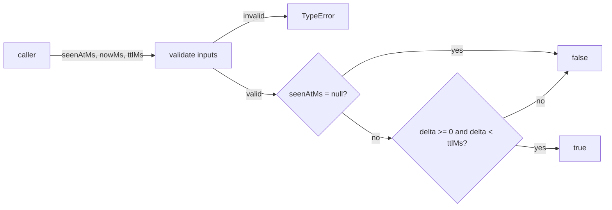
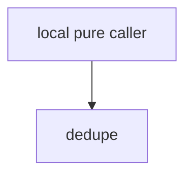

# Module: Dedupe

<!--SECTION:SPEC_ID-->
DELIVERY-POLICIES-DEDUPE
<!--/SECTION:SPEC_ID-->

<!--SECTION:MODULE_VISION-->
## Module Vision
This module owns the pure duplicate-window predicate `isDuplicate`: it validates the numeric inputs supplied by the caller and decides whether a non-null timestamp falls inside a TTL window. Parent scope: [delivery](../../delivery.spec.md). No parent or child modules exist; consumers are local pure callers in the same scope.
<!--/SECTION:MODULE_VISION-->

<!--SECTION:OVERVIEW-->
## Overview

_Проверка вхождения отметки в TTL-окно без чтения часов — DED-REQ-1, DED-REQ-2, DED-REQ-3._
<!--/SECTION:OVERVIEW-->

<!--SECTION:MODULE_USAGE_EXAMPLE-->
## Module Usage Example
```ts
import { isDuplicate } from "./dedupe.js";

const decide: (
  seenAtMs: number | null,
  nowMs: number,
  ttlMs: number,
) => boolean = isDuplicate;

const fresh = decide(null, 100, 10);
const duplicate = decide(100, 109, 10);

try {
  decide(101, 100, 0);
} catch (error) {
  if (!(error instanceof TypeError)) throw error;
}
```

| Input | Outcome |
|---|---|
| `isDuplicate(100,110,10)` | `false` |
| `isDuplicate(100,109,10)` | `true` |
| `isDuplicate(null,100,0)` | `false` |
| `isDuplicate(101,100,0)` | `TypeError` |
<!--/SECTION:MODULE_USAGE_EXAMPLE-->

<!--SECTION:MODULE_REQUIREMENTS-->
## Requirements
### DED-REQ-1 [должен]
**Когда** все входы допустимы и `seenAtMs` не равен `null`, **модуль должен** вернуть `true` ровно при `0 <= nowMs - seenAtMs < ttlMs`; при `nowMs - seenAtMs = ttlMs` запись считается истёкшей, а при `ttlMs = 0` результат всегда `false`.

> Refines DEL-REQ-1 with the new module-owned window semantics; without the strict upper bound and the zero-TTL case, callers cannot distinguish an expired record from a live one.

### DED-REQ-2 [должен]
**Когда** все входы допустимы и `seenAtMs` равен `null`, **модуль должен** вернуть `false`.

> Refines DEL-REQ-1: absence of a prior observation is not a duplicate, and the null timestamp does not bypass input validation.

### DED-REQ-3 [должен · нештатная]
**Если** `nowMs`, `ttlMs` или непустой `seenAtMs` отрицателен либо не является конечным безопасным целым, **то модуль должен** выбросить `TypeError` до возврата любого результата, включая случаи `seenAtMs = null` и `ttlMs = 0`.

> Refines DEL-REQ-2: invalid numeric inputs must fail explicitly instead of producing an ordinary negative result; `nowMs` and `ttlMs` are validated even when `seenAtMs` is null.

### DED-REQ-4 [должен · нештатная]
**Если** `seenAtMs` не равен `null` и `seenAtMs > nowMs`, **то модуль должен** выбросить `TypeError`, в том числе при `ttlMs = 0`.

> Refines DEL-REQ-2: a future observation is outside the domain of the window predicate, and silently returning `false` would hide caller corruption.

### DED-REQ-5 [должен]
**Модуль должен** не выполнять сетевой ввод-вывод, не ждать, не читать часы и не изменять состояние.

> Refines DEL-REQ-1: the result must depend only on the arguments so the predicate stays deterministic and testable without runtime substitutes.
<!--/SECTION:MODULE_REQUIREMENTS-->

<!--SECTION:INTER_MODULE_DEPENDENCIES-->
## Inter-Module Dependencies
- **Depends on:** None.
- **Scope Reference (cross-scope):** None.
- **Provides to:** Local pure callers in `delivery`; no sibling module.


_У модуля нет зависимостей от соседних модулей._
<!--/SECTION:INTER_MODULE_DEPENDENCIES-->

<!--SECTION:ENTITY_INVENTORY-->
## Entity Inventory
_This is the complete entity list of the module. Any entity introduced by an execution agent beyond this list is drift and requires updating the spec._

| Name | Type | Purpose |
|------|------|---------|
| `isDuplicate` | Function | Pure check that a timestamp falls inside a TTL window. |

Ошибки: throw `TypeError` → `isDuplicate`.

ER-эскиз не рисуется: в инвентаре одна сущность без отношений.
<!--/SECTION:ENTITY_INVENTORY-->

<!--SECTION:ENTITY_SURFACES-->
## Entity Surfaces
The public surface is one pure function with one operation and `TypeError` failures for invalid inputs.

<details>
<summary>Полные поверхности сущностей</summary>

### `isDuplicate`
- **Type:** Function
- **Purpose:** Decide whether a non-null timestamp falls inside a TTL window.
- **Public Properties:** N/A
- **Public Operations:** Validate the three numeric-or-null inputs and return a boolean duplicate decision.
- **Lifecycle:** Created by module import; no instance state; terminates on return or thrown `TypeError`.
- **Events Emitted:** N/A
- **Errors & Degradation:** `TypeError` via `throw` for invalid numeric inputs or a future `seenAtMs`; owned by `isDuplicate` and handled by the caller.
- **Consumers:**
  - Internal: Local pure callers in the `delivery` scope; no concrete production consumer yet.
  - External: N/A
- **Usage Waiver:** Planned public predicate for the `delivery` scope; no concrete production usage exists while implementation is unapproved.

</details>
<!--/SECTION:ENTITY_SURFACES-->

<!--SECTION:MODULE_CONTRACTS-->
## Module Contracts
One-line summary: one pure Service (`isDuplicate`), no Ports or Adapters.

Граф не рисуется: в модуле нет Port/Adapter, только Service `isDuplicate`.

Call Chain не рисуется: в инвентаре одна абстракция — `isDuplicate`.

<details>
<summary>Контракты DbC</summary>

#### Service: `isDuplicate`
- **Purpose:** Decide whether a non-null timestamp falls inside a TTL window.
- **Consumers:** Local pure callers in the `delivery` scope; no concrete production consumer yet.
- **Runtime Backing:** `not-implemented`
- **Verification Levels:** `contract`, `unit`
- **Deferred Runtime Scope:** All declared behavior; implementation and tests await an approved task.

**Contract (DbC):**
- `isDuplicate`:
  - Pre: All numeric arguments are finite safe integers; `nowMs` and `ttlMs` are nonnegative; `seenAtMs` is `null` or a nonnegative safe integer no greater than `nowMs`; no attempt or maximum-attempt counters are part of this operation.
  - Post: Returns `false` when `seenAtMs` is `null`; otherwise returns `true` exactly when `0 <= nowMs - seenAtMs < ttlMs`; equality at `ttlMs` is expired and `ttlMs = 0` returns `false`.
  - On pre-violation: Throws `TypeError` before returning any result for a negative or non-safe-integer time or TTL, or for a non-null `seenAtMs` greater than `nowMs`, including when `ttlMs = 0`; `nowMs` and `ttlMs` are validated even when `seenAtMs` is `null`.

**Invariants:** No network I/O, waiting, clock reads, persistent store, or state mutation; the result is deterministic from the arguments.

</details>
<!--/SECTION:MODULE_CONTRACTS-->

<!--SECTION:PUBLIC_OPTIONS-->
## Public Options & Policies
None. The module has no public flags or configurable policies; the TTL is a caller-supplied argument.

<details>
<summary>Опции и политики</summary>

No publicly observable options are defined. `ttlMs` is an operation input, not a module policy.

</details>
<!--/SECTION:PUBLIC_OPTIONS-->

<!--SECTION:FILE_STRUCTURE-->
## File Structure
```
src/delivery/policies/dedupe/
├── dedupe.ts
└── dedupe.test.ts
```

**File Mapping:**
- `src/delivery/policies/dedupe/dedupe.ts`: pure `isDuplicate` operation and input validation.
- `src/delivery/policies/dedupe/dedupe.test.ts`: unit tests for the documented inputs, TTL boundary, null case, and invalid-input errors.
<!--/SECTION:FILE_STRUCTURE-->

<!--SECTION:RESEARCH-->
## Research
No research documents support this bounded module.
<!--/SECTION:RESEARCH-->

<!--SECTION:MODULE_DECISION_LOG-->
## Module Decision Log
One line records the pure-function shape with no Port/Adapter; the full entry is folded.

<details>
<summary>Полные записи Decision Log</summary>

DED-DL-1 2026-10-25 — pure function `isDuplicate` without Port or Adapter (почему: single implementation and no confirmed variability or test seam; отвергнуто: Port wrapper — unnecessary indirection; риск: consumers depend on the concrete function)

</details>
<!--/SECTION:MODULE_DECISION_LOG-->

<!--SECTION:HANDOFF-->
## Handoff to Tasks
- **Status:** pending-operator
- **Operator decision:** pending
- **Implementation files to be created:** `src/delivery/policies/dedupe/dedupe.ts` (after approval)
- **Test files to be created:** `src/delivery/policies/dedupe/dedupe.test.ts` (after approval)
- **Stack dependencies:**
  - Language: `typescript` (resolves to `ai/directives/coding/typescript-rules.xml`)
  - Test framework: `node-test` (resolves to `ai/directives/testing/node-test.xml`)
- **Module Rules Additions:** None.
- **Open risks & validation needs:** No implementation or execution evidence exists; TTL boundary behavior remains unverified until an approved task exists.
<!--/SECTION:HANDOFF-->

<!--SECTION:IMPLEMENTATION_INSIGHTS-->
## Implementation Insights
No implementation notes yet; this appendix stays empty until verified code exists.

<details>
<summary>Заметки по реализации</summary>

Nothing to record before implementation and audit compaction.

</details>
<!--/SECTION:IMPLEMENTATION_INSIGHTS-->
