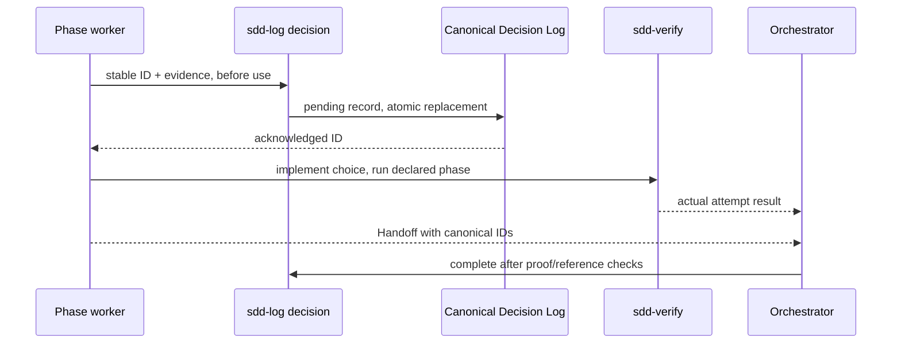
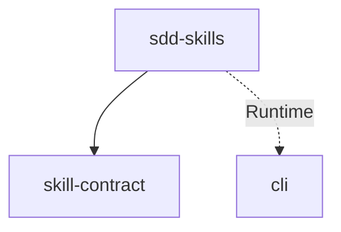

# Module: sdd-skills

<!--SECTION:SPEC_ID-->

AI-SKILLS-SDD-SKILLS

<!--/SECTION:SPEC_ID-->

<!--SECTION:OVERVIEW-->

## Обзор


_Обзор пути от контракта к реализации и проверке._

<!--/SECTION:OVERVIEW-->

→ Parent scope: [`../ai-skills.spec.md`](../ai-skills.spec.md)

<!--SECTION:MODULE_VISION-->

## 1. Module Vision

Восемь SDD-навыков проводят изменение от спецификации до проверенного кода. Поток оставляет модели
свободу рассуждения, но проверяет наблюдаемые артефакты на двух смысловых границах и простыми
механическими инвариантами.

```text
actual specs → independent semantic review → operator approval #1
→ actual tickets → mechanical authoring check → independent actual-ticket review
→ operator approval #2 (decomposition + test plan)
→ execute from ticket/Execution Log/Git → real gates → audit → code-review
```

Продолжение stateless: спецификации, тикеты, Execution Log, Git и текущий вывод CLI — полный источник
состояния. Постоянная `.sdd-session.md`, scaffold-plan JSON/digest, feasibility state machine,
worker-checkpoint JSON и обязательное переиспользование critic/worker не входят в контракт.

<!--/SECTION:MODULE_VISION-->

<!--SECTION:MODULE_USAGE_EXAMPLE-->

## 2. Module Usage Example

```text
1. /sdd создаёт/изменяет фактические V2-спеки.
2. Один fresh reviewer проверяет весь изменённый spec set; оператор утверждает эти bytes.
3. /sdd-scaffold создаёт реальные tickets и indexes.
4. sdd-check --task specs/ai-skills/sdd-skills/sdd-skills.task.SS-run-all.md --authoring проверяет ticket;
   sdd-check --all проверяет DAG.
5. Один fresh reviewer проверяет реальные tickets против утверждённых specs.
6. Оператор одним решением утверждает разбиение и Requirement-ID → scenario → test plan.
7. /sdd-execute DP-fields восстанавливает фазу из ticket + Execution Log + Git, выполняет real gates,
   затем запускает audit и code-review.
```

<!--/SECTION:MODULE_USAGE_EXAMPLE-->

<!--SECTION:MODULE_REQUIREMENTS-->

## Module Requirements — planned execution autonomy

### SS-REQ-1 [должен]

Существенное решение сохраняется в каноническом Decision Log до применения и остаётся адресуемым
после Handoff/restart. Повтор ID с тем же payload идемпотентен; другой payload или orphan reference
не превращается в успешную запись. Проверки: CLI create/read/verdict, lost-ack и conflicting-ID.

### SS-REQ-2 [должен]

Вывод CLI и prompts согласованно разрешают ограниченные CLI-owned event/decision/blocker операции.
Worker не редактирует ticket Markdown, не пишет DONE/receipt и не принимает собственное отклонение.
Проверки: source/generated contract controls и запрет неразрешённой мутации.

### SS-REQ-3 [должен]

Технический blocker допускает разрешённое восстановление без автоматического вопроса оператору.
Проверки: реальная FAIL attempt → изменение → свежая PASS attempt; история failure сохранена.
Отсутствующая внешняя authority не становится техническим разрешением.

### SS-REQ-4 [должен]

Изменение технических targets/deps/phases/test implementation сохраняет обязательства продукта и
обновляет scope/rules/Verify context до новых записей. Проверки: валидная delta принимается;
cycle/foreign writer/path escape/ослабление oracle отклоняются, старый PASS не считается новым proof.

### SS-REQ-5 [должен]

Повтор той же ошибки на том же существенном состоянии под новым call ID не считается progress.
Новый относящийся к причине сбоя факт допускает следующую гипотезу. Проверки: same-state negative,
new-fact positive и восстановление фактов после restart; liveness watchdog не подменяет этот критерий.

### SS-REQ-6 [должен]

Проверка результата независима от утверждения worker и от изменяемых им тестов. Допускаются разные
корректные реализации; host-owned product oracle ловит удаление обязательного assertion/negative
scenario и подмену gate body при неизменном имени команды.

### SS-REQ-7 [должен · нештатная]

Конфликт со спецификацией приводит к обоснованному proposal, а не молчаливой смене product behavior.
Новые внешние полномочия требуют конкретного запроса до внешнего эффекта. Проверки принимают такую
остановку как ожидаемый исход и не требуют DONE ценой нарушения authority.

### SS-REQ-8 [должен]

Попытки сохраняют фактические решения/gates/trace/metrics и outcome cleanup. Обычная задача без
существенного отклонения не требует выдуманного Decision Log. Неизвестные path/ordering факты явно
остаются unknown, не заменяются рассказом worker или исправлением прошлых оценок.

<!--/SECTION:MODULE_REQUIREMENTS-->

<!--SECTION:ENTITY_INVENTORY-->

## 3. Entity Inventory (Closed-World)

| Name                       | Type          | Purpose                                                   |
| -------------------------- | ------------- | --------------------------------------------------------- |
| `SddSkill`                 | Entity        | Публичный вход и его роль в SDD flow                      |
| `DirectiveReference`       | Value Object  | Путь к owner directive и способ активации                 |
| `ArtifactApprovalBoundary` | Specification | Review + operator approval текущих фактических артефактов |
| `OrchestratorProtocol`     | Specification | Resolve → phase dispatch → real gates → audit/review      |
| `PhaseDispatchPrompt`      | Specification | Bounded prompt фазового worker                            |
| `HandoffPayload`           | Value Object  | Фактический результат одной фазы                          |
| `ExecutionDecision`        | Value Object  | Каноническое существенное решение с evidence и verdict    |
| `TechnicalReplan`          | Specification | Проверяемая delta средств без смены обязательств продукта |
| `ProgressEvidence`         | Value Object  | Новое основание следующей попытки, не новый tool-call ID  |
| `SddWorkflowPhase`         | Enumeration   | route, specify, scaffold, execute, verify, iterate        |

<!--/SECTION:ENTITY_INVENTORY-->

<!--SECTION:ENTITY_SURFACES-->

## 4. Entity Surfaces

<details><summary>Подробности</summary>

### `SddSkill`

- **Properties:** `name`, `pattern`, `directives`, `phase`
- **Lifecycle:** хранится в `ai/skills/<name>/SKILL.md`, деплоится через `sync-skills`
- **Invariant:** direct entry выполняет один read-only `sdd-state` и передаёт forced intent router;
  ни entry, ни router не открывают persistent session

### `ArtifactApprovalBoundary`

- **Spec boundary (#1):** фактический полный spec set → structural checks → один fresh independent
  semantic review → correction/recheck → operator approval
- **Ticket boundary (#2):** фактические tickets/indexes → authoring checks → один fresh independent
  review actual tickets → operator approval decomposition + test plan
- **Invalidation:** semantic edit после review требует нового bounded review; semantic edit после
  approval требует повторного соответствующего approval. Planned exception: a checked
  `TechnicalReplan` preserving the original approved product commitments does not invalidate
  approval #2 merely for changing technical targets/phases/deps/test allocation. The accepted
  commitment baseline remains available for independent review; any weakening or product change
  still requires the corresponding approval. This exception activates only with the implemented,
  qualified transition, never by declaring an arbitrary edit "technical".
- **Durable evidence:** approval #1 — обычная Decision Log entry в каждой spec из reviewed set;
  approval #2 — секция в общем task index. Маркер содержит status, список путей, reviewer verdict,
  operator decision и дату; не содержит hash/JSON
- **Trust boundary:** CLI проверяет форму, значения и membership; модель по текущим артефактам и Git
  evidence решает, не устарел ли маркер; при сомнении он сбрасывается в `pending`

### `OrchestratorProtocol`

- Resolve selected/pickable tickets through `sdd-task`
- Reconstruct phase from ticket, Execution Log, Git and current tool output
- Mentally check declared phase consistency; do not serialize a plan for a critic
- Dispatch a bounded fresh worker per phase; worker continuation is optional, never correctness state
- Record actual commands/files/decisions/deviations in Execution Log
- Run declared real tests/type/lint/coverage and mechanical `sdd-check`
- Dispatch fresh audit and code-review

### `PhaseDispatchPrompt`

- Input: exact phase block, referenced spec/rule excerpts, target files, prior Execution Log facts,
  Git evidence
- Output: typed `HandoffPayload`
- Boundary: worker does not silently change product commitments, authority or acceptance strength.
  Technical targets/dependencies/phases/test implementation may change only through the checked
  `TechnicalReplan` transition before writing beyond the previous scope. Until that transition is
  implemented and qualified, the current runtime does not grant this permission.
- Read context starts at the tool manifest; a concrete unresolved import/caller/assertion/diagnostic
  or spec reference permits an exact related project read, reported with path and reason in Handoff
  decisions. This is not permission to change targets, activate rules, widen verification, inspect
  secrets/tool internals, or follow paths outside the checkout.

### `HandoffPayload`

- `artifacts: string[]`
- `requirements: string[]`
- `commands: { command: string; exit: number; result: string }[]`
- `decisions: string[]`
- `open: string[]`
- Significant deviations reference canonical `ExecutionDecision` IDs; Handoff is not a second
  verdict store. Ordinary local choices do not require a deviation record.

### `ExecutionDecision` — planned execution extension

- Owner: the ticket's canonical Decision Log, written through a bounded CLI operation, not direct
  Markdown editing by the phase worker. Spec-authoring and task-index decisions retain their owners.
- Content: stable ID, what/why, observed evidence or explicit assumption, affected scope, selected
  alternative and verification. Non-obvious reversible choices may remain pending during execution;
  product/authority changes are proposals, not permission to apply them.
- Ordering: durable acknowledgement precedes the decision's use; Handoff contains the same ID.
- Idempotency: identical ID/payload retry returns the existing record; conflicting payload rejects
  without partial mutation. A lost acknowledgement never authorizes inventing another accepted fact.
- Review: pending decisions remain visible to reconstruction and final operator review; verdict
  edits address the same ID. A Handoff-only missing reference is diagnostic, not an empty clean log.

### `TechnicalReplan` — planned execution extension

- Preserved commitments: agreed user outcome, observable behavior, required negative scenarios,
  safety/authority constraints and acceptance strength.
- Mutable means: technical targets, phases, dependency edges, implementation and test allocation
  that preserve those commitments. A field name is not an authority classification.
- Transition: record reason/evidence and bounded delta; validate ownership, paths and graph; refresh
  dispatch/rule/Verify context before applying work newly authorized by the delta.
- Evidence: retain old failed attempts and decisions; invalidate stale completion proof after a
  material change. A technical delta is not a new product approval; a commitment change is.
- Role: the worker may invoke explicitly permitted CLI-owned decision/event/blocker operations;
  it cannot edit ticket Markdown, mark DONE, accept its own deviation or fabricate proof. The
  orchestrator owns phase completion, Verify owns its actual attempt evidence.

### `ProgressEvidence` — planned execution extension

- Relevant new diagnostic fact or changed relevant artifact/hypothesis input permits another attempt.
- Repeating the same command/failure/state with a new call ID, timestamp or wording is not progress.
- A watchdog measures liveness; it does not prove meaningful technical progress. Any exhaustion
  claim must name an implemented observable policy, not an imaginary CLI counter.
- Continuation reconstructs evidence from ticket/Execution Log/Git and actual command results;
  session identity and private model memory are never necessary state.

### `SddWorkflowPhase`

- `route` — sdd router and forced direct entries
- `specify` — root/scope/module/infra/interface plus approval #1
- `scaffold` — real ticket creation, checks, ticket review, approval #2
- `execute` — phase workers and real gates
- `verify` — audit, check, code-review
- `iterate` — critic on demand, reconcile

</details>
<!--/SECTION:ENTITY_SURFACES-->

<!--SECTION:MODULE_CONTRACTS-->

## 5. Module Contracts (DbC)



_Планируемая цепочка записи решения и проверки фазы — SS-REQ-1, SS-REQ-2, SS-REQ-6._

<details><summary>Подробности</summary>

### Specification: `ArtifactApprovalBoundary`

**Preconditions:**

- reviewer target contains actual files, not an abstract plan;
- target is bounded and structurally valid;
- reviewer is independent from author and read-only.

**Postconditions:**

- approval #1 marker names the reviewed spec set and carries operator decision;
- approval #2 marker names the reviewed ticket set and carries operator decision;
- findings are resolved or explicitly returned to the operator;
- no hidden session/journal or content fingerprint is needed to resume.

### Specification: `OrchestratorProtocol`

**Preconditions:**

- ticket passed approval #2;
- dependencies are DONE;
- phase and exact verification commands resolve through ticket/spec.

**Postconditions:**

- Execution Log records plan-versus-fact;
- every declared real gate ran and passed;
- mandatory Requirement-ID values appear in implemented tests;
- audit and code-review ran before DONE.

**Invariants:**

- happy-path-only is invalid when behavior has an applicable failure/negative case;
- every mandatory Requirement-ID maps to a scenario and planned/implemented test;
- model judges semantic proof; mechanics judge presence, shape and traceability;
- batch parallelism requires disjoint Target Files and no dependency relation;
- lost worker identity never blocks resume; a fresh worker receives durable bounded context.
- uncertain dependencies favor keeping related work together; a split explains exact inputs/outputs,
  shared writers, independent verification and its concrete benefit over one ticket with phases;
- ticket review starts from role → user outcome → relevant risks → cheapest sufficient tests and
  diagnostic/performance evidence, reusing existing infrastructure rather than defaulting to e2e;
- semantic findings identify consequences and evidence; stylistic preferences do not replace coverage.

### Execution autonomy requirements — planned, not yet implemented

The [execution plan and experiment matrix](../../../ai/flow-eval/docs/EXECUTION-AUTONOMY-PLAN.md)
defines bounded qualification; it does not authorize treating an unimplemented capability as active.

| Requirement | Contract                        | Positive and negative acceptance                       |
| ----------- | ------------------------------- | ------------------------------------------------------ |
| SS-REQ-1    | Canonical decisions             | Round-trip, orphan/conflict controls, restart          |
| SS-REQ-2    | Coherent writer protocol        | CLI and prompts agree; proof/status mutation rejected  |
| SS-REQ-3    | Technical recovery              | Failure retained, fresh PASS; authority still stops    |
| SS-REQ-4    | Bounded technical replan        | Context refreshed; invalid graph/path/oracle rejected  |
| SS-REQ-5    | Progress distinct from activity | Same-state/new-ID negative; relevant-new-fact positive |
| SS-REQ-6    | Independent outcome oracle      | Multiple valid implementations; weakening detected     |
| SS-REQ-7    | Product proposal and authority  | No silent change or unauthorized external effect       |
| SS-REQ-8    | Inspectable effects             | Complete evidence/cleanup; no invented ceremony        |

Unit/CLI integration tests prove deterministic transitions and fault windows. Live evals check
observed model behavior on real V2 fixture artifacts. Independent semantic review supplements these
checks, never waives a red oracle or unknown execution evidence. Exact-byte proof is for protected
inputs/atomic edits, not one mandatory command sequence for every valid implementation.

</details>
<!--/SECTION:MODULE_CONTRACTS-->

<!--SECTION:PUBLIC_OPTIONS-->

## 6. Public Options & Policies

| Option               | Binding                                                                 | Status  |
| -------------------- | ----------------------------------------------------------------------- | ------- |
| Single state read    | `sdd-state` is read-only; router consumes exact result once             | bound   |
| Spec semantic gate   | one independent review + operator approval #1                           | bound   |
| Ticket semantic gate | actual-ticket review + operator approval #2                             | bound   |
| Mechanical coverage  | Requirement-ID → scenario → test; applicable negative scenario required | bound   |
| Worker lifetime      | disposable; no checkpoint/session-key correctness dependency            | bound   |
| Migration            | V1→V2 only                                                              | bound   |
| Execution autonomy   | SS-REQ-1..8; canonical decisions and bounded technical replan           | planned |

<!--/SECTION:PUBLIC_OPTIONS-->

<!--SECTION:FILE_STRUCTURE-->

## 7. File Structure

```text
ai/skills/
├── sdd/SKILL.md
├── sdd-scaffold/SKILL.md
├── sdd-execute/SKILL.md
├── sdd-audit/SKILL.md
├── sdd-check/SKILL.md
├── sdd-code-review/SKILL.md
├── sdd-critic/SKILL.md
└── sdd-reconcile/SKILL.md
```

<!--/SECTION:FILE_STRUCTURE-->

<!--SECTION:MODULE_DECISION_LOG-->

## 8. Module Decision Log

<details><summary>Подробности</summary>

### D-M002 — SDD-навыки в одном модуле

- **Status:** active
- **Why:** навыки связаны одним flow и общей директивной системой; фазовые подмодули добавят
  координацию без отдельной доменной границы.
- **Risk accepted:** при росте surface модуль может потребовать декомпозиции.

### D-M003 — Stateful public entries проходят через один router

- **Status:** superseded by D-M004
- **Recorded:** RC follow-up до draft.64
- **Why superseded:** persistent session, feasibility journal и retained workers превратили простое
  reasoning в ручной протокол JSON/NEXT, создавали ложные migration/conflict ветки и не давали
  восстановить цель после потери worker. Решение сохраняется только как историческое объяснение;
  возврат отложен до отдельного доказательства необходимости и модели concurrency.

### D-M004 — Stateless flow и две границы утверждения

- **Status:** active
- **Recorded:** RC follow-up after draft.64 degradation
- **Why:** спецификации, human-readable approval markers, tickets, Execution Log и Git уже содержат необходимое состояние. Две fresh
  semantic проверки удерживают смысл там, где механический CLI его доказать не может, а operator
  approvals записываются в самих canonical artifacts. Это сокращает процесс без ослабления обязательных
  requirement/negative/test invariants.
- **Risk accepted:** fresh reviewer после semantic correction расходует дополнительный вызов модели;
  это плата за проверку точных новых bytes, а не за долговечную critic session.
- **Rejected alternatives:**
  - патч persistent session — сохраняет неверный скрытый control plane;
  - approval абстрактного DAG до tickets — не доказывает фактические artifacts;
  - только mechanical gates — не оценивают смысл и доказательность теста;
  - только model review — не гарантирует ID/section/traceability presence.

AI-SKILLS-SDD-SKILLS-DL-1 2026-10-26 — Осторожная декомпозиция, review пользовательских сценариев и evidence-directed чтение (почему: меньше предположительных зависимостей и ложных блокировок без ослабления проверок; отвергнуто: свободная запись вне Target Files и автономное изменение DAG — обсуждаются отдельно).

SS-DL-2 2026-10-26 — Разделить изменяемый технический путь и сохраняемые обязательства продукта; решения хранить в одном каноническом Decision Log до применения, Handoff оставляет ссылки (почему: одновременные Handoff-only, direct Edit и CLI-only модели теряют решения и конфликтуют; отвергнуто: второй verdict store, blanket approval любой перестановки фаз и применение новых targets до проверенного replan). Статус: proposed; implementation и эффект ещё не квалифицированы.

### План реализации и приёмки — 2026-10-26

1. Уточнить существующий инвариант дробления; процедура derivation объясняет каждую границу и
   сравнивает с объединённым вариантом. Смысловую достаточность оценивает reviewer, не счётчик тикетов.
2. Усилить actual-ticket review: роли/цели, негативные и временные сценарии, уровни тестов,
   переиспользование harness, диагностика и применимые performance-проверки без выдуманных SLA.
3. Согласовать `sdd-task` и phase protocol: manifest — начало чтения, конкретный пробел допускает
   связанный read с объяснением в Handoff; запись/удаление, approval, правила и гейты неизменны.
4. RED→GREEN contract/CLI tests; bounded live Flash evals для дробления, review и related-read,
   с сохранением исходных результатов, контрольных отрицательных примеров и cleanup после прогона.
5. Независимое ревью PR → merge только ревьюером. No npm publication. Автономное перепланирование,
   исправление deviation persistence и изменение границ записи не входят в этот пакет.

Реализация и bounded проверки выполнены; независимое PR review ещё требуется.
[Сводка 12 Flash-прогонов](../../../ai/flow-eval/results/2026-10-26-task-quality-final/README.md):
декомпозиция/review проходят на обоих вариантах, related-read устраняет наблюдавшуюся остановку.
Полный execute flow и статистическое неухудшение этими микропрогонами не установлены.
Независимое code review обнаружило неограниченные lifecycle HTTP-вызовы запускателя. Добавлены
deadline/cancellation и обязательный local cleanup при ошибке удаления сессии, покрытые тестами
зависших запросов. Выполненный runner сохранён отдельным hash-bound snapshot; live результаты не
переписаны и не выдаются за прогон последующего hardening.

Независимое goal/research review выявило две текстовые неоднозначности: test/diagnostic evidence
нужно только где применимо (структурный DAG/writer-конфликт доказывают сами targets/deps);
запрещены installed/bundled tool internals, а не CLI targets/helpers проекта. Они уточнены и
покрыты RED→GREEN controls. Четыре дополнительных Flash-прогона не воспроизвели предполагаемые
ошибки модели: ответы верны в обоих вариантах. При этом оба CLI-прогона сделали два лишних
directory reads; исходные path failures сохранены. [Полный follow-up](../../../ai/flow-eval/results/2026-10-26-task-quality-boundaries/README.md)
не объявляет ни экономию, ни full-trajectory PASS; новых live-серий для этого пакета не требуется.

</details>
<!--/SECTION:MODULE_DECISION_LOG-->

<!--SECTION:INTER_MODULE_DEPENDENCIES-->

## 9. Inter-Module Dependencies

- **Depends on:** `skill-contract`, `cli` (`sdd-state`, `sdd-task`, `sdd-new`, `sdd-check`)
- **Provides to:** все SDD-потребители



_Зависимости навыков от общего контракта и CLI-инструментов._

<!--/SECTION:INTER_MODULE_DEPENDENCIES-->

<!--SECTION:HANDOFF-->

## 10. Handoff to Task Scaffolding

- Skills and source directives implement the stateless flow.
- CLI must remove the obsolete `sdd-session` surface and stop emitting `[SESSION]` state.
- Generated `ai/directives/sdd-v2/**` must be reassembled from source templates.
- Contract regressions must cover both approvals, V1→V2-only migration, negative scenario presence,
  Requirement-ID traceability and resume without worker/session identity.

<!--/SECTION:HANDOFF-->
