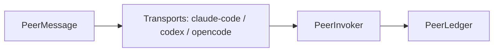
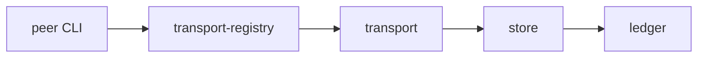

# peer: Scope Specification

<!--SECTION:SPEC_ID-->

PEER

<!--/SECTION:SPEC_ID-->

<!--SECTION:OVERVIEW-->

## Обзор



_Агент-to-агент messaging между разными runtime (Claude Code, Codex, OpenCode) через общий транспортный контракт и инвокер._

<!--/SECTION:OVERVIEW-->

<!--SECTION:SCOPE_TYPE-->

## scope-type

product

<!--/SECTION:SCOPE_TYPE-->

<!--SECTION:VISION-->

## 1. Vision & Primary Goal

Единый runtime-agnostic контракт для передачи сообщений между агентскими сессиями в разных
инструментах (Claude Code, Codex, OpenCode). Peer не зависит от конкретного runtime: каждый transport
адаптирует свой процесс-протокол к общему `PeerMessage` + `PeerPort`, `peer-invoker` маршрутизирует
доставку, `peer-ledger` ведёт учёт.

<!--/SECTION:VISION-->

<!--SECTION:PROJECT_TYPE-->

## 2. Project Type

- **Type:** cli-utility
- **Why this type:** Одна CLI-команда (`gennady peer list/read/send`) без UI, без долгоживущего сервера.

<!--/SECTION:PROJECT_TYPE-->

<!--SECTION:GOLDEN_DX-->

## 3. Approved Usage Example

```sh
npx gennady peer list --json
npx gennady peer read claude-code:default
npx gennady peer send --to codex:default --message 'hi'
```

<!--/SECTION:GOLDEN_DX-->

<!--SECTION:REQUIREMENTS_AND_CONSTRAINTS-->

## 4. Requirements & Constraints

### PEE-REQ-1 [должен]

`list` — перечислить доступные peer-сессии всех runtime.

### PEE-REQ-2 [должен]

`read` — прочитать сообщения конкретной сессии.

### PEE-REQ-3 [должен]

`send` — отправить сообщение в сессию.

### PEE-REQ-4 [должен · нештатная]

Read-only по умолчанию; `send` — единственный мутирующий путь. Transport failure → typed error, не тихий fail.

<!--/SECTION:REQUIREMENTS_AND_CONSTRAINTS-->

<!--SECTION:USE_CASES-->

## 5. Use Cases

- Агент Claude Code спрашивает у сессии Codex статус задачи.
- Оператор читает историю peer-сообщений.

<!--/SECTION:USE_CASES-->

<!--SECTION:DATA_FLOW-->

## 6. Data Flow



<!--/SECTION:DATA_FLOW-->

<!--SECTION:ARCHITECTURE-->

## 7. High-Level Architecture

- `peer-port.ts` — доменные порты (runtime-agnostic transport contract).
- `peer-message.ts` / `peer-ref.ts` — типизированные сообщения и ссылки.
- `peer-match.ts` / `peer-store.ts` / `peer-ledger.ts` — маршрутизация, хранение, журнал.
- `claude-code/*` / `codex/*` / `opencode/*` — transports конкретных runtime.
- `peer-invoker.ts` / `peer-transport-registry.ts` — запуск и реестр transports.
- `cli/cmd/peer/**` — CLI: `list`, `read`, `send`.

<!--/SECTION:ARCHITECTURE-->

<!--SECTION:DECISION_LOG-->

## 8. Decision Log

<details><summary>Подробности</summary>

### D-001 — Runtime-agnostic port

- **Status:** active
- **Why:** Единый `PeerPort` вместо per-runtime API позволяет добавлять transports без изменения invoker.

</details>

<!--/SECTION:DECISION_LOG-->

<!--SECTION:SCOPE_DEPENDENCIES-->

## 9. Scope Dependencies

- **Depends on:** `shared/common` (logger, parse-args, exec).
- **Provides to:** `cli` (команда `peer`), AI-агенты.

<!--/SECTION:SCOPE_DEPENDENCIES-->

<!--SECTION:BOOTSTRAP_REQUIREMENTS-->

## 10. Bootstrap Requirements

<details><summary>Подробности</summary>

| Requirement | Kind | Owner | Resolution |
| --- | --- | --- | --- |
| Node.js 22+ | runtime | infra-base | уже в `shared/common` |

</details>

<!--/SECTION:BOOTSTRAP_REQUIREMENTS-->

<!--SECTION:MODULE_MAP-->

## 11. Module Map

| Модуль | Путь | Назначение |
| --- | --- | --- |
| PeerPort | `services/peer/peer-port.ts` | runtime-agnostic transport contract |
| ClaudeCodeTransport | `services/peer/claude-code/**` | Claude Code transport + protocol |
| CodexTransport | `services/peer/codex/**` | Codex transport + store |
| OpenCodeTransport | `services/peer/opencode/**` | OpenCode transport + store |
| PeerInvoker | `services/peer/peer-invoker.ts` | запуск доставки |
| PeerLedger | `services/peer/peer-ledger.ts` | учёт сообщений |
| peer CLI | `cli/cmd/peer/**` | `list` / `read` / `send` |

<!--/SECTION:MODULE_MAP-->

<!--SECTION:HANDOFF-->

## 12. Handoff to module-decomposition

- **Primary input:** `specs/peer/peer.spec.md`
- **Areas requiring decomposition:** `peer-port`, `claude-code`, `codex`, `opencode`, `peer-invoker`, `peer-ledger`, `peer CLI`.

<!--/SECTION:HANDOFF-->
